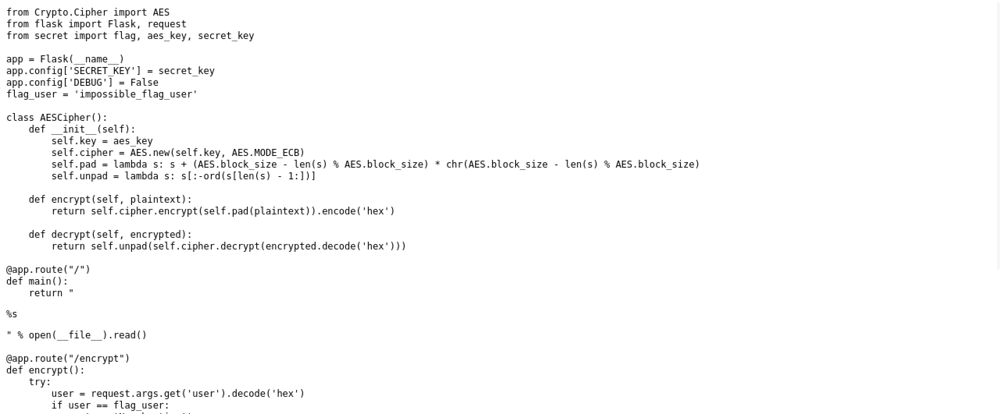
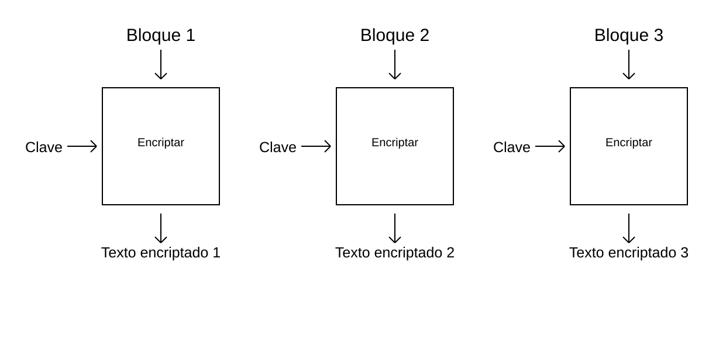
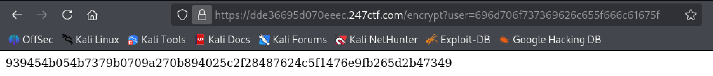
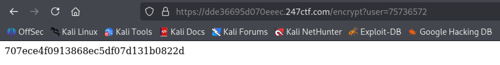
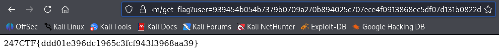

# THE IMPOSSIBLE USER
## CATEGORÍA: CRYPTOGRAPHY

### PRESENTACIÓN DEL PROBLEMA:
Al acceder al servidor otorgado por el ejercicio, se ve que muestra lo que parece ser el código fuente del mismo, que muestra tres rutas:

* `/`, que muestra el código fuente del servidor.
* `/encrypt`, que encripta un usuario definido en el parámetro de URL `user` (excepto si es `"impossible_flag_user"`). El usuario debe estar codificado en hexadecimal por UTF-8, o sea, debe convertirse a bytes (mediante UTF-8) y luego a una cadena de texto hexadecimal.
* `/get_flag`, que entrega la bandera si el parámetro de URL `user` representa el usuario `"impossible_flag_user"` encriptado.



La gracia del ejercicio se encuentra en intentar encriptar `"impossible_flag_user"` para pasar el resultado a `/get_flag` y conseguir la bandera, pero como no se puede hacer de forma directa, hay que hacerlo de otra forma.

### PASO A PASO DEL PROCESO:

**Paso 1: Construir herramientas previas**

Por conveniencia, se recomienda automatizar la codificación de nombres de usuarios para pasarlos a la ruta `/encrypt`. En Python, por ejemplo, se haría de la siguiente forma:

```python
def encode_user(user: str) -> str:
	return user.encode("utf-8").hex()
```

Donde el nombre se convierte a bytes bajo la codificación UTF-8, para luego pasar a codificación hexadecimal.

**Paso 2: Investigar sobre el mecanismo de encriptación**

Como se puede ver en el código fuente, el servidor utiliza AES (*Advanced Encryption Standard*) en modo ECB (*Electronic Code Book*).

AES es, en esencia, un algoritmo de encriptación simétrica para mensajes de tamaño variable, donde los mismos se dividen en bloques que se encriptan uno por uno, lo cual puede hacerse de muchas formas (o modos). Uno de ellos es el ECB, donde cada bloque se encripta de forma independiente de los demás.



Este modo es conocido por ser poco seguro, debido a que como cada bloque encriptado es independiente del resto, son más fáciles de desencriptar.

Además, si hay algún mecanismo que impida encriptar un mensaje de forma directa, se puede dividir en bloques y encriptarlos por separado.

**Paso 3: Dividir `"impossible_flag_user"` en bloques y encriptarlos por separado**

AES divide los mensajes en bloques de 16 bytes, por lo que eso es lo que se hará con el usuario en cuestión, dejándonos dos bloques: `"impossible_flag_"` y `"user"`, que se pueden encriptar por separado.




El encriptado del bloque 1 tiene un resultado del doble de bytes por el padding, que genera un nuevo bloque, pero se puede ignorar.

**Paso 4: Juntar los mensajes encriptados y enviar el resultado**

Lo que queda ahora es eliminar la segunda mitad del bloque 1 encriptado, juntarlos en orden y enviarlo a la ruta `/get_flag`. El servidor los desencriptará por separado y tendrá como resultado el mensaje original (`"impossible_flag_user"`).

### FLAG:



**Autor: Santiago De Olivera**
