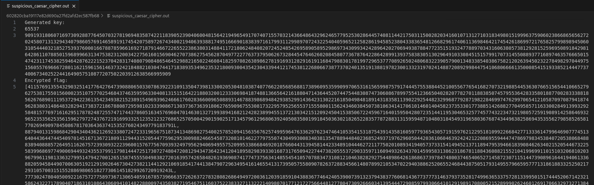

# Suspicious Caesar Cipher
## CATEGORÍA: Criptografía

### PRESENTACIÓN DEL PROBLEMA:
Se nos proporciona un script que genera una clave RSA para cifrar la bandera caracter por caracter. También se nos proporciona el archivo de salida generado al correr el script, el cual incluye una lista con los caracteres cifrados de la bandera. El objetivo es recuperar la bandera a pesar de no tener la llave privada para descifrarla.


*Script de Python:*
```
from Crypto.Util.number import getStrongPrime
from fractions import gcd
from secret import flag

def get_key(e=65537, bit_length=2048):
    while True:
        p = getStrongPrime(bit_length, e=e)
        q = getStrongPrime(bit_length, e=e)
        if gcd(e, (p - 1) * (q - 1)) == 1:
            return e, p * q

def encrypt(e, n, m):
    return [((ord(c) ** e) % n) for c in m]

e, n = get_key()

print("Generated key:")
print(e)
print(n)

print("Encrypted flag:")
print(encrypt(e, n, flag))
```
*Archivo de salida:*




### PASO A PASO DEL PROCESO:

1. Con la información del script y del archivo de salida conocemos el valor de e = 65537 (exponente público común) y n = producto de dos primos grandes (módulo RSA) utilizados para generar la llave pública y cifrar los caracteres.

2. El cifrado RSA se basa en:

    `c = m^e mod n`

    donde m es el valor ASCII de un carácter de la bandera, y c es el caractér resultante del cifrado.

3. Como conocemos la llave pública (e y n) y sabemos los caracteres que la bandera puede contener, es posible aplicar fuerza bruta inversa sobre cada valor cifrado. Entonces, para cada caracter en la lista cifrada, podemos probar todos los caracteres posibles y verificar cuál de ellos, al cifrarse con e y n, da ese valor.

4. Con el siguiente script de Python, se puede aplicar lo descrito en el paso anterior y obtener la bandera.

```
e = 65537
n = <PEGAR_VALOR_DEL_ARCHIVO>
encrypted_flag = <PEGAR_VALOR_DEL_ARCHIVO>

# Rango de caracteres imprimibles ASCII (desde "0" hasta "}")
ascii_printables = [chr(i) for i in range(48, 126)]

# Intentamos descifrar cada valor de la lista cifrada
flag = ""
for c in encrypted_flag:
    for ch in ascii_printables:
        if pow(ord(ch), e, n) == c:
            flag += ch
            break

print("Flag recuperada:")
print(flag)
```

**DESCRIPCIÓN DE LA SOLUCIÓN:** 

El desafío se centra en un uso no convencional del algoritmo RSA. A diferencia de lo habitual, en donde RSA se utiliza para cifrar mensajes completos o claves simétricas, en este caso se cifra cada carácter de la bandera individualmente usando RSA. Esta elección debilita la seguridad y hace que sea posible realizar un ataque de fuerza bruta por reversión del cifrado.

El punto clave es que los caracteres posibles de la bandera son pocos, ya que solo contiene caracteres imprimibles ASCII que van desde el 48 (0) hasta el 125 (}). Por tanto, hay únicamente 78 valores posibles de entrada.

Conociendo el valor de e (65537, un valor estándar y público) y el valor de n (extraído del archivo de salida), podemos probar los 78 posibles valores de m y ver cuál produce el mismo resultado cifrado c. Esto es lo que permite "romper" el cifrado sin necesidad de conocer la clave privada.

### FLAG:
`247CTF{aedd410d06584baedcbb59382ddd2649}`

**Autor/a: Javier Moreno**