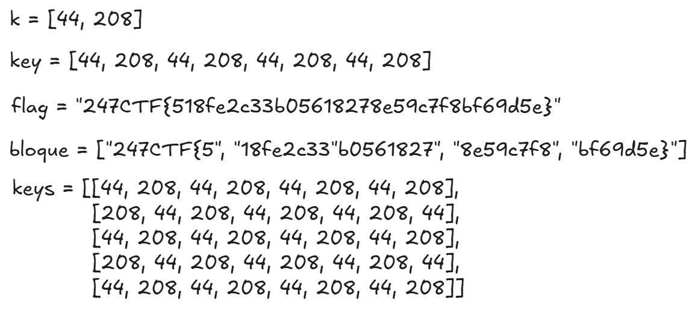
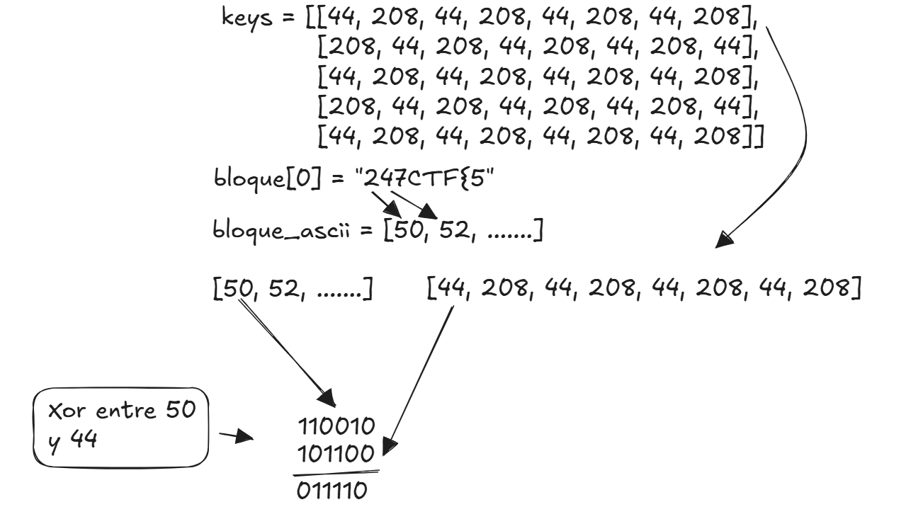
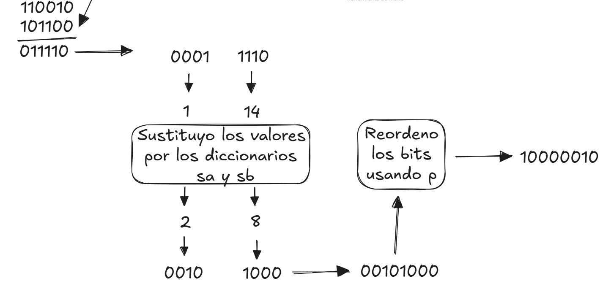
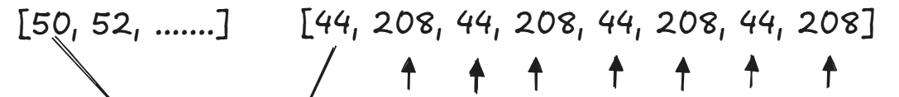
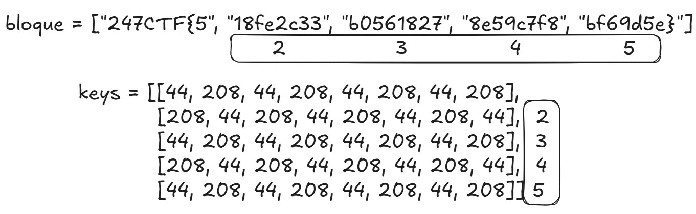

# CTF247 - CRIPTOGRAFÍA - N°4 "Substitution-flag-permutation network"

Tip: Creamos una red de sustitución-permutación de banderas. Ciframos la bandera con la red, pero olvidamos anotar la clave. ¿Puedes invertir la red y recuperar el texto plano de la bandera?

## Introducción

Antes de todo, en la carpeta "code" encontrá los códigos para la ejecución de este problema, en una carpeta esta exacto como cuando se descarga y en el otro, la solución al problema.

Para comenzar este ctf, vamos a tener que descargar un .zip el cual va a contener un script python llamado **chall.py** que contiene lo siguiente:

```py 
import random
from secret import flag

rounds = 5
block_size = 8
sa = {
    0: 15, 
    1: 2, 
    2: 14, 
    3: 0, 
    4: 1, 
    5: 3, 
    6: 10, 
    7: 6, 
    8: 4, 
    9: 11, 
    10: 9, 
    11: 7, 
    12: 13, 
    13: 12, 
    14: 8, 
    15: 5
}
sb = {
    0: 12, 
    1: 8, 
    2: 13, 
    3: 6, 
    4: 9, 
    5: 1, 
    6: 11, 
    7: 14, 
    8: 5, 
    9: 10, 
    10: 3, 
    11: 4, 
    12: 0, 
    13: 15, 
    14: 7, 
    15: 2
}
key = [random.randrange(255), random.randrange(255)] * 4
to_bin = lambda x, n=block_size: format(x, "b").zfill(n)
to_int = lambda x: int(x, 2)
to_chr = lambda x: "".join([chr(i) for i in x])
to_ord = lambda x: [ord(i) for i in x]
bin_join = lambda x, n=int(block_size / 2): (str(x[0]).zfill(n) + str(x[1]).zfill(n))
bin_split = lambda x: (x[0 : int(block_size / 2)], x[int(block_size / 2) :])
str_split = lambda x: [x[i : i + block_size] for i in range(0, len(x), block_size)]
xor = lambda x, y: x ^ y

def s(a, b):
    return sa[a], sb[b]

def p(a):
    return a[5] + a[2] + a[3] + a[1] + a[6] + a[0] + a[7] + a[4]

def ks(k):
    return [
        k[i : i + int(block_size)] + k[0 : (i + block_size) - len(k)]
        for i in range(rounds)
    ]

def kx(state, k):
    return [xor(state[i], k[i]) for i in range(len(state))]

def en(e):
    encrypted = []
    for i in e:
        a, b = bin_split(to_bin(ord(i)))
        sa, sb = s(to_int(a), to_int(b))
        pe = p(
            bin_join((to_bin(sa, int(block_size / 2)), to_bin(sb, int(block_size / 2))))
        )
        encrypted.append(to_int(pe))
    return encrypted

def r(p, k):
    keys = ks(k)
    state = str_split(p)
    for b in range(len(state)):
        for i in range(rounds):
            rk = kx(to_ord(state[b]), keys[i])
            state[b] = to_chr(en(to_chr(rk)))
    return [ord(e) for es in state for e in es]

encrypted = r(flag, key)
print("Encrypted flag => %s" % encrypted)
# Encrypted flag => [190, 245, 36, 15, 132, 103, 116, 14, 59, 38, 28, 203, 158, 245, 222, 157, 36, 100, 240, 206, 36, 205, 51, 206, 90, 212, 222, 245, 83, 14, 222, 206, 163, 38, 59, 157, 83, 203, 28, 27]

```

## Pre-requisitos

Si intentamos ejecutar el programa ni bien lo descargamos, tendremos un error en el siguiente import:

```
from secret import flag
```

Esto sucede ya que la idea del problema es llegar a obtener la bandera que fue encriptada por el programa, por lo que obviamente, esa bandera no se encuentra, por lo que vamos a crear una nosotros (obviamente que no es la correcta) siguiendo la estrucutra que manejan las banderas de estos prolbemas (**247CTF{..............}**) para poder ejecutar y ver como funciona el código

Para solucionar esto podemos hacer dos cosas, podemos simplemente borrar esta linea y crear una variable llamada "flag" con nuestra bandera, o si no la solución que implementamos, crear un archivo en el mismo directorio **secret.py** en el cual crearemos la variable flag de la misma manera, de esta forma creemos que es mejor ya que no modificamos el código incial.


## Análisis de código
Para resolver este problema, primero debemos entender bien como funciona el código

Primero tenemos dos constantes donde **block_size** es el largo de los bloques que se va a dividir la bandera y **rounds** la cantidad de veces que se va a aplicar el método principal de encriptación.

Luego hay dos diccionarios **sa y sb** que dado un valor entre 0 y 15, devuelve otro valor tambien entre 0 y 15, que no nos importa cual, solo debemos tener en cuenta eso.

Tambien hay varias funciones importantes para pasar caracteres a números, números a binarios, entre otros... 

Por ultimo tenémos los métodos principales que se van usando que son los siguientes, simplemente vamos a explicar que hace, luego explicaremos bien su función en el ejercicio.
* s(a, b) = Utilizando los diccionarios, simplemente intercambia a y b por los valores correpondientes de cada diccionario
* p(a) = Mueve los bits del número binario a
* ks(k) = Genera una serie de claves matriz de claves, con los mismos valores, pero intercalando orden
* kx(state, k) = Hace un XOR entre el valor de la clave y un caracter (en binario)
* en(e) = Aplica la función s y p
* r(p, k) = Nuestro método main

## Ejecución

Primero tenemos nuestra bandera (obviamente falsa) de la siguiente forma

```
flag = "247CTF{518fe2c33b05618278e59c7f8bf69d5e}"
```

Luego hace una secuencia de pasos sencillos que son los siguientes
* Se crea una llave de dos números randoms entre 0 y 255
* Esa llave se multiplica por 4 para que queden 8 valores en total (4 del primer número y 4 el segundo)
* Parte la bandera de a 8 caracteres
* Se llama al método **ks** generandons la matriz de claves 

En la siguiente imagen se observa un ejemplo de lo que se hizo



# Luego por cada de bloque, haremos el siguiente proceso

* Convertimos todos los caracteres a su valor ASCII
* Hacemos un XOR entre cada valor de la primera lista de llaves y el bloque correspondiente (en binario)



Este proceso se repite 7 veces mas para cada número del bloque y de la llave

* Luego en el método **en** partimos el binario al medio para que nos queden dos números de 4 bits
* LLamamos al método **ks** y usando los diccionarios **sa y sb** sustituimos estos dos números que se formaron
* Una vez que sustituimos lo juntamos nuevamente y llamamos al método **p** para reordenar los bits



Una vez que se realizo esto, por cada elmento del bloque, se va a repetir el mismo proceso



Y luego todo esto se va a hacer 4 veces más, al final nos va a quedar una lista de 8 números como la siguiente:

```py
[23, 96, 11, 105, 37, 99, 207, 7]
```

Finalmente se hace el mismo proceso para el resto de la bandera



Entonces la bandera que nostros proporcionamos quedaría cifrada de  la siguiente forma:

```py
[89, 121, 68, 110, 164, 120, 53, 121, 89, 98, 76, 139, 164, 121, 53, 120, 76, 98, 89, 121, 164, 139, 164, 98, 251, 89, 121, 68, 110, 164, 120, 53, 121, 89, 98, 76, 139, 164, 121, 53, 120, 76]
```

## Solución

Una vez que entendemos el código, el ejercicio nos proporciona la bandera del desafio de forma cifrada, ya que se le aplicaron los pasos que acabamos de ver, entonces para encontrar nuestra bandera, debemos aplicar los pasos en orden inverso hasta conseguir la bandera original.

Partiendo de la base, la bandera cifrada es la siguiente (esto es proporcionado en el ejercicio):

```py
[224, 113, 117, 80, 190, 50, 59, 193, 199, 154, 70, 67, 224, 214, 212, 54, 243, 111, 128, 243, 199, 154, 224, 27, 201, 67, 128, 104, 131, 27, 70, 154, 243, 37, 66, 104, 226, 193, 107, 79]
```

# Invertir funciones

Primero vamos a invertir las funciones que se usaron para cifrar las banderas
* **ks** - Invertimos los diccionarios, es decir si antes en el diccionario sa, el valor 1 correspondia al 15, ahora en sa_inv, el valor 15 corresponde a 1, este proceso lo hacemos con los dos diccionarios.
* **p** - Creamos una función p_inv, en la cual reordenamos los bits del binario a su forma previa de la función "p".
* **XOR** - No es necesario ya que "a XOR b XOR b = a" por lo que la función inversa de XOR sería XOR

Una vez que tenemos el flujo y las funciones invertidas, nos falta la llave, que como sabemos se crea con dos números randoms entre 0 y 255, por lo que para la solución final, encontraremos la llave por fuerza bruta.

# Solución final

Para la solución final, la idea es aplicar los métodos invertidos en orden inverso con todas las claves posibles, y comparar todos los resultados sabiendo que la bandera contiene "247CTF" en la bandera, de tal forma de filtrarla, en un pseudocódigo se vería así:

```py
def solucion(bandera_cifrada):
    for i in range(256):
        for j in range(256):
            clave = [i, j] 
            for x in range(len(bloque))          #Para cada bloque de la bandera cifrada
                for y in range(5)                #Uso cada bloque de mi key
                    p_inv
                    s_box_inv                    # Funciones invertidas
                    xor(clave)                   # Hago el XOR con las key i,j
                bandera = join(esto)             # Armo la bandera
            if '247CTF' in bandera:              # Comparo si dentro de la bandera se encuentra "247CTF"
                print(bandera)
```

El siguiente código, tiene solo la solución final, ¡NO FUNCIONARÁ SI SE EJECUTA! ya que faltan variables y funciones origniales, para ejecutar y testear el ejercicio, ejecutar el achivo python **solution.py** en la carpeta solution.

```py
inv_sa = {
    15: 0, 
    2: 1, 
    14: 2, 
    0: 3, 
    1: 4, 
    3: 5, 
    10: 6, 
    6: 7, 
    4: 8, 
    11: 9, 
    9: 10, 
    7: 11, 
    13: 12, 
    12: 13, 
    8: 14, 
    5: 15
}

inv_sb = {
    12: 0, 
    8: 1, 
    13: 2, 
    6: 3, 
    9: 4, 
    1: 5, 
    11: 6, 
    14: 7, 
    5: 8, 
    10: 9, 
    3: 10, 
    4: 11, 
    0: 12, 
    15: 13, 
    7: 14, 
    2: 15
}

def inversa_sustituir(a, b):     
    return inv_sa[a], inv_sb[b]

def inversa_permutacion(a):      
    return a[5] + a[3] + a[1] + a[2] + a[7] + a[0] + a[4] + a[6]

def aplico_Sbox_Pbox_invertida(lista_enteros, clave):      # me hace lo mismo pero en el orden al revez q hoy
    resultado = []
    contador = 0
    for i in lista_enteros:
        binario = to_bin(i)
        perm_deshecha = inversa_permutacion(binario) # paso a binario y hago la permutacion al reve
        a, b = bin_split(perm_deshecha) # aca divido en 2 y aplico las cajas
        inv_a, inv_b = inversa_sustituir(to_int(a), to_int(b))

        unidos = bin_join((to_bin(inv_a, int(block_size / 2)), to_bin(inv_b, int(block_size / 2)))) #uno y paso a entero
        numero = to_int(unidos)

        if contador % 2 == 0:
            val = xor(numero, clave[0])     # esto es lo mismo, pero no tengo la clave, aun
        else:
            val = xor(numero, clave[1])
        contador += 1

        resultado.append(val)
    return resultado

def desencriptador(codigo_encriptado, clave):
    claves = generar_claves(clave)    # se generan las 5 claves
    bloques = str_split(codigo_encriptado)    # se divide la lista en bloques de 8

    for b in range(len(bloques)):
        bloque = bloques[b]
        for i in reversed(range(rounds)):  # se desencripta en orden inverso (última clave a primera)
            bloque = aplico_Sbox_Pbox_invertida(bloque, claves[i])
        bloques[b] = bloque
    return [chr(e) for bloque in bloques for e in bloque]

for i in range(256):
    for j in range(256):
        clave = [i, j] * 4
        bandera_descifrada = desencriptador(encrypted_flag, clave)
        bandera = ''.join(bandera_descifrada)
        if '247CTF' in bandera:
            print("Bandera: "+bandera)
            break
    else:
        continue
    break

```

Bandera = 247CTF{390d2b4a771cc79ec85a403ac609702d}