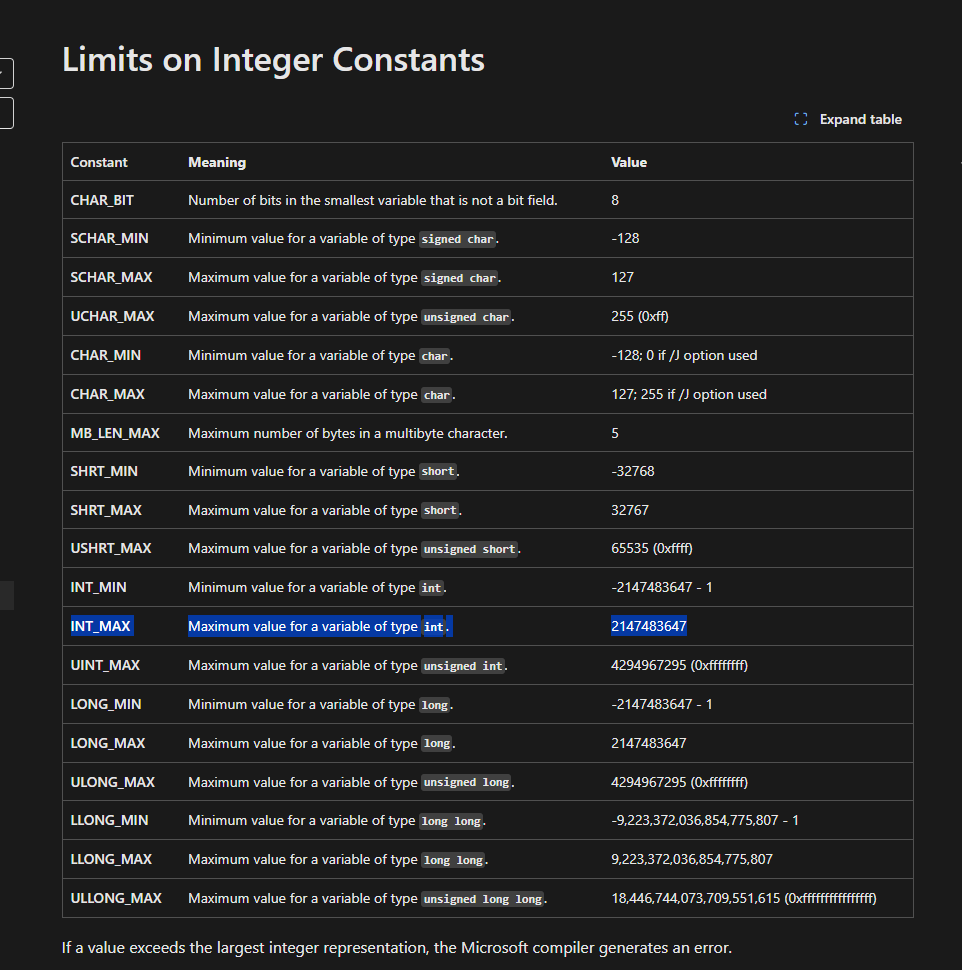

````markdown
# Integer Overflow Magic
## CATEGORÍA: micellaneous

### PRESENTACIÓN DEL PROBLEMA:
Se proporciona un archivo en lenguaje C que al ejecutarse pide un número por entrada estándar (`scanf`) y evalúa una condición aparentemente imposible: que un número positivo sea mayor que sí mismo más uno. Si esa condición se cumple, imprime el contenido de `flag.txt`.

Código fuente:

```c
#include <stdio.h>
int main() {
    int impossible_number;
    FILE *flag;
    char c;
    if (scanf("%d", &impossible_number)) {
        if (impossible_number > 0 && impossible_number > (impossible_number + 1)) {
            flag = fopen("flag.txt","r");
            while((c = getc(flag)) != EOF) {
                printf("%c",c);
            }
        }
    }
    return 0;
}
````



### PASO A PASO DEL PROCESO:

1. **Descarga y análisis**
   Se descargó y extrajo un archivo que contenía el código fuente anterior.

2. **Análisis de condición imposible**
   La condición `impossible_number > impossible_number + 1` parece lógica y matemáticamente falsa, pero en C, debido a los **overflows de enteros con signo**, es posible forzar un comportamiento inesperado si se ingresa el valor máximo representable.

3. **Identificación del límite**
   En C, para un `int` típico (4 bytes), el valor máximo es `2147483647`. Al sumarle 1, el valor se desborda y se vuelve negativo, cumpliendo así la condición.

   ```c
   // En números:
   impossible_number = 2147483647
   impossible_number + 1 = -2147483648
   ```

4. **Ejecución remota**
   Se utilizó `nc` (Netcat) para conectarse al servidor remoto, y se ingresó el número `2147483647` para provocar el overflow y que se lea la flag desde `flag.txt`.

   ```bash
   echo 2147483647 | nc <host> <port>
   ```

### **DESCRIPCIÓN DE LA SOLUCIÓN:**

El programa depende de una condición que parece ser lógicamente falsa, pero gracias a los **overflows en enteros con signo en C**, se puede forzar a que un número positivo sea "mayor" que sí mismo más uno. Identificando correctamente el valor máximo que un entero puede tomar, se logró forzar la ejecución del bloque de código que abre y muestra el contenido de `flag.txt`.

### FLAG:

247CTF{c69287be15653ac9ab47dcd3f2fcd8fa}


**Autor/a: Franco Robotti**
