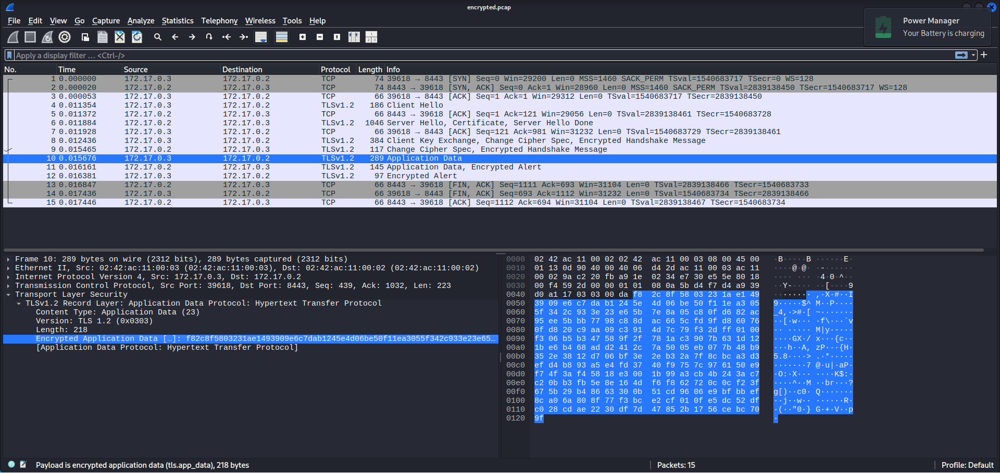
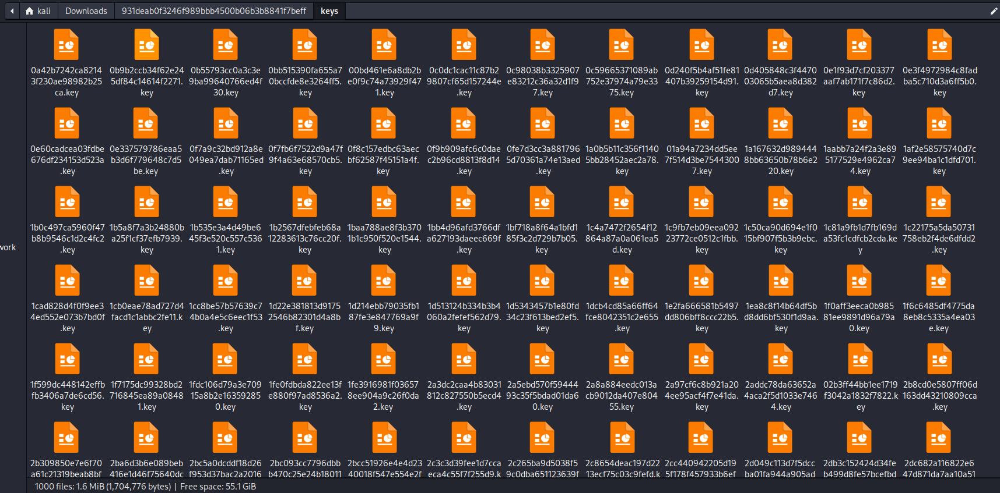
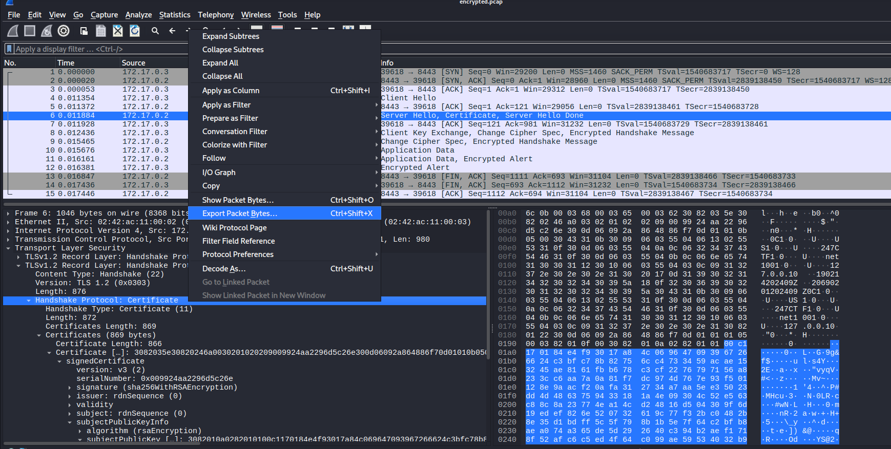
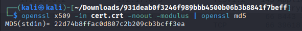
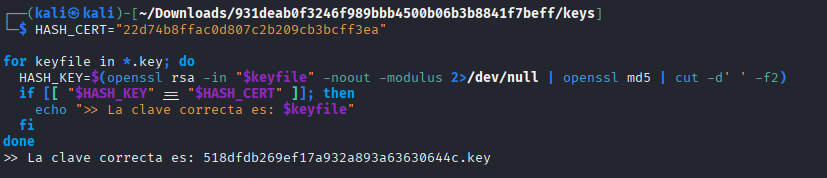
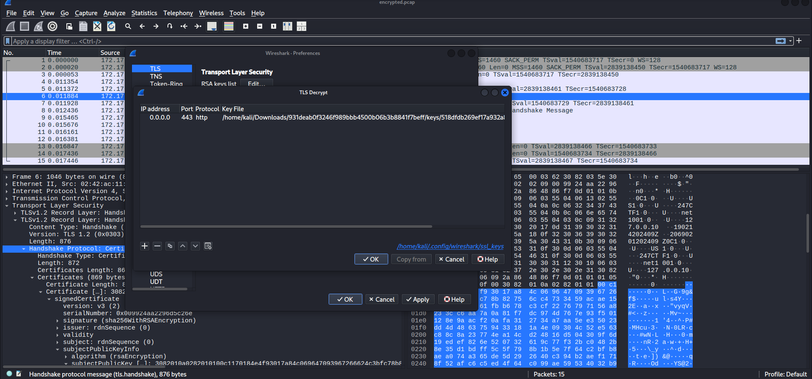
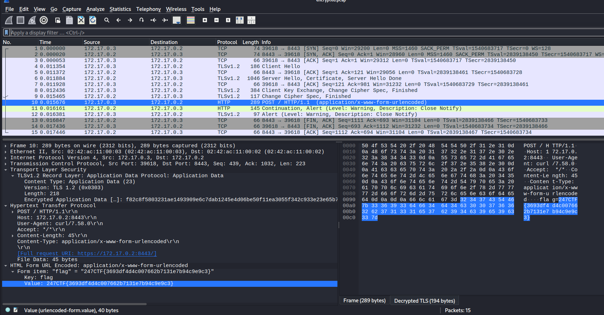

# Not My Modulus
## CATEGORÍA: Networking

### PRESENTACIÓN DEL PROBLEMA:
Se nos proporciona un archivo `.pcap` que contiene una captura de tráfico encriptado y un conjunto de llaves privadas. El objetivo es identificar cuál de estas llaves se debe utilizar para descifrar la información de los paquetes.

Para poder encontrar la llave privada necesaria para desencriptar los paquetes, será necesario extraer el módulo RSA del certificado utilizado en la conexión TLS y calcular su hash MD5. Luego, aplicamos el mismo proceso para cada una de las llaves privadas. Si hay una llave cuyo hash coincide con el del certificado, esta será la llave correcta. 





### PASO A PASO DEL PROCESO:

1. Abrimos el archivo de intercambio de paquetes `.pcap` en Wireshark. Identificamos el paquete que contiene el certificado enviado por el servidor como parte del proceso de handshake y exportamos los bytes del certificado en un archivo `.der`. 



2. Luego, convertimos el certificado a formato legible PEM para poder utilizar funciones de OpenSSL: 

    `openssl x509 -in cert.der -inform DER -outform PEM -out cert.crt`

    Extraemos el módulo RSA del certificado y calculamos su hash MD5:

    `openssl x509 -in cert.crt -noout -modulus | openssl md5`.

    Esto nos devuelve el hash del módulo público RSA del certificado `22d74b8ffac0d807c2b209cb3bcff3ea`.



3. Luego, podemos elaborar un script Bash para calcular el hash del modulo RSA de cada una de las llaves privadas y compararla con el hash obtenido del certificado. En caso de encontrar una llave que coincida, se imprime su nombre.

```
HASH_CERT="22d74b8ffac0d807c2b209cb3bcff3ea"

for keyfile in *.key; do
  HASH_KEY=$(openssl rsa -in "$keyfile" -noout -modulus 2>/dev/null | openssl md5 | cut -d' ' -f2)
  if [[ "$HASH_KEY" == "$HASH_CERT" ]]; then
    echo ">> La clave correcta es: $keyfile"
  fi
done
```

4. Al ejecutar el script del paso anterior, encontramos que la llave cuyo hash coincide con el del certificado es `518dfdb269ef17a932a893a63630644c.key`



5. En Wireshark, desde la opción `Edit > Preferences > Protocol > TLS` podemos añadir la llave privada y visualizar la información de los paquetes desencriptada. Al inspeccionar los datos, se puede observar la bandera.





**DESCRIPCIÓN DE LA SOLUCIÓN:** 

Durante una conexión TLS, el servidor envía su certificado digital, que contiene la clave pública utilizada para el cifrado RSA durante el handshake. Esta clave pública incluye el módulo RSA (n), el cual es único para cada par de claves (pública/privada).

Aunque no tenemos acceso directo a los certificados, sí podemos extraer el certificado desde el `.pcap`, obtener su módulo y calcular su hash MD5 como identificador. Luego, aplicamos el mismo proceso a cada una de las llaves privadas provistas: extraemos el módulo RSA de cada una y calculamos su hash.

Dado que una clave privada válida debe compartir el mismo módulo que su clave pública correspondiente (la del certificado), el hash del módulo será el mismo si coinciden. Esto permite identificar con precisión cuál es la clave privada que empareja con el certificado TLS usado en la sesión capturada.

Una vez identificada, Wireshark puede usar esa clave para descifrar la sesión y revelar el contenido de los paquetes, incluida la bandera.

### FLAG:
`247CTF{3693df4d4c007662b7131e7b94c9e9c3}`

**Autor/a: Javier Moreno**