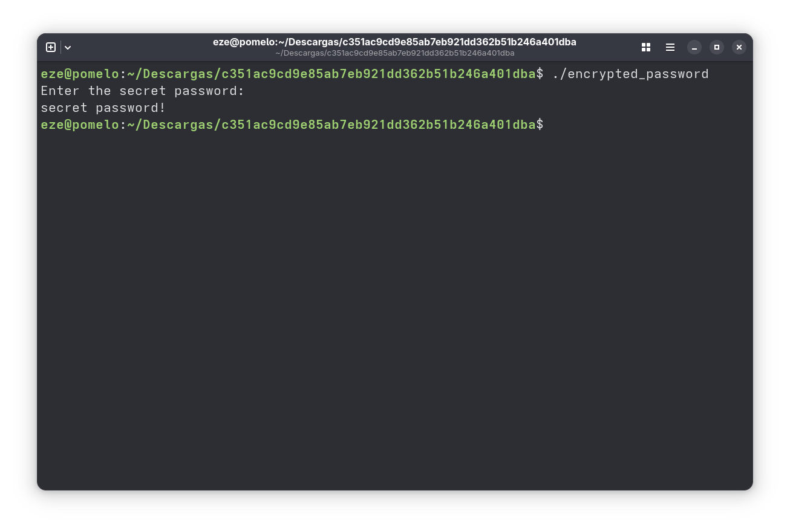
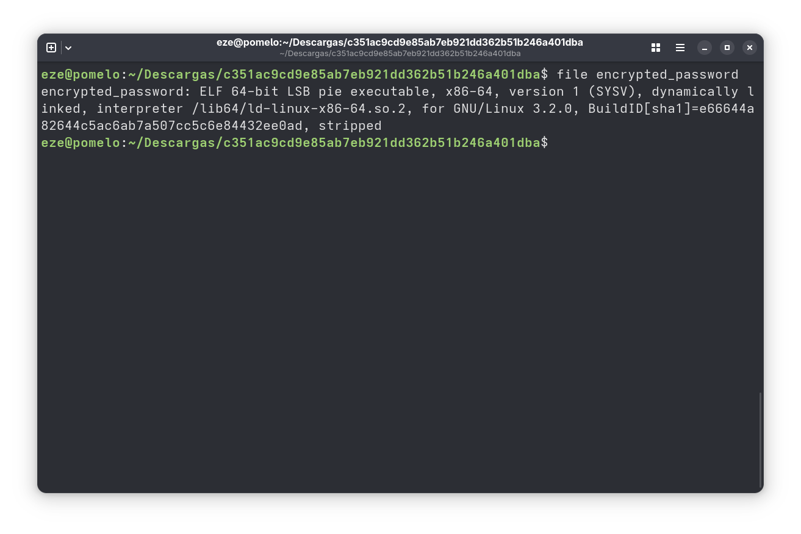
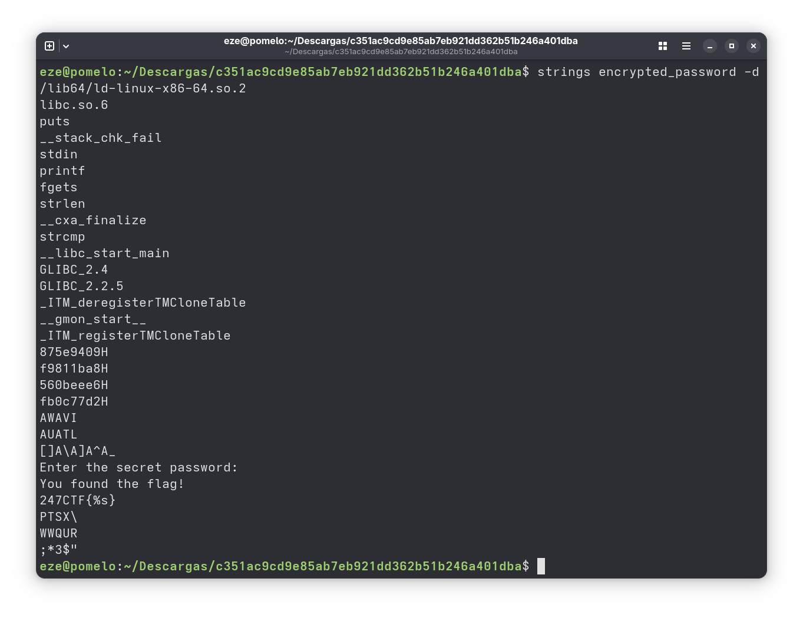
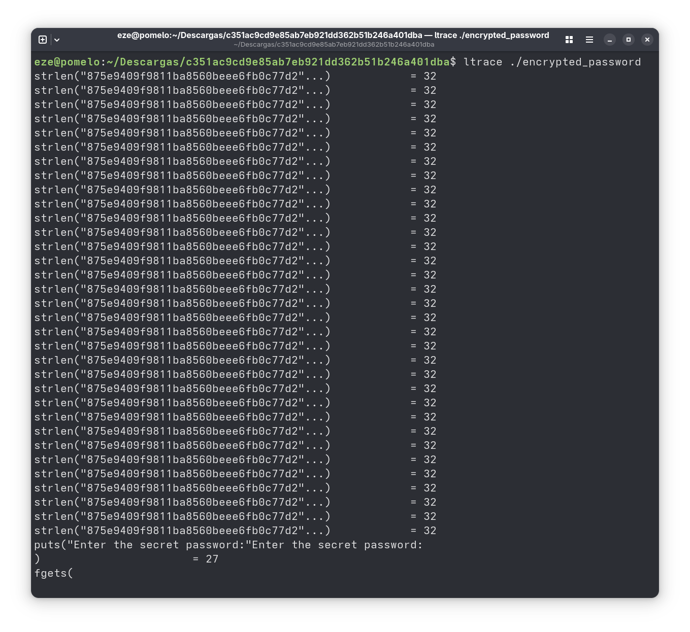
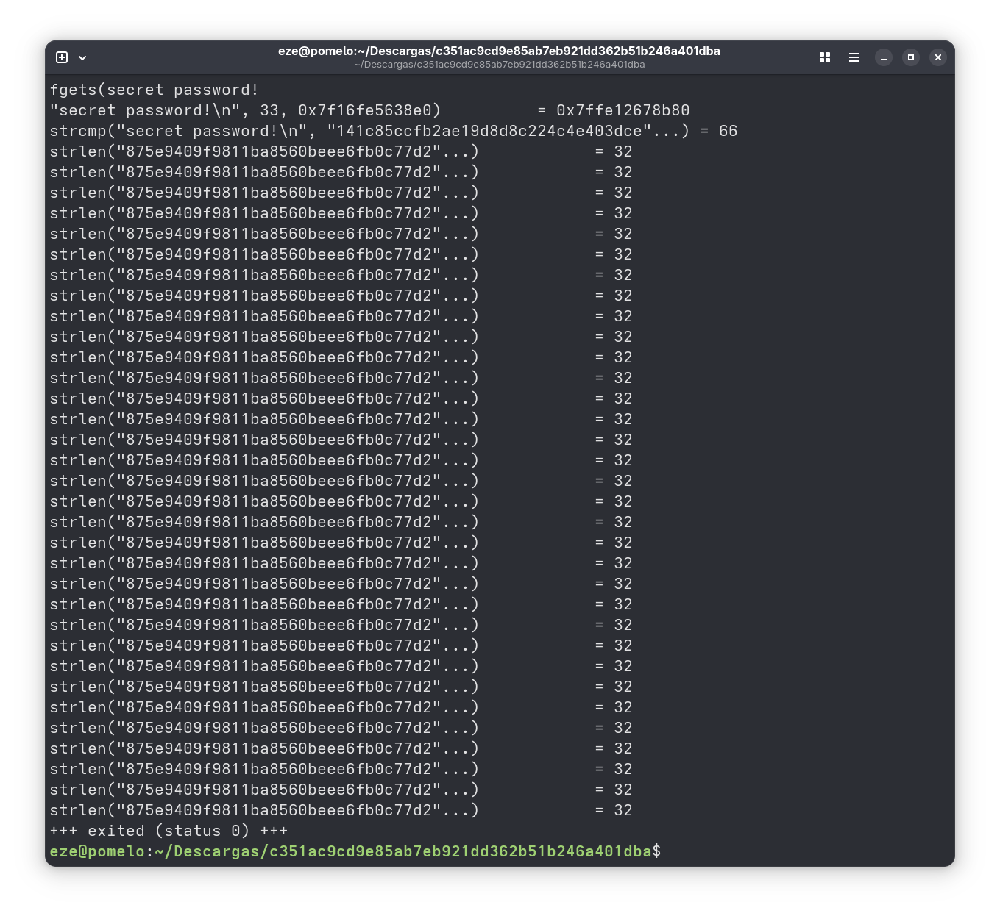
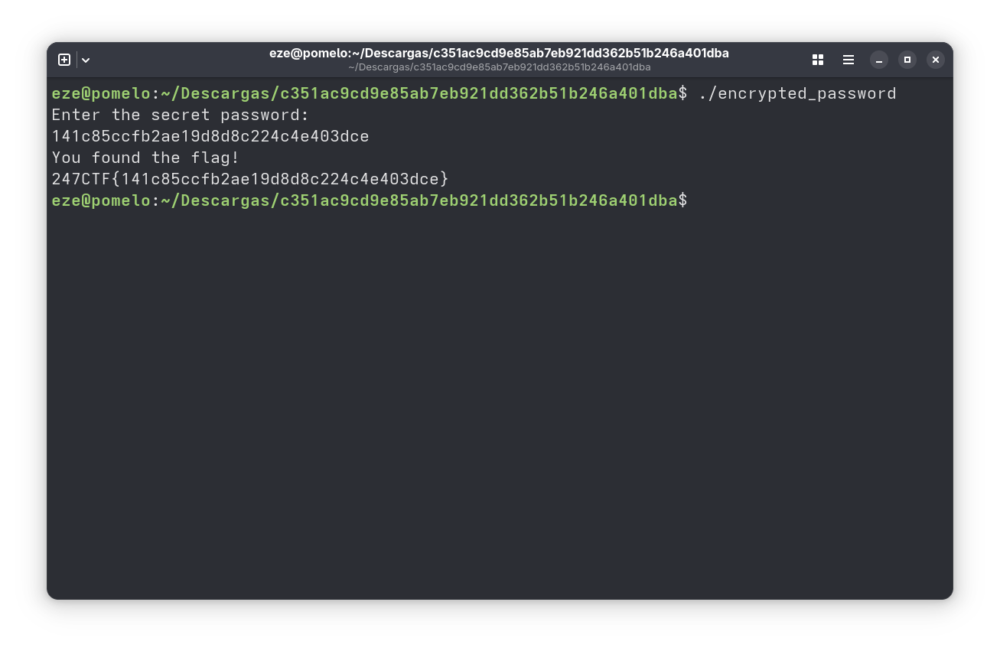

# The Encrypted Password
## Categoría: Reversing

*You won't find the admin's secret password in this binary. We even encrypted it with a secure one-time-pad. Can you still recover the password?*

---

### Presentación del problema

Al iniciar el challenge, podemos descargar un zip. Al descomprimirlo, solo hay un binario dentro. Probemos ejecutarlo:



Podemos ver que el programa pide una contraseña, y si se le ingresa la contraseña incorrecta (en esta caso ingresamos *secret password!*) termina sin imprimir nada más. Podemos asumir que si ingresáramos la contraseña correcta se imprime la flag.

---

### Paso a paso

Primero, vamos a intentar sacar información sobre el ejecutable. Empezamos usando la utilidad *file* para obtener información básica.


Podemos ver que es un ejecutable para Linux 64 bits (que ya sabíamos, porque lo pudimos ejecutar), que es *dinamically linked* (o sea, usa las bibliotecas compartidas del sistema) y *stripped* (no tiene símbolos, que son información sobre el código fuente original, por lo que no podemos pasar el programa por un debugger). Además de *file*, podemos usar *strings*, que es una utilidad de Linux que imprime las secuencias de caracteres legibles dentro de un archivo (esta utilidad funciona con cualquier tipo de archivos: para archivos de texto imprime el archivo completo, pero en el caso de ejecutables se imprimen solo los strings "hardcodeados" dentro del archivo).


Podemos ver varias cosas interesantes:
- Un *247CTF{%s}*, que es como se formatean strings en C para imprimir con la función *printf*, que también aparece en la captura. Así que nos estaría faltando un pedazo de la flag.
- Además vemos varias funciones de C, entre ellas:
	- *fgets*: Lee input de la terminal.
	- *strlen*: Devuelve el largo de un string.
	- *strcmp*: Compara dos strings.

Con esto, podemos asumir que es un programa bastante simple, que lo único que hace es leer la contraseña que ingresa el usuario por la terminal, compararla con la contraseña válida e imprimir la flag si coinciden. A pesar de eso, no podemos ver la contraseña con *strings*, así que hay que probar de otra forma.

Como ya vimos, el programa es *dinamically linked*, por lo que las funciones de C que utiliza son las que están disponibles en el sistema. Entonces, podemos usar la utilidad *ltrace*, que registra las llamadas que hace un ejecutable a las bibliotecas compartidas, junto con sus parámetros.



Inmediatamente nos aparecen todas las llamadas que hace el programa. Podemos ver que llama *strlen* varias veces sobre un mismo string, al parecer solo para generar código extra y dificultar revisar el assembly. También, vemos que se pausó en la llamada a *fgets*, ya que está esperando a que ingresemos la contraseña.


Ahora que ingresamos *secret password!*, se terminó de ejecutar el programa y apareció la llamada a *strcmp* que estábamos buscando, con el string que ingresamos y ```"141c85ccfb2ae19d8d8c224c4e403dce"``` como parámetros. Lo más probable es que esta sea la clave correcta.



---

### Flag
247CTF{141c85ccfb2ae19d8d8c224c4e403dce}

**Autor**: Ezequiel González
