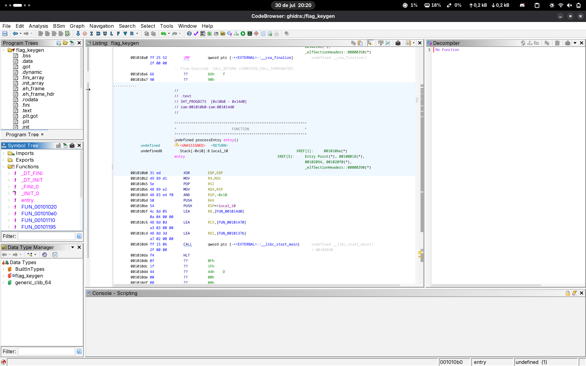
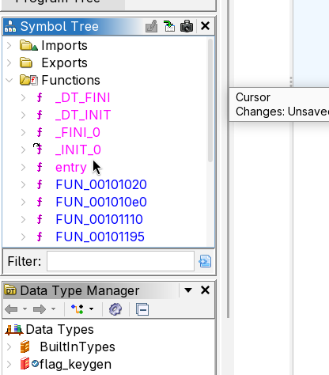
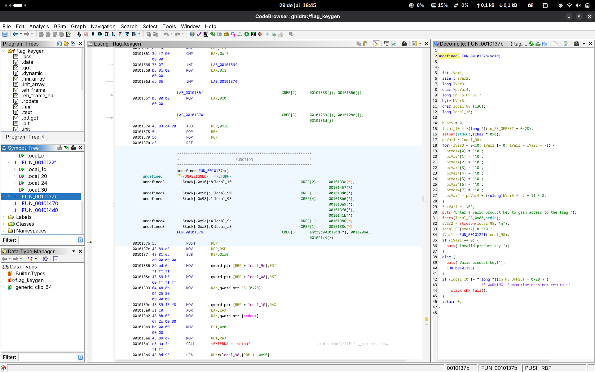
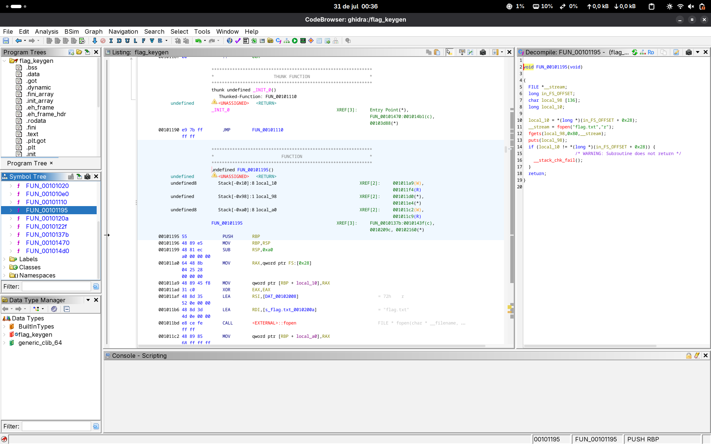
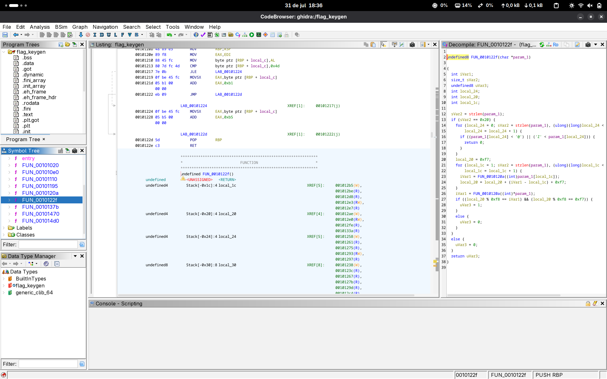
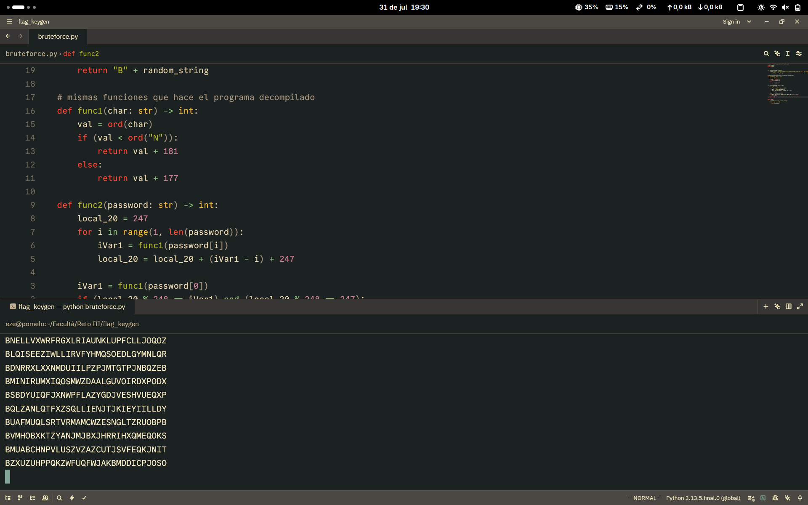
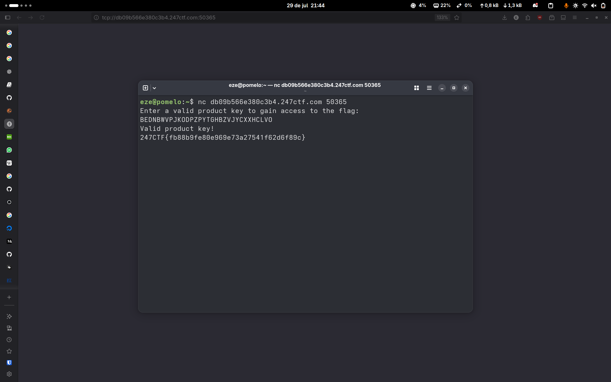

# Flag keygen
## Categoría: Reversing

*We created a service which can read and print the flag for you. To use the application, you first need to enter a valid product key. Can you reverse the algorithm and generate a valid key?*

---

### Presentación del problema

Al iniciar el challenge, podemos descargar el ejecutable y también acceder a este a través de una ruta, por ejemplo:

```
tcp://db09b566e380c3b4.247ctf.com:50365
```

Antes que nada, probamos que hace el programa:

```
eze@pomelo:~/Descargas/7c82775834840d332b1883bdb37451ebd56c99c3$ ./flag_keygen 
Enter a valid product key to gain access to the flag:
pim pum pam
Invalid product key!
```

Podemos obtener un poco de info sobre el ejectutable usando *file*, que nos da información básica sobre cualquier archivo, y *strings*, que devuelve las secuencias de caracteres imprimibles dentro de programa.:

```
eze@pomelo:~/Descargas/7c82775834840d332b1883bdb37451ebd56c99c3$ file flag_keygen 
flag_keygen: ELF 64-bit LSB pie executable, x86-64, version 1 (SYSV), dynamically linked, interpreter /lib64/ld-linux-x86-64.so.2, BuildID[sha1]=3b015dee86e096192c94f9f78de9c76c16f94dcb, for GNU/Linux 3.2.0, stripped
```

```
eze@pomelo:~/Descargas/7c82775834840d332b1883bdb37451ebd56c99c3$ strings flag_keygen -d
/lib64/ld-linux-x86-64.so.2
mgUa
libc.so.6
fopen
puts
__stack_chk_fail
stdin
fgets
strlen
strcspn
stdout
__cxa_finalize
setbuf
__libc_start_main
GLIBC_2.4
GLIBC_2.2.5
_ITM_deregisterTMCloneTable
__gmon_start__
_ITM_registerTMCloneTable
u/UH
[]A\A]A^A_
flag.txt
Enter a valid product key to gain access to the flag:
Valid product key!
Invalid product key!
;*3$"
```

- Sabemos que es un ejecutable para Linux, sin símbolos (no podemos usar debugger).
- Gracias a strings, podemos asumir que la flag no está dentro del ejecutable, sino que la saca de un archivo externo (*fopen*, *flag.txt*), por lo que sí o sí tenemos que encontrar una clave válida y usarla con el programa que hostea la página, no con el ejecutable que tenemos.

---

### Paso a paso
#### Decompilando el programa

Con lo anterior, sabemos que no nos queda otra que desensamblar el binario e intentar ver cómo valida si una clave es correcta. En este caso usamos *Ghidra* para explorar el assembly del programa y ver una decompilación (aproximada) en C.


*vista principal al abrir Ghidra con el ejecutable*

Va a salir un popup que pregunta si queremos analizar el programa. Luego de darle que sí, podemos ver el decompilado de distintas funciones, aunque la mayoría no nos sirven (son funciones vacías, solo con un *return* o no las llaman de ningún lado).


*panel de funciones*

Luego de revisar un poco, pareciera que la función **FUN_0010137b** es el *main* del programa (el decompilado está en el panel de la derecha):



Es un decompilado bastante desprolijo (*undefined8* como retorno de la función, en vez de un *int*, los nombres medio que sin sentido para las funciones y variables, etc.), pero hay que tener en cuenta que el ejecutable no tiene símbolos, es decir, no tiene información sobre el código original, y Ghidra hace lo mejor que puede.

En este caso, podemos darnos cuenta que es la función *main* porque:
- Imprime "Enter a valid product key..." (línea 30).
- Lee la clave del usuario (con *fgets()*, línea 31).
- Edita la clave cambiando el saltó de línea '\n' por el caracter nulo '\0' (líneas 32 y 33, porque los strings en C no guardan el largo de estos, tienen que tener el caracter '\0' para indicar cuando terminan).
- Pasa la clave a otra función y luego determina si imprime la *flag* a partir del resultado (líneas 34 a 41).

La función hace varias cosas más, pero no nos interesan y lo más probable es que no haya sido código escrito por el desarrollador, sino que sean artefactos de la decompilación o código que agrega el compilador.

Con lo que sabemos, podemos revisar las funciones urlque quedan:
- En la línea 40 de *main* (cuando la clave que ingresa el usuario es válida), se llama a **FUN_00101195** (imagen de abajo), y podemos confirmar que la flag está en otro archivo que el programa abre e imprime (líneas 10, 11, 12 y 13, primero reserva un buffer, luego abre el archivo con *fopen*, copia los contenidos al buffer con *fgets* y por último imprime con *puts*).



- En la línea 34 de *main*, llama a **FUN_0010122f** y le pasa por parámetro la clave que ingresó el usuario (imagen de abajo). De nuevo, la función tiene *undefined8* como valor de retorno, aunque claramente devuelve *int* (C recién agregó booleanos hace un par de años, por lo que se usaban ints o la biblioteca *stdbool*). La función hace varios chequeos con la clave, y además llama otra función (**FUN_0010120a**). Vamos a intentar aprolijar el código así lo podemos ver más a detalle.



#### Función para verificar la clave

Versión un poco más prolija de ambas funciones (pasando números de hexa a decimal, cambiando el nombre de variables, etc.):
```c
#include <stddef.h>
#include <stdio.h>
#include <string.h>

int FUN_0010120a(char c) {
	int res;

	if (c < 'N') {
		res = c + 181;
	} else {
		res = c + 177;
	}
	return res;
}

bool FUN_0010122f(char *clave) {
	size_t largo_clave = strlen(clave);
	if (largo_clave == 32) {
		for (int i = 0;
			largo_clave = strlen(clave), (size_t)i < largo_clave;
		    i = i + 1) {
		    if ((clave[i] < '@') || ('Z' < clave[i])) {
			    return false;
		    }
	    }
	
		int a = 247;
		int b;
		for (int i = 1;
			largo_clave = strlen(clave), (size_t)i < largo_clave;
	        i = i + 1) {
		    b = FUN_0010120a((int)clave[i]);
		    a = a + (b - i) + 247;
		}
	
	    b = FUN_0010120a((int)*clave);
	    if ((a % 248 == b) && (a % 248 == 247)) {
		    return true;
	    } else {
		    return false;
		}
	}
	
	return false;
}
```

Ahora, podemos concluir algunas características que debe tener una clave para que sea válida:
- 32 caracteres de largo (primer *if* de la función).
- Tiene que tener solo letras mayúsculas (primer *for* de la función: itera por cada caracter y chequea que sea mayor o igual que '@' y menor o igual que 'Z'. Si revisamos la tabla ASCII los únicos caracteres que cumplen con esto son ABCDE...XYZ).
- Tiene que empezar con 'B':
	- El último *if* de la función chequea ```(a % 248 == b) && (a % 248 == 247)```, por lo que ```b``` tiene que ser 247. A ```b```  se le asigna el resultado de la función **FUN_0010120a**, que como podemos ver recibe un caracter y devuelve el valor numérico de este + 181 o 177. El único caracter que resulta en 247 es 'B'.

Podríamos seguir estudiando la función, pero intentar seguir como el bucle va modificando la variable ```a``` es demasiado complicado, y además ya tenemos suficiente información como para automatizar la creación de claves con un script (imagen más abajo con algunos outputs).

```python
import string
import random


# Genera un string randomizado de 32 de largo y que empieza con B.
def generate_random_string():
    random_string = "".join(random.choice(string.ascii_uppercase) for _ in range(31))
    return "B" + random_string

# mismas funciones que hace el programa decompilado
def func1(char: str) -> int:
    val = ord(char)
    if (val < ord("N")):
        return val + 181
    else:
        return val + 177

def func2(password: str) -> int:
	# sacamos los chequeos de largo, primer caracter, y dejamos solo el complicado.
    local_20 = 247
    for i in range(1, len(password)):
        iVar1 = func1(password[i])
        local_20 = local_20 + (iVar1 - i) + 247

    iVar1 = func1(password[0])
    if (local_20 % 248 == iVar1) and (local_20 % 248 == 247):
        return True
    return False

while True:
    password = generate_random_string()
    if (func2(password)):
        print(password)

```



Con este script es más que suficiente para generar claves válidas, así que solo queda conectarnos con netcat a la ruta que hostea la página e ingresar cualquiera de las claves para obtener la flag.



---

### Flag
247{fb88b9fe80e969e73a27541f62d6f89c}

**Autor**: Ezequiel González