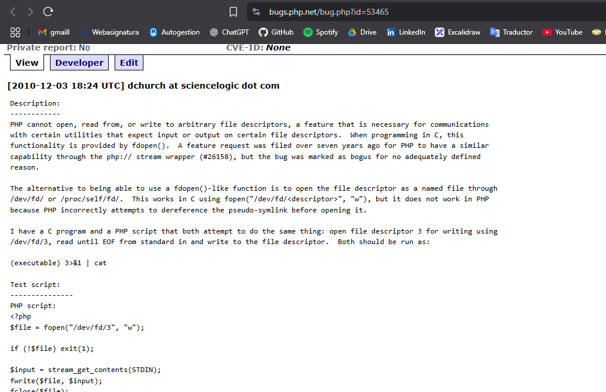
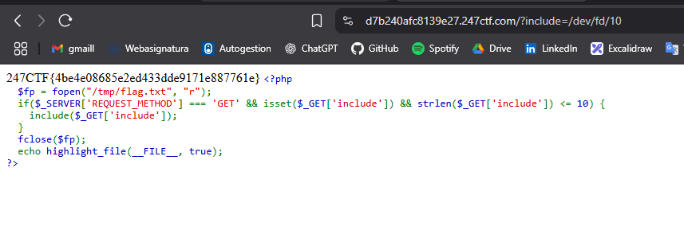

````markdown
## Análisis del script PHP con inclusión basada en descriptores

Al ingresar al laboratorio, se nos presenta el siguiente archivo PHP:

```php
<?php
  $fp = fopen("/tmp/flag.txt", "r");
  if($_SERVER['REQUEST_METHOD'] === 'GET' && isset($_GET['include']) && strlen($_GET['include']) <= 10) {
    include($_GET['include']);
  }
  fclose($fp);
  echo highlight_file(__FILE__, true);
?>
````

### Explicación del funcionamiento

* El script abre el archivo `/tmp/flag.txt` en modo lectura (`r`) y lo asigna al descriptor de archivo `$fp`.
* Si la solicitud es de tipo **GET** y se incluye un parámetro `include` de longitud menor o igual a 10 caracteres, PHP intenta incluir el archivo especificado.
* Luego, se cierra el descriptor de archivo y se imprime el propio código fuente resaltado con `highlight_file()`.

### Vulnerabilidad relacionada: Bug PHP #53465

Este comportamiento está relacionado con el bug reportado en **PHP Bug #53465**, que describe cómo PHP maneja incorrectamente el acceso a archivos abiertos a través de rutas como `/dev/fd/N`, resolviendo symlinks en lugar de trabajar directamente con el descriptor.

### Explotación

Al intentar manualmente incluir archivos a través de descriptores `/dev/fd/N`, se comprobó que:

```
/dev/fd/10
```

funciona correctamente, ya que el descriptor de archivo 10 apunta al archivo `/tmp/flag.txt` abierto por `fopen()`. PHP logra incluir el contenido **antes** de que se cierre el descriptor.

### Resultado

Esto permite incluir el contenido del descriptor `$fp`, revelando así la **flag del ejercicio** al visitar la URL:

```
https://d7b240afc8139e27.247ctf.com/?include=/dev/fd/10
```

### Evidencia





### FLAG:

247CTF{4be4e08685e2ed433dde9171e887761e}


**Autor/a: Franco Robotti**
