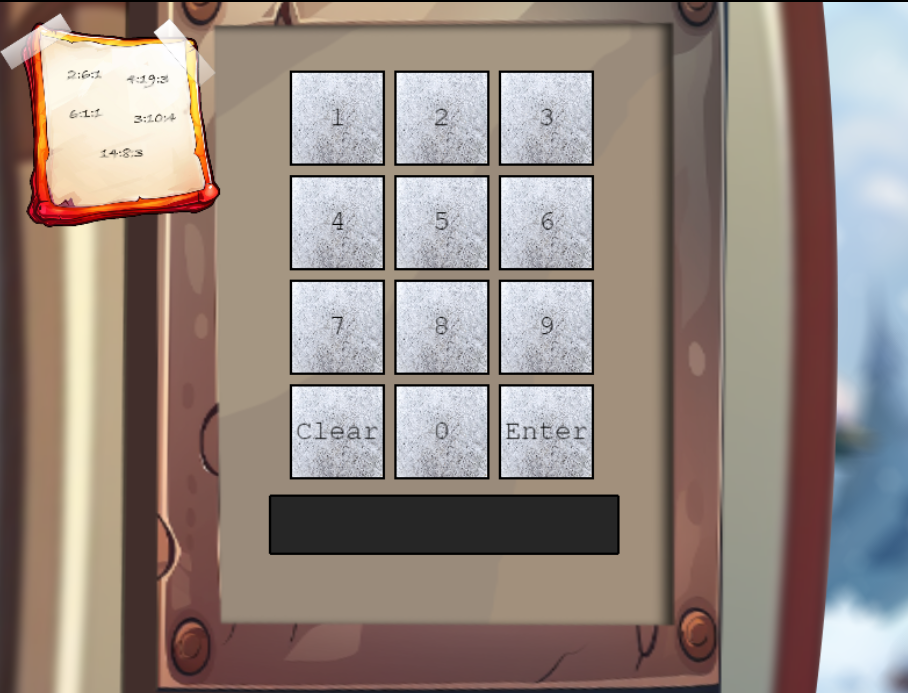
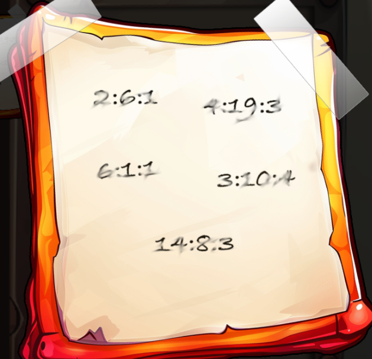
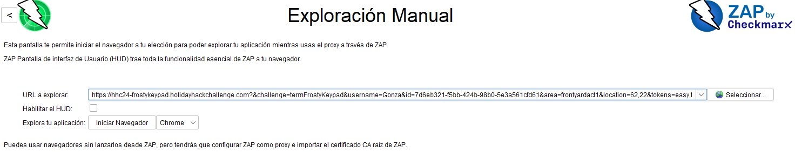
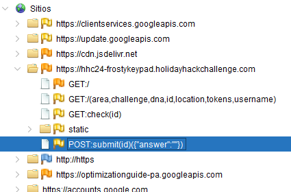
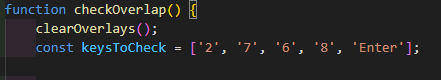
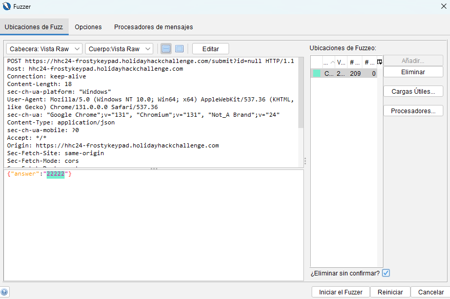
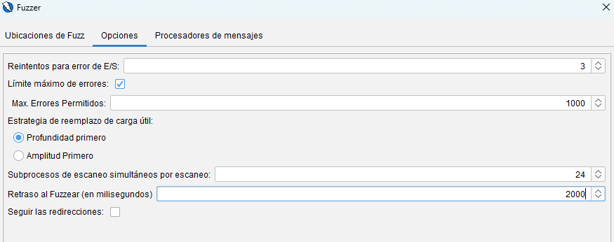
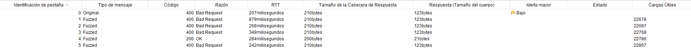
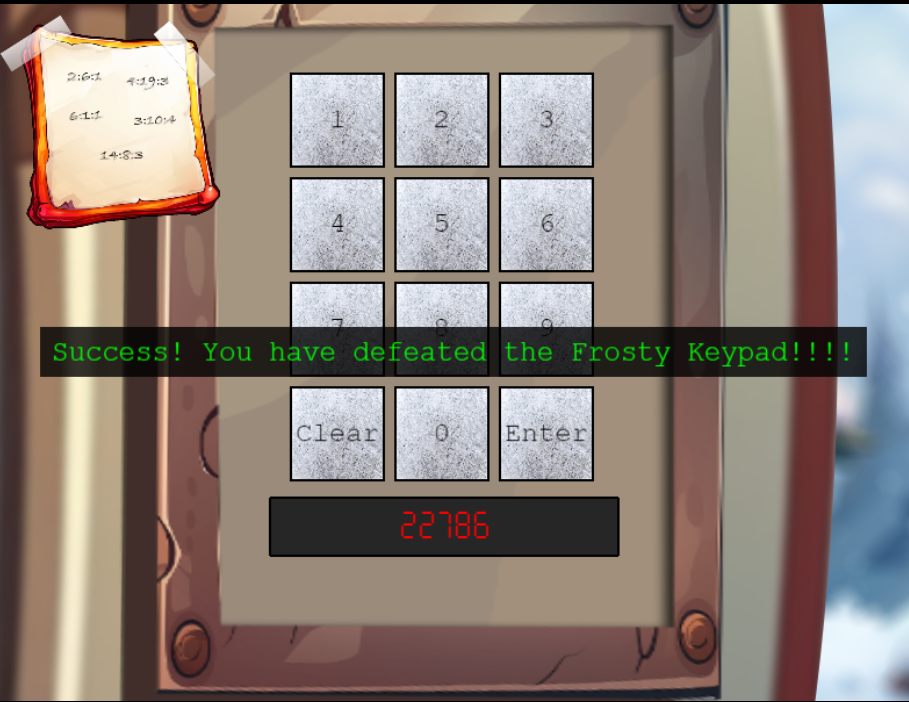

## Solución al Desafío

El problema era encontrar una combinación de 5 números. En la pantalla había una nota con 5 combinaciones de dígitos separados por dos puntos en el formato `número:número:número`, un teclado numérico y un botón de "Enter".
<p float="left">
  
  
</p>

Para resolverlo, utilicé un enfoque de fuerza bruta con la herramienta ZAP. Estos fueron los pasos que seguí:

### Exploración inicial

Primero, copé la URL del desafío y la cargué en la opción de exploración manual de ZAP.



Desde el navegador integrado, envié una combinación cualquiera de 5 números para observar cómo funcionaba el método. Así descubrí que usaba una solicitud `POST` con el siguiente formato:

```
submit(id)({"answer": "22222"})
```


### Análisis del código

Al revisar el código, encontré una función llamada `checkOverlap`. Esta mostraba huellas cuando pasabas una linterna UV sobre las teclas '2', '7', '6', '8' y 'Enter'. Eso me indicó que estos números eran parte de la combinación.



### Generación de combinaciones

Sabiendo que la combinación era de 5 números y que solo conocía 4 dígitos (‘2’, ‘7’, ‘6’, ‘8’), deduje que uno de ellos tenía que repetirse. Para automatizar la generación de combinaciones, usé un script en Python que creó todas las posibles (240 en total) y las guardó en un archivo `.txt`, una combinación por línea. Las combinaciones tenían el formato `22768` (sin separadores).
El código utilizado es el siguiente:
```python
from itertools import permutations

numeros = [2, 6, 7, 8]
combinaciones = set()

for num_repetido in numeros:
    # Armar lista con un número repetido
    base = [num_repetido, num_repetido] + [n for n in numeros if n != num_repetido]
    # Generar permutaciones y añadirlas al conjunto
    combinaciones.update(permutations(base))

# Convertir el conjunto a lista y ordenar
resultado = sorted(combinaciones)

# Escribir las combinaciones en un archivo .txt
with open("combinaciones.txt", "w") as archivo:
    for combinacion in resultado:
        archivo.write("".join(map(str, combinacion)) + "\n")

print(f"Total combinaciones: {len(resultado)}")
print("Archivo 'combinaciones.txt' creado con éxito.")
```

### Configuración del fuzzing

En ZAP configuré un ataque de fuzzing usando el archivo generado. Especifiqué que el cuerpo de la solicitud (`body`) fuera del tipo JSON:

```json
{"answer":"22222"}
```

Luego, configuré el campo para reemplazar "combinación" con cada línea del archivo.



Para evitar problemas de “Too Many Requests” (HTTP 429), ajusté el retraso entre cada solicitud a 2000 milisegundos.



### Ejecución y resultado

Inicié el ataque y observé las respuestas. La combinación correcta fue la que devolvió un código de estado `200 OK`. Finalmente, encontré que la combinación correcta era `22867`.



## Conclusión

Resolver el desafío implicó combinar varias técnicas: análisis manual, generación automatizada de datos y configuración de pruebas de seguridad. Fue un proceso interesante y efectivo para llegar al resultado correcto.


