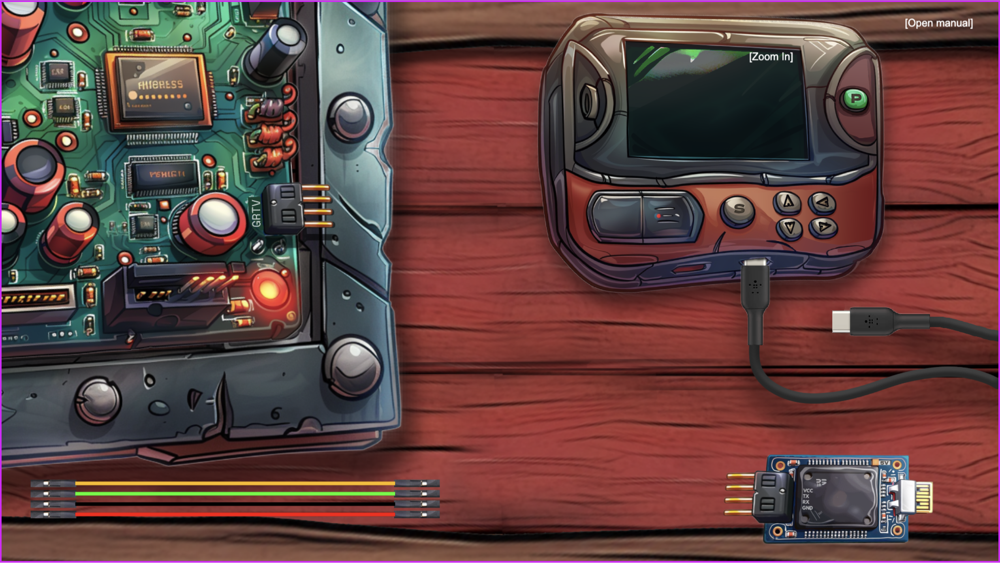
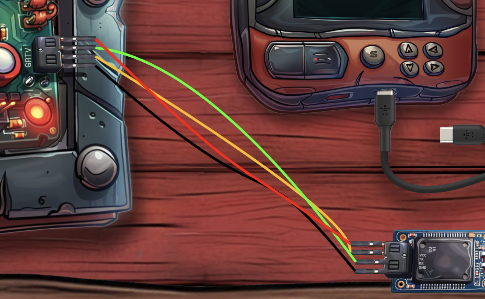
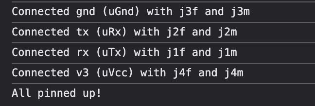
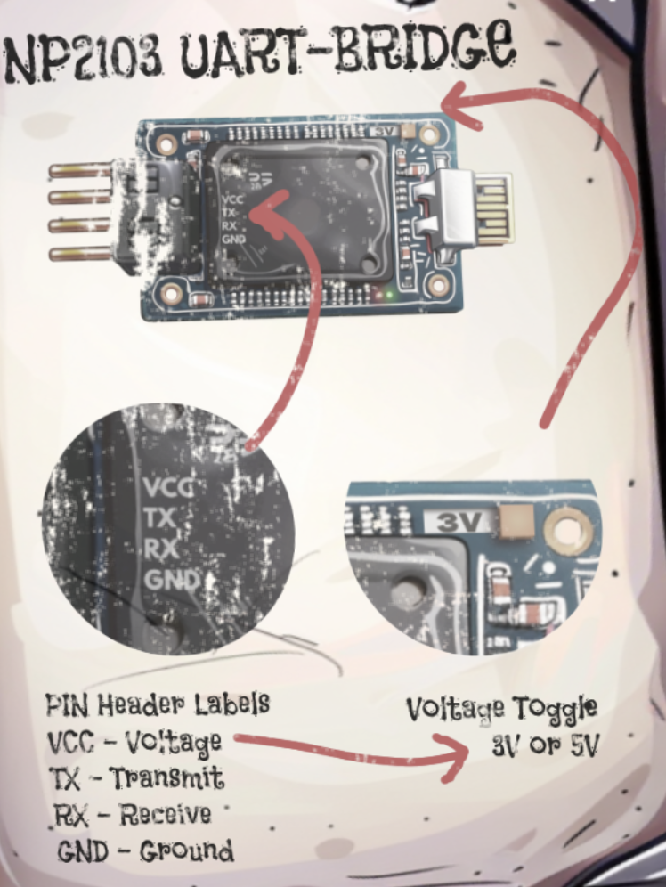
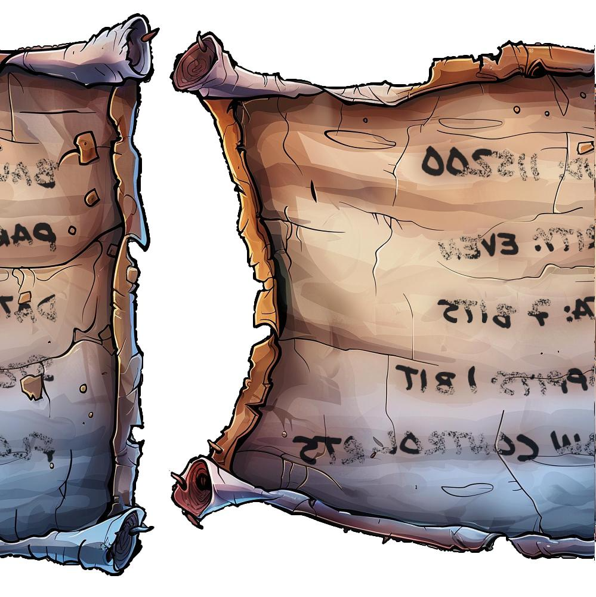
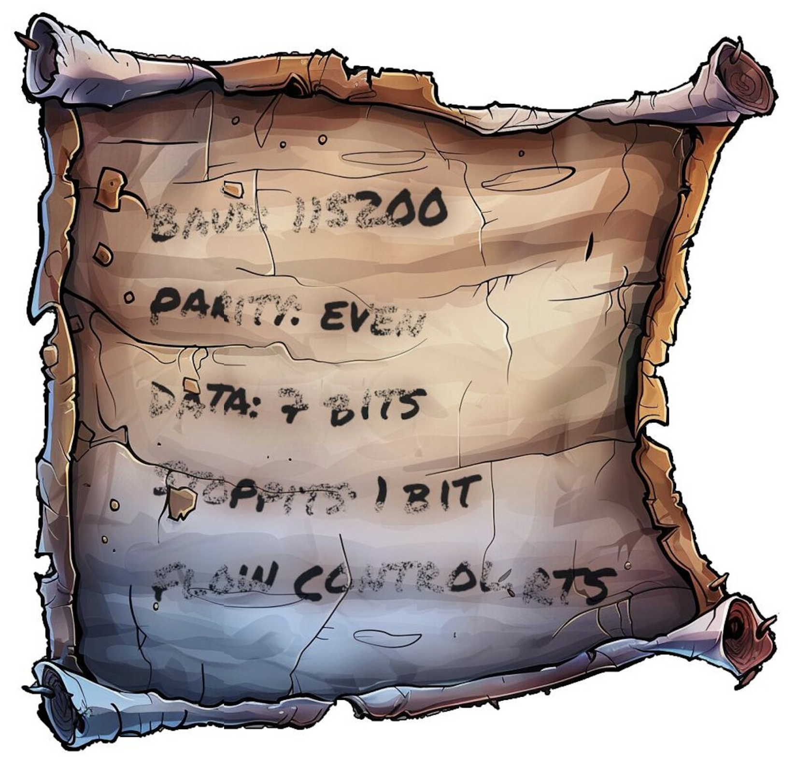
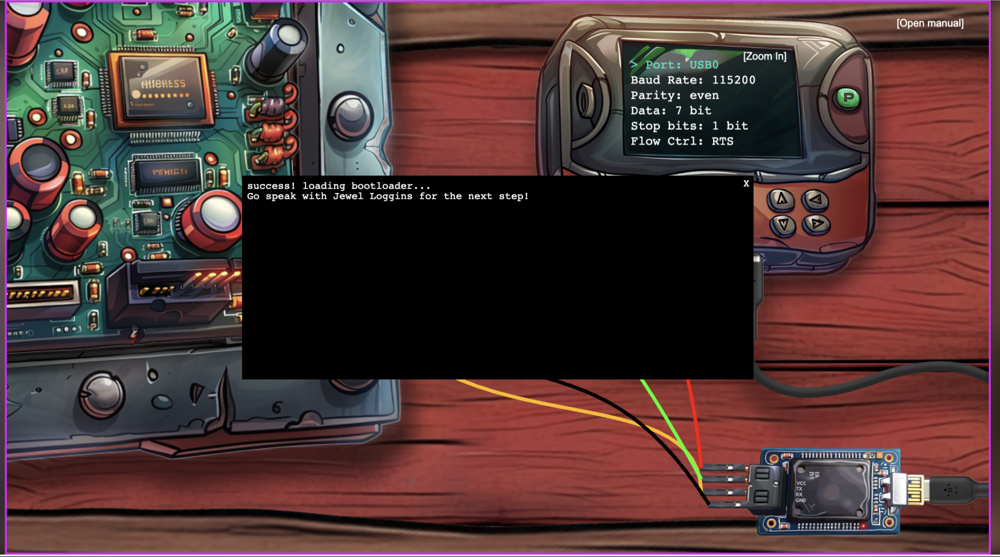

# Writeup - Desafío SLH

## Introducción

El objetivo en este desafío era poder encender el *Santa Little Helper*, para esto es necesario recuperar la configuración correcta que encendía el dispositivo, mediante una combinación de conexiones específicas entre cables y una configuración particular.

En el desafío de **"Frosty Keypad"** se nos presenta un archivo comprimido que contiene 1,000 imágenes. En ese reto se menciona que las imágenes contenían originalmente las instrucciones necesarias, pero estas fueron pasadas por una trituradora, dejando un conjunto de tiras desordenadas.

---

## Análisis del código fuente

Para este desafío, dado que toda la información que tenía es lo que muestro en esta imagen



Comencé explorando el código fuente del dispositivo, encontré fragmentos relevantes que describían las conexiones necesarias entre los cables. Uno de los snippets indicaba los colores en hexadecimal y cómo se conectaban los pines:

```javascript
const targetPins = [
  { pin: this.children.getByName('gnd'), dest: this.children.getByName('uGnd'), color: 0x000000 },
  { pin: this.children.getByName('tx'), dest: this.children.getByName('uRx'), color: 0x1bff00 },
  { pin: this.children.getByName('rx'), dest: this.children.getByName('uTx'), color: 0xff8700 },
  { pin: this.children.getByName('v3'), dest: this.children.getByName('uVcc'), color: 0xff0000 }
];
```

Con esta información, pude identificar que:

- **GND** (negro) conecta el pin `gnd` de un dispositivo al `uGnd` del otro.
- **TX** (verde) conecta `tx` con `uRx`.
- **RX** (naranja) conecta `rx` con `uTx`.
- **V3** (rojo) conecta `v3` con `uVcc`.



Utilizando esta información y observando el dispositivo, comprobé que las conexiones eran correctas gracias al mensaje que aparecía en consola:



Otro snippet en el código mostraba la condición para completar el desafío:

```javascript
if (this.uV === 3 && this.allConnectedUp && !this.usbIsAtOriginalPosition || this.dev) {
    // console.log("PARTY TIME");
    let checkIt = await checkit([
        this.currentPortIndex, this.currentBaudIndex, this.currentParityIndex,
        this.currentDataIndex, this.currentStopBitsIndex, this.currentFlowControlIndex
    ], this.uV);
    if (checkIt) {
        this.popup("success! loading bootloader...\nGo speak with Jewel Loggins for the next step!");
        this.yippee.play();
    }
}
```

Este fragmento confirmó que el **voltaje debe estar en 3 volts** y que todas las conexiones deben ser correctas para cargar el dispositivo.



---

## Reconstrucción de las imágenes

El siguiente paso fue reconstruir las instrucciones a partir de las 1,000 imágenes que nos entregaron. Estas imágenes eran tiras desordenadas, por lo que el primer intento consistió en ordenarlas alfabéticamente y unirlas horizontalmente mediante un script de Python. Esto generó una imagen sin sentido aparente, pero confirmó que las tiras formaban un patrón.

### Cálculo de similitud entre imágenes

Para organizar las tiras, utilicé la función `compare_ssim` de SSIM_PIL de Python, que calcula la similitud entre dos imágenes mediante análisis de contraste, colores y otros canales. Implementé un script que:

1. Compara cada imagen con todas las demás, calculando la similitud.
2. Selecciona la imagen más similar como siguiente pieza.
3. Repite el proceso hasta agotar todas las imágenes.

``` python
import os

from PIL import Image
from SSIM_PIL import compare_ssim


def open_images(input_folder):
    image_files = [
        os.path.join(input_folder, f)
        for f in os.listdir(input_folder)
        if f.endswith(".jpg")
    ]
    image_files.sort()

    images = {img: Image.open(img) for img in image_files}
    return images


def concatenate_images(images, output_file, direction="horizontal"):
    widths, heights = zip(*(img.size for img in images))
    if direction == "horizontal":
        total_width = sum(widths)
        max_height = max(heights)
        result_size = (total_width, max_height)
    elif direction == "vertical":
        max_width = max(widths)
        total_height = sum(heights)
        result_size = (max_width, total_height)
    else:
        raise ValueError("Direction must be 'horizontal' or 'vertical'")

    result_image = Image.new("RGB", result_size)

    offset = 0
    for img in images:
        if direction == "horizontal":
            result_image.paste(img, (offset, 0))
            offset += img.size[0]
        elif direction == "vertical":
            result_image.paste(img, (0, offset))
            offset += img.size[1]

    result_image.save(output_file)
    print(f"Concatenated image saved as {output_file}")


def compare_images(images: dict):
    image_order = []
    actual_name = list(images.keys())[0]
    actual = images.pop(actual_name)
    while len(images) > 0:
        max_sim = (0,)
        for image in images:
            sim_value = compare_ssim(actual, images[image], tile_size=1)
            max_sim = (sim_value, image) if sim_value > max_sim[0] else max_sim
        image_order.append((max_sim[1], images[max_sim[1]]))
        print(max_sim)
        print(len(images))
        actual_name = max_sim[1]
        actual = images.pop(actual_name)
    return image_order

input_folder = "slices"
images = open_images(input_folder)
ordered_tuples = compare_images(images)
images_ordered = [path_img[1] for path_img in ordered_tuples]
concatenate_images(images_ordered, "output.jpg")
```

El resultado fue una imagen reconstruida que, aunque dividida en dos partes y volteada, era legible. Ajusté la orientación y recorté el resultado final:

- **Resultado inicial:**



- **Resultado final (ajustado):**



---

## Resolución del desafío

Con la imagen reconstruida, obtuve la configuración necesaria y la ingresé en la consola del dispositivo. Esto permitió encender el *Santa Little Helper*, completando así el desafío. El dispositivo mostró el siguiente mensaje:



---

## Conclusión

El desafío *SLH* requirió una combinación de análisis de código fuente, manipulación de imágenes y creatividad para reconstruir las instrucciones del dispositivo.

### Lecciones aprendidas

- **Similitud de imágenes en Python:** Herramientas como `compare_ssim` son valiosas para analizar patrones visuales.
- **Exploración de código:** Revisar el código fuente fue clave para entender los requisitos del dispositivo.
- **Iteración en scripts:** Probar diferentes enfoques y ajustar el proceso es fundamental en retos de este tipo.

Con estas herramientas y un enfoque sistemático, logremos resolver el desafío satisfactoriamente.
