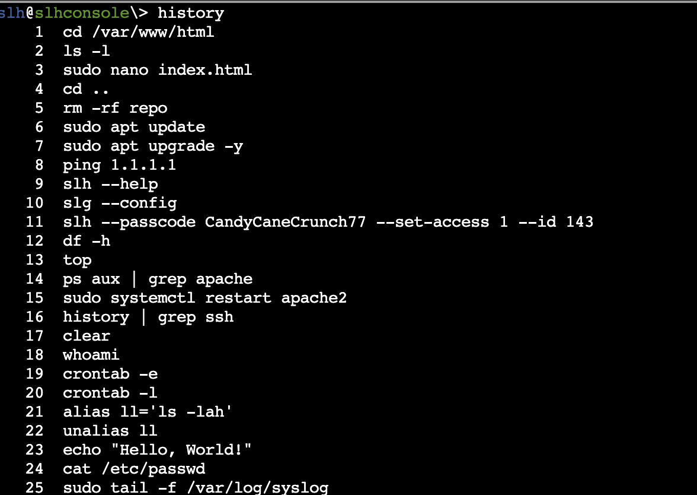
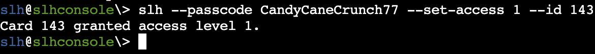
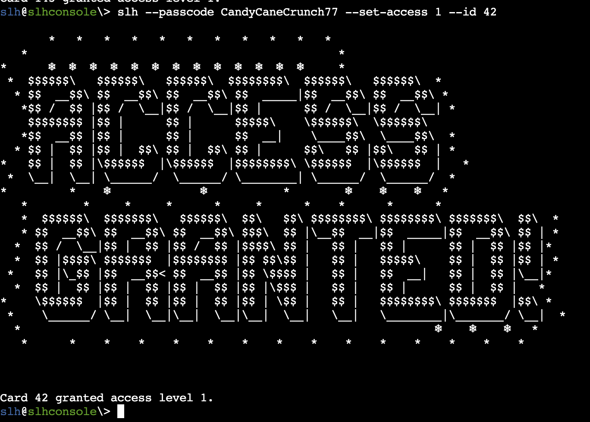

# HARDWARE Part 2

Al iniciar en la consola de SLH se identifica que el historial no está limpio, esto pasa al realizar algunas pruebas de la cli y volviendo a comandos anteriores con dar "flechita arriba”, por lo tanto se ejecuta el comando history con el siguiente resultado:

Tal como se ve, se tiene en el historial el passcode que se utilizó para conectarse a la card con id 143, por lo tanto al ejecutar el comando de la linea 11 del historial:

El acceso es correcto, sin embargo no es la tarjeta a la que se pide acceder, según Jewel Loggins se especifica que la tarjeta es la 42, por lo tanto se modifica el id al 42

Este resultado genera el Silver.

Consideraciones a futuro:

Es fundamental implementar buenas prácticas de seguridad para evitar exponer contraseñas en el historial de comandos. Una de las principales recomendaciones es **evitar incluir credenciales directamente en la línea de ejecución de la CLI**, ya que estas quedan registradas en el historial del shell, lo que puede ser fácilmente accesible por cualquier usuario con permisos en el servidor. En su lugar, se sugiere utilizar **variables de entorno** o archivos de configuración con los permisos adecuados para almacenar credenciales de forma segura. Además, es importante configurar el historial del shell (por ejemplo, `HISTIGNORE` en Bash) para que no registre comandos que contengan palabras sensibles como `password`. También se recomienda auditar periódicamente el historial y los permisos de los usuarios, implementando mecanismos como el uso de **gestores de contraseñas.**
Otra alternativa es antes de realizar una ejecución en la que no quieramos que quede en el historial es simplemente agregando un espacio antes del comando a ejecutar `  `  `echo hola`