# Elf Stack Silver

## Introducción

En este desafío, se nos entregaron varios archivos con registros o logs, los cuales debían ser analizados utilizando herramientas y comandos de la línea de comandos de Linux, como cat, grep, curl, sort y uniq, entre otros. El propósito principal era extraer información relevante de estos archivos mediante la combinación de diferentes comandos y opciones.

Los logs son registros detallados de eventos generados por sistemas, aplicaciones o servidores que almacenan información crítica, como el acceso de usuarios, URLs visitadas, códigos de respuesta, direcciones IP y fechas de los eventos.

El desafío constaba de diferentes niveles de dificultad, con preguntas que iban desde simples consultas hasta análisis más complejos de los registros. 

A continuación, se detalla cada comando utilizado para resolver las preguntas del desafío

## Desarrollo

1. cat *.log | cut -d " " -f 4 | sort | uniq  respuesta: 5
2. cat *.log | cut -d " " -f 4 | sort | uniq -c  respuesta: AuthLog
3. grep AuthLog *.log | more respesta: hostname

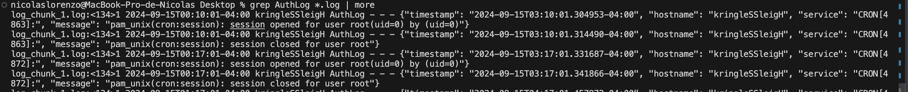

4. cat *.log | cut -d " " -f 4 | sort | uniq -c   respuesta: NetflowPmacct

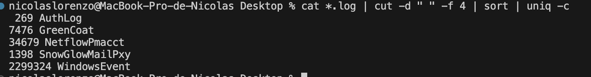

5. grep NetflowPmacct *.log | head -n 1  respuesta: port_dst

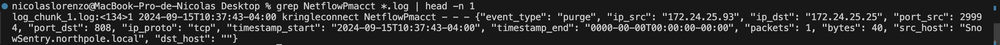

6. cat *.log | cut -d " " -f 4 | sort | uniq -c  respuesta: SnowGlowMailPxy

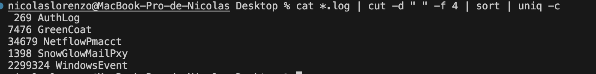

7. grep SnowGlowMailPxy *.log | head -n 1  respuesta: body

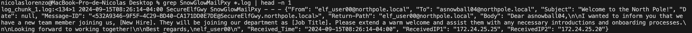

8. grep GreenCoat *.log | cut -d " " -f 3 | uniq  respuesta: SecureElfGwy

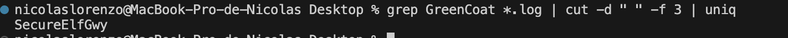

9. grep GreenCoat *.log | head -n 1     respuesta: url

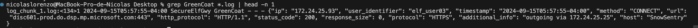

10. grep GreenCoat *.log | grep -Po 'url": "\K[^"]*' | sort | uniq -c | sort -n

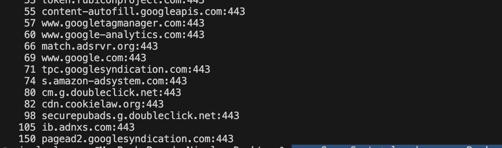

11. grep WindowsEvent *.log | ggrep -Po '"Channel": "\K[^"]*' | sort | uniq -c | sort -h  respuesta: 5

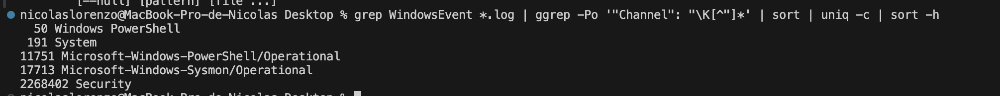

12. grep WindowsEvent *.log | ggrep -Po '"Channel": "\K[^"]*' | sort | uniq -c | sort -h   respuesta: Microsoft-Windows-Sysmon/Operational

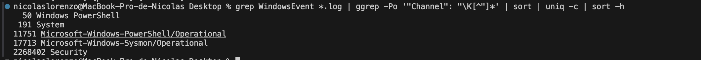

13. Respuesta: 6 

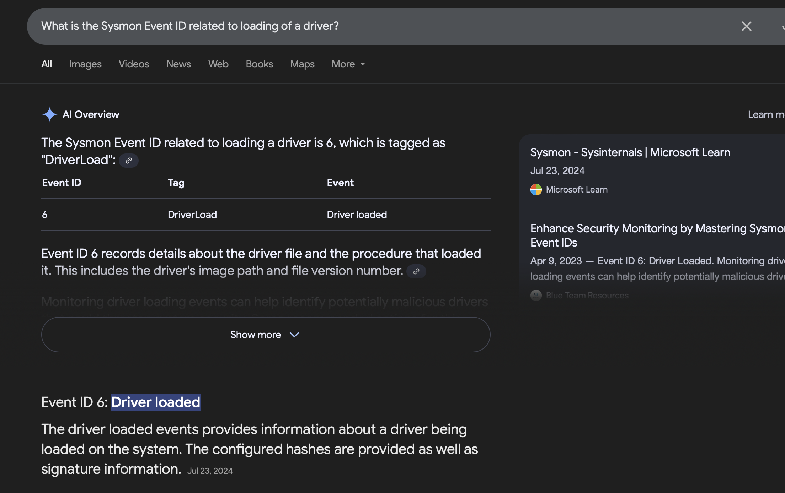

14. Respuesta: 4697

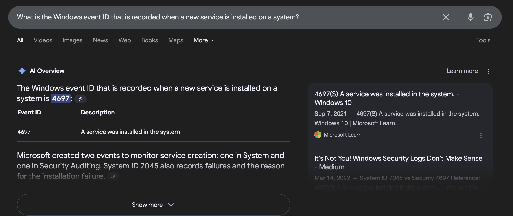

15. grep WindowsEvent *.log |  grep -o 'Subject_AccountName=[^ ]**' | sort | uniq | wc -l 

respuesta: 0

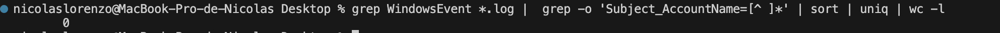

### ¿Cómo funciona cada comando?

`cat *.log`

Se utiliza para leer y concatenar, en este caso, todos los archivos .log.

`cut -d " " -f 4` 

Este comando extrae partes especificas del texto, utilizando -d como delimitador (en este caso “ ”), y la operación -f para seleccionar un campo de cada línea (en este caso el campo 4) .

`sort`

Utilizado para ordenar las líneas del texto, ya sea númericamente como alfabéticamente.

`uniq`

Elimina las líneas duplicadas de forma consecutiva, por ello, si se busca eliminar aquellas palabras que se repiten es importante antes realizar una operación de ordenamiento.

`uniq -c`

Al utilizar el parámetro `-c` se retorna las ocurrencias de cada palabra única sin duplicados consecutivos.

`grep AuthLog *.log | more` 

La operación `grep`  se utiliza con el fin  de obtener líneas que coincidan con un patrón dado (en este caso que contengan el texto `AuthLog`). La opción `more` se usa para que la salida se visualice de forma más cómoda.

`head -n 1`

La operación `head`  la utilizamos para mostrar las primeras líneas del archivo, y el uso del parámetro `-n 1` es para indicar que solo retorne la primera línea.