# Desafío: PowerShell Silver
En este desafío se requiere el uso del intérprete PowerShell. Consiste en resolver una serie de desafíos a través de la consola para evadir una suerte de defensa por parte de los elfos y ganar nuevamente acceso a las operaciones del arsenal.

## **Primer desafío**
Se solicita que leamos el contenido del archivo `welcome.txt` ubicado en el directorio actual:

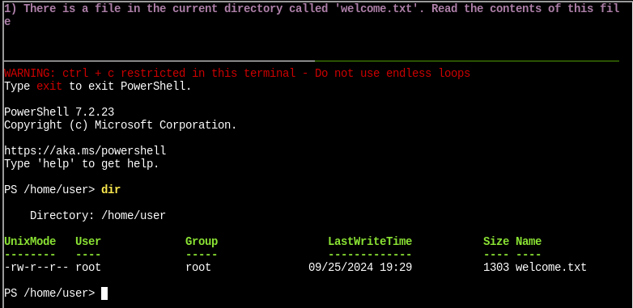

Para ello basta con utilizar el comando `Get-Content` que tiene PowerShell:

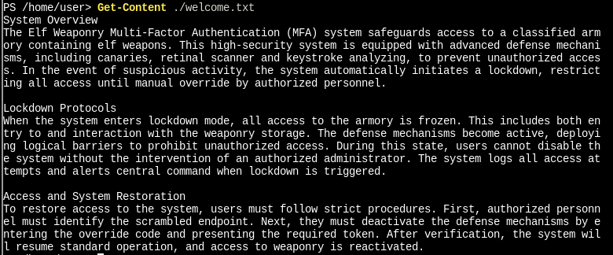

## **Segundo desafío**
Ahora debemos contar el número de palabras que existen en el archivo, entonces escribimos la ruta del archivo, utilizamos nuevamente el comando `Get-Content` y pipeamos el output a un segundo comando `Measure-Object` junto con la flag `–Word`:

```powershell
Get-Content ./welcome.txt | Measure-Object -Word
```

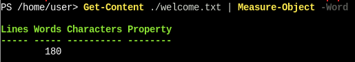

## **Tercer desafío**
Ahora nos dice que hay un servidor escuchando para nuevas conexiones, para ver todos los sockets en escucha se puede utilizar el comando `netstat` junto con 
la flag `l` o `--listening`:

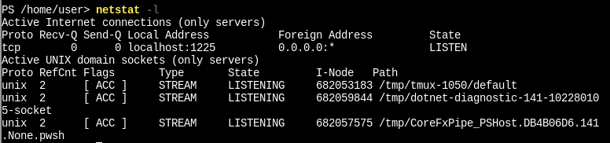

## **Cuarto desafío**
Ahora debemos comunicarnos con el servidor y ver cuál es el status code que nos devuelve. Para ello existe el comando `Invoke-WebRequest`. Es necesario indicar la URI mediante la flag `-Uri`:

```powershell
Invoke-WebRequest -Uri 127.0.0.1:1225
```

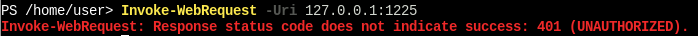

El servidor responde con status code 401.

## **Quinto desafío**
Ahora nos dice que intentemos autenticarnos con credenciales estándar de usuario administrador, es decir, *user: admin*, *password: admin*. Esto lo podemos hacer ejecutando una serie de comandos:

```powershell
$user = 'admin'
$pass = 'admin'

$pair = "$($user):$($pass)"

$encodedCreds = [System.Convert]::ToBase64String([System.Text.Encoding]::ASCII.GetBytes($pair))

$basicAuthValue = "Basic $encodedCreds"

$Headers = @{
    Authorization = $basicAuthValue
}

Invoke-WebRequest -Uri '127.0.0.1:1225' -Headers $Headers
```


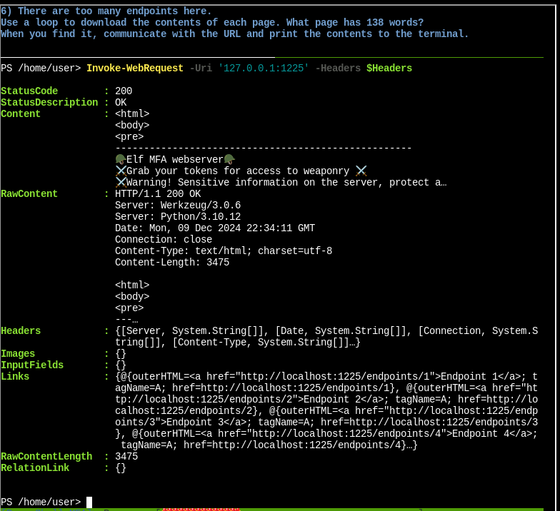


## **Sexto desafío**
Ahora es necesario que descarguemos todos los contenidos de los endpoints utilizando un loop. En la propiedad "Links" que devuelve la request se encuentran todos los endpoints. Para ver todos los links podemos expandir la propiedad pipeando el resultado a `Select-Object -ExpandProperty links`:

```powershell
Invoke-WebRequest -Uri '127.0.0.1:1225' -Headers $Headers | Select-Object -ExpandProperty links
```

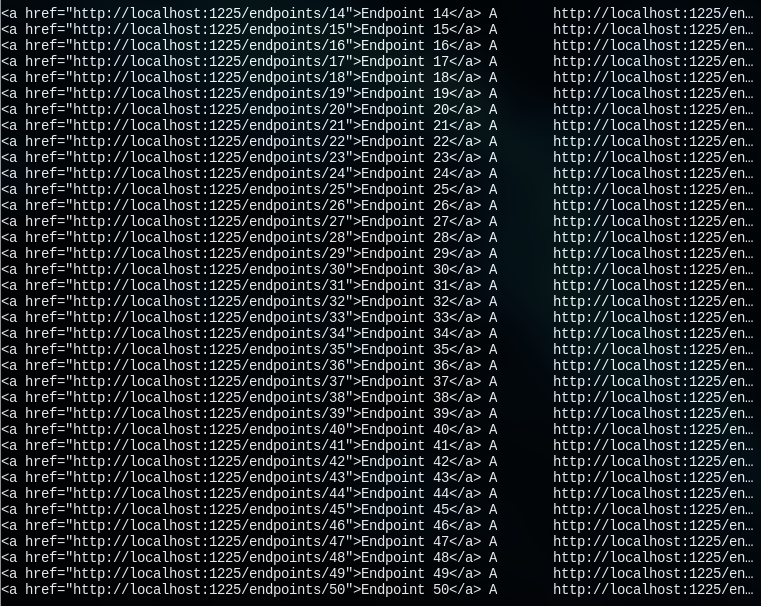

Aquí se puede ver que existen 50 endpoints, entonces podemos crear un loop para que realice 50 iteraciones, recuperando cada uno de los documentos y contando las palabras que hay en ellos:

```powershell
1..50 | ForEach-Object { Invoke-WebRequest 127.0.0.1:1225/endpoints/$_ -Headers $Headers | measure -word }
```

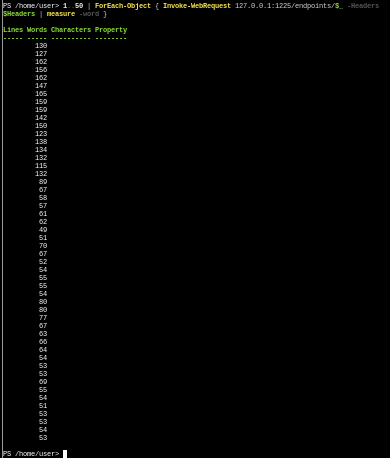

Como el contenido del output no entra en el emulador de terminal, tuve que hacer zoom out, y puede verse que el archivo con 138 palabras es el numero 13. Para obtener este archivo, puede ejecutarse los siguientes comandos:

```powershell
Invoke-WebRequest -Uri 127.0.0.1:1225/endpoints/13 -Headers $Headers -OutFile file13.txt
Get-Content file13.txt
```

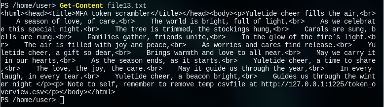


## **Séptimo desafío**
El contenido del archivo `file13.txt` revela la existencia de un archivo con extensión `.csv`. Para ver su contenido podemos aplicar los mismos comandos que la vez anterior, cambiando simplemente la URI y el nombre del archivo de salida:

```powershell
Invoke-WebRequest -Uri 127.0.0.1:1225/token_overview.csv -Headers $Headers -OutFile token_overview.csv
Get-Content token_overview.csv
```

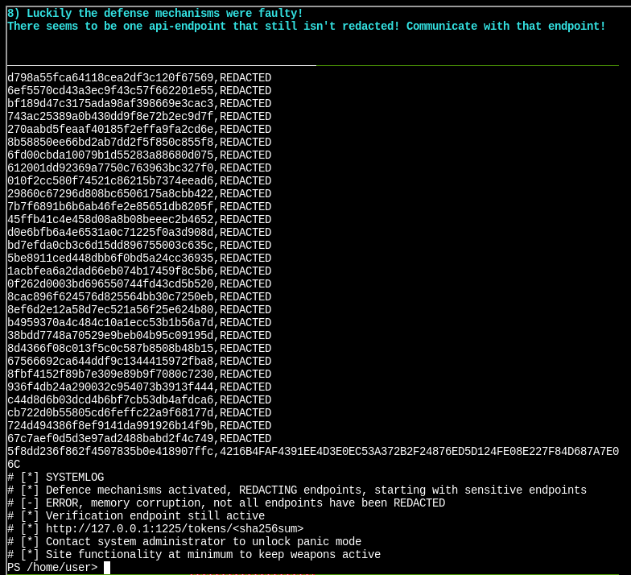


## **Octavo desafío**
Al parecer existe un endpoint que no está redactado. Basado en la respuesta del servidor, el endpoint se encuentra en `http://127.0.0.1:1225/tokens/<sha256sum>`, en donde `<sha256sum>` es un placeholder para un checksum SHA256. Aquí se puede colocar el checksum del endpoint no redactado: `4216B4FAF4391EE4D3E0EC53A372B2F24876ED5D124FE08E227F84D687A7E06C`:

```powershell
Invoke-WebRequest -Uri 127.0.0.1:1225/tokens/4216B4FAF4391EE4D3E0EC53A372B2F24876ED5D124FE08E227F84D687A7E06C -Headers $Headers 
```

Intenté colocando el mismo valor SHA256 como cookie agregándolo a la variable de entorno `headers` que antes había creado, pero no funcionó, el servidor decía que faltaba una cookie 'token', entonces coloque la nueva cookie en los headers con el valor del hash SHA256:

```powershell
$Headers = @{
    Authorization = $basicAuthValue
	Cookie='token=4216B4FAF4391EE4D3E0EC53A372B2F24876ED5D124FE08E227F84D687A7E06C'
}
```

```powershell
Invoke-WebRequest -Uri 127.0.0.1:1225/tokens/4216B4FAF4391EE4D3E0EC53A372B2F24876ED5D124FE08E227F84D687A7E06C -Headers $Headers
``` 

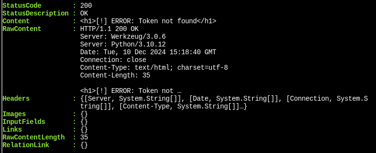

En ese momento se me ocurrió intentar con el hash MD5 correspondiente al token, modificando nuevamente la variable `headers`:

```powershell
$Headers = @{
    Authorization = $basicAuthValue
    Cookie='token=5f8dd236f862f4507835b0e418907ffc'
}
```

```powershell
Invoke-WebRequest -Uri 127.0.0.1:1225/tokens/4216B4FAF4391EE4D3E0EC53A372B2F24876ED5D124FE08E227F84D687A7E06C -Headers $Headers
``` 


## **Noveno desafío**
El servidor respondió con un código MFA e indicó que debemos establecerlo dentro del valor de la cookie `mfa_code`, en la URI `http://127.0.0.1:1225/mfa_validate/4216B4FAF4391EE4D3E0EC53A372B2F24876ED5D124FE08E227F84D687A7E06C`:

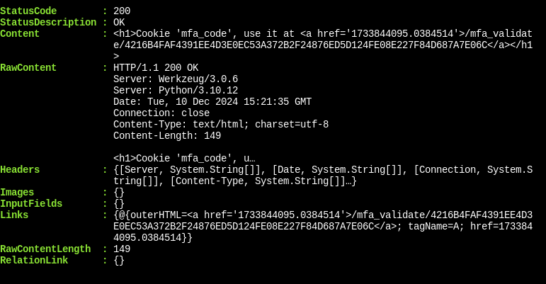

```powershell
$Headers = @{
    Authorization = $basicAuthValue
    Cookie = "token=5f8dd236f862f4507835b0e418907ffc"
    mfa_code = "1733844095.0384514"
}
```

```powershell
Invoke-WebRequest -Uri 127.0.0.1:1225/mfa_validate/4216B4FAF4391EE4D3E0EC53A372B2F24876ED5D124FE08E227F84D687A7E06C -Headers $Headers
```


## **Décimo desafío**
Ahora necesitamos validar el token en el endpoint:

```powershell
$Headers = @{
    Authorization = $basicAuthValue
    Cookie = "token=5f8dd236f862f4507835b0e418907ffc"
}

$mfa = (Invoke-WebRequest -Uri 127.0.0.1:1225/tokens/4216B4FAF4391EE4D3E0EC53A372B2F24876ED5D124FE08E227F84D687A7E06C -Headers $Headers).Links.href

$Headers = @{
    Authorization = $basicAuthValue
    Cookie = "token=5f8dd236f862f4507835b0e418907ffc; mfa_token=$mfa"
}

(Invoke-WebRequest 127.0.0.1:1225/mfa_validate/4216B4FAF4391EE4D3E0EC53A372B2F24876ED5D124FE08E227F84D687A7E06C -Headers $Headers).Content
```

El servidor responde con un **Base64**: 

```
Q29ycmVjdCBUb2tlbiBzdXBwbGllZCwgeW91IGFyZSBncmFudGVkIGFjY2VzcyB0byB0aGUgc25vdyBjYW5ub24gdGVybWluYWwuIEhlcmUgaXMgeW91ciBwZXJzb25hbCBwYXNzd29yZCBmb3IgYWNjZXNzOiBTbm93TGVvcGFyZDJSZWFkeUZvckFjdGlvbg==
```

Ahora resta decodificarlo, esto puede hacerse utilizando:

```powershell
$text = 'Q29ycmVjdCBUb2tlbiBzdXBwbGllZCwgeW91IGFyZSBncmFudGVkIGFjY2VzcyB0byB0aGUgc25vdyBjYW5ub24gdGVybWluYWwuIEhlcmUgaXMgeW91ciBwZXJzb25hbCBwYXNzd29yZCBmb3IgYWNjZXNzOiBTbm93TGVvcGFyZDJSZWFkeUZvckFjdGlvbg=='

$decoded = [System.Text.Encoding]::UTF8.GetString([System.Convert]::FromBase64String($text))

Write-Output $decoded
```

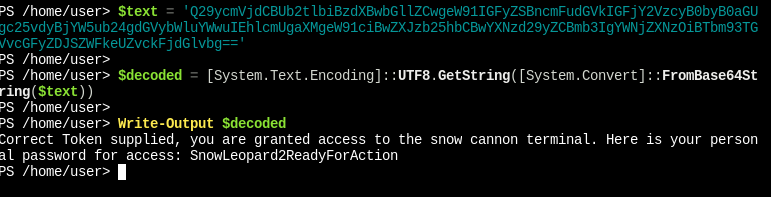

Tal y como puede verse en la imagen, el output contiene la contraseña personal "*SnowLeopard2ReadyForAction*". Aquí termina el desafío en dificultad "**Silver**".