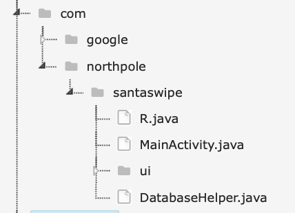
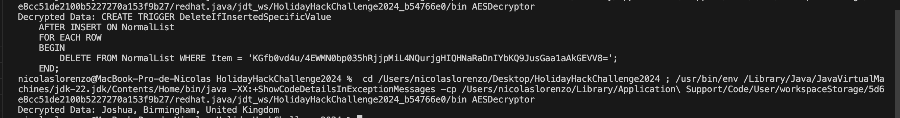

# Mobile-Analisis 2da Parte (Gold)

## Introducción 

El objetivo principal de este desafío era encontrar el nombre de la persona que faltaba en la lista de regalos, una tarea que inicialmente parecía simple pero que escondía una serie de retos técnicos y lógicos. El nombre estaba encriptado en distintos archivos proporcionados, y la única forma de descifrarlo era transformar los archivos en un formato que pudiera ser analizado de manera eficiente.

Para lograrlo, era necesario combinar múltiples habilidades técnicas, incluyendo el manejo de archivos y el uso de herramientas de análisis de código fuente. Además, se requería un entendimiento profundo de cómo extraer, filtrar y analizar información clave oculta dentro de los archivos.

## Desarrollo

Convertir SantaSwipeSecure.aab a SantaSwipeSecure.apks

```bash
java -jar bundletool-all-1.17.2.jar build-apks --bundle=SantaSwipeSecure.aab --output=SantaSwipeSecure.apks --mode=universa
```

Luego de convertirlo a .apks procedimos a descomprimirlo  logrando obtener un unico archivo .apk

A través de la herramienta mobSF analizamos el código del archivo apk e identificamos algunas clases relevantes que estaban contenidas dentro de la carpeta ”com”



La clase “MainActivity.java” contiene código que trabaja con una  base de datos SQLite usando otra clase  ”DatabaseHelper".

También contiene funciones llamadas “encryptData” y “decryptData” las cuales sirven para cifrar y descifrar un texto plano utilizando AES/GCM/NoPadding junto a una clave secreta y un vector de inicialización (IV) almacenado en la clase.


Luego de investigar y analizar el código, optamos por realizar un script en java que se encargue de descifrar cualquier texto que se le envíe utilizando los mismos parámetros que se utilizaron para cifrarlo (IV y EK).
Generamos un certificado para firmar el apk y poder ejecutarlo y luego lo firmamos con ese certificado, usando keytool y apksigner

```bash
keytool -genkey -v -keystore my-release-key.jks -keyalg RSA -keysize 2048 -validity 10000 -alias my-alias
 

apksigner sign --ks my-release-key.jks --out universal.apk universal.apk 

```

Por último usamos apktool para decompilar el apk y obtener la información que precisabamos para desencriptar el código que precisabamos usando IV y EK

```bash
apktool d -f universal-signed.apk
```

Esto nos genera una carpeta con el código decompilado y en ‘res/values/string.xml‘ encontramos IV y EK que vamos a utilizar luego para desencriptar

```bash
<string name="ek">rmDJ1wJ7ZtKy3lkLs6X9bZ2Jvpt6jL6YWiDsXtgjkXw=</string>
<string name="iv">Q2hlY2tNYXRlcml4</string>
```

```java
import java.nio.charset.StandardCharsets;
import java.util.Base64;
import javax.crypto.Cipher;
import javax.crypto.SecretKey;
import javax.crypto.spec.GCMParameterSpec;
import javax.crypto.spec.SecretKeySpec;

public class AESDecryptor {

    private static final String AES_GCM_NO_PADDING = "AES/GCM/NoPadding";
    private static final int GCM_TAG_LENGTH = 128; // Tag length in bits

    private SecretKey secretKey;
    private byte[] iv;

    // Constructor to initialize the key and IV
    public AESDecryptor(String base64Key, String base64Iv) {
        // Use Base64 standard decoder to handle characters like '+'
        this.secretKey = new SecretKeySpec(Base64.getDecoder().decode(base64Key), "AES");
        this.iv = Base64.getDecoder().decode(base64Iv);
    }

    /**
     * @param encryptedData The Base64-encoded encrypted data.
     * @return The decrypted string.
     */
    public String decrypt(String encryptedData) {
        try {
            // Initialize the cipher in decrypt mode
            Cipher cipher = Cipher.getInstance(AES_GCM_NO_PADDING);
            GCMParameterSpec gcmParameterSpec = new GCMParameterSpec(GCM_TAG_LENGTH, iv);
            cipher.init(Cipher.DECRYPT_MODE, secretKey, gcmParameterSpec);

            // Decode the encrypted data and decrypt it
            byte[] decodedEncryptedData = Base64.getDecoder().decode(encryptedData);
            byte[] decryptedBytes = cipher.doFinal(decodedEncryptedData);

            // Return the decrypted data as a string
            return new String(decryptedBytes, StandardCharsets.UTF_8);
        } catch (Exception e) {
            System.err.println("Error during decryption: " + e.getMessage());
            return null;
        }
    }

    public static void main(String[] args) {
        // Example values for the secret key and IV (Base64-encoded)
        String base64Key = "rmDJ1wJ7ZtKy3lkLs6X9bZ2Jvpt6jL6YWiDsXtgjkXw="; 
        String base64Iv = "Q2hlY2tNYXRlcml4";          

        String encryptedData = "IVrt+9Zct4oUePZeQqFwyhBix8cSCIxtsa+lJZkMNpNFBgoHeJlwp73l2oyEh1Y6AfqnfH7gcU9Yfov6u70cUA2/OwcxVt7Ubdn0UD2kImNsclEQ9M8PpnevBX3mXlW2QnH8+Q+SC7JaMUc9CIvxB2HYQG2JujQf6skpVaPAKGxfLqDj+2UyTAVLoeUlQjc18swZVtTQO7Zwe6sTCYlrw7GpFXCAuI6Ex29gfeVIeB7pK7M4kZGy3OIaFxfTdevCoTMwkoPvJuRupA6ybp36vmLLMXaAWsrDHRUbKfE6UKvGoC9d5vqmKeIO9elASuagxjBJ";
        String itemEncrypted = "KGfb0vd4u/4EWMN0bp035hRjjpMiL4NQurjgHIQHNaRaDnIYbKQ9JusGaa1aAkGEVV8=";
        
        AESDecryptor decryptor = new AESDecryptor(base64Key, base64Iv);

        // Decrypt the data
        String decryptedData = decryptor.decrypt(itemEncrypted);

        if (decryptedData != null) {
            System.out.println("Decrypted Data: " + decryptedData);
        } else {
            System.err.println("Decryption failed.");
        }
    }
}

```

Finalmente conseguimos desencriptar ambas cadenas y obtener el nombre de la persona que fue eliminada de la tabla “NormalList”.



Herramientas:
- **Kali Linux**
- **bundletool**
- **apktool**
- **MobSF**
- **keytool**
- **apksigner**
- **Java**
- **Base64 Decoder**
