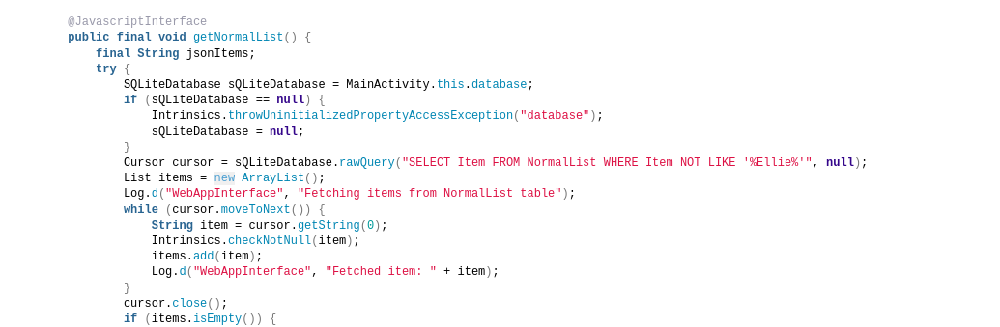

## Mobile Analysis

1era Parte (Silver)

Para obtener la medalla silver, hay que encontrar de la lista de regalos, que niño no estaba dentro de la lista que habían creado originalmente.

Instalamos Docker: [https://www.kali.org/docs/containers/installing-docker-on-kali/](https://www.kali.org/docs/containers/installing-docker-on-kali/)

Instalamos la imagen de Docker de MobSF para hacer el analisis estatico del archivo .apk: [https://github.com/MobSF/Mobile-Security-Framework-MobSF](https://github.com/MobSF/Mobile-Security-Framework-MobSF)

```bash
sudo docker pull opensecurity/mobile-security-framework-mobsf
```

Levantamos el contenedor en localhost:8000:

```bash
sudo docker run -it -p 8000:8000 opensecurity/mobile-security-framework-mobsf
```

Entramos a MobSF con las credenciales por defecto mobsf/mobsf y escaneamos el archivo SantaSwipe.apk, luego mirando el código podemos ver en com/northpole/santaswipe/MainActivity.java que filtra de la lista el Item “Ellie”, por lo que este es el niño que falta en la lista por un error en la query:


