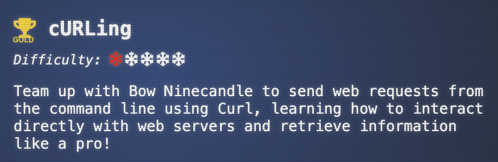
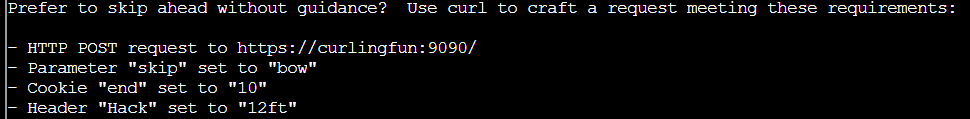
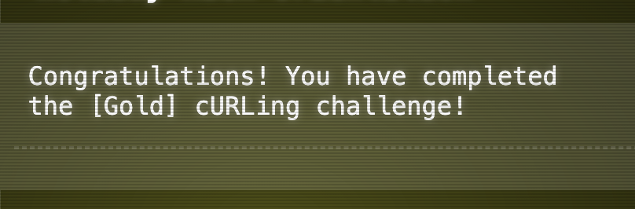

# ACT I: cURLing




- Básicamente se inició con la lectura de la documentación de cURL para recordar cómo funcionaba, cómo se pasaban los parámetros y otros detalles relacionados con las URLs en cURL.
- Inicialmente procedimos a verificar nuestra ubicación dentro de la terminal. Ejecutando el comando `ls`, se observó que había un archivo llamado `HARD-MODE.txt`.
- Al ejecutar el comando `cat` seguido del nombre del archivo `cat HARD-MODE.txt`, se abrió el documento, que indicaba realizar el desafío sin guía y proporcionaba una URL con unos parámetros para usar con cURL.



- Se ejecutó el siguiente comando con cURL:  
` curl -k -X POST  https://curlingfun:9090/ -d "skip=bow" --cookie "end=10" -H "Hack: 12ft"`

- Posteriormente nos va a pedir que accedamos a la siguiente URL: https://curlingfun:9090/../../etc/button, para lograr esto ejecutemos el comando curl en la siguiente dirección:  
`curl --insecure --path-as-is https://curlingfun:9090/../../etc/button`
- Procediendo a solicitarnos que ejecutamos a la suguiente URL: https://curlingfun:9090/GoodSportsmanship, con el comando:  
`curl -k https://curlingfun:9090/GoodSportsmanship`  
 donde obtenemos la siguiente respuesta:
```
<html>
<head><title>301 Moved Permanently</title></head>
<body>
<center><h1>301 Moved Permanently</h1></center>
<hr><center>nginx/1.18.0 (Ubuntu)</center>
</body>
</html>
```
Lo que nos da la certeza que el recurso al que queremos acceder ha sido movido, por lo que ejecutamos el comando agregando el parametro `-L` para habilitar el redireccionamiento automático al nuevo lugar: `curl -k -L https://curlingfun:9090/GoodSportsmanship` completando así el desafío y obteniendo la recompensa **GOLD**.



