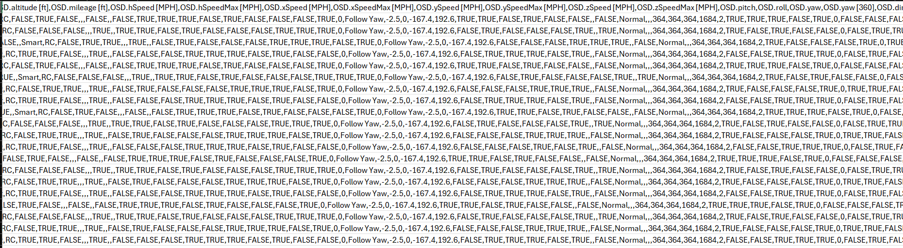
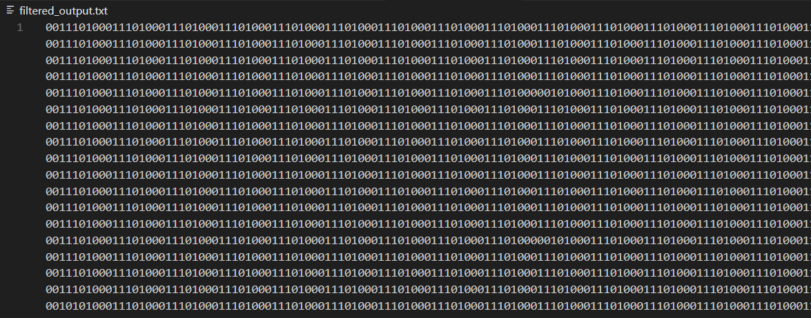
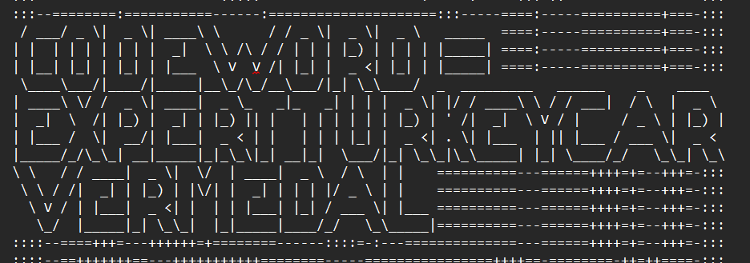

# Gold Medal Write-Up

## Análisis Inicial

La medalla **Gold** está relacionada con la pista proporcionada en los comentarios de los drones:

> "Comments for Pigeon-Lookalike-v4
> This is a great drone for surveillance, but we need to keep it out of the rain.
> I can't believe we are using pigeons for surveillance. If anyone finds out, there will most likely be a conspiracy theory about it.
> I heard a rumor that there is something fishing with some of the files. There was some talk about only TRUE carvers would find secrets and that FALSE ones would never find it."

En este comentario llaman la atención las menciones a los "archivos" y las palabras **TRUE** y **FALSE** destacadas en mayúscula. Como el ejercicio incluye dos archivos, un `.kml` y un `.csv`, se analizó en cuál de ellos aparecen estas palabras.

## Inspección del Archivo `.csv`

En el archivo `.csv`, se puede ver que hay muchos campos que tienen los valores **TRUE** y **FALSE** de forma muy recurrente. Considerando varias posibilidades, se plantea que estos valores "true" y "false" podrían representarse como **1** y **0**, lo que permitiría formar cadenas binarias que podrían esconder algún patrón o palabra clave.

Se decidió transformar los valores **TRUE** y **FALSE** a **1** y **0** y después procesarlos para buscar información oculta.



## Transformación de Datos

Para hacer la transformación, se creó un script en Python que convierte los valores **TRUE** a **1** y **FALSE** a **0**, eliminando el resto del texto en cada línea, y escribe el resultado en un archivo `.txt`. El script utilizado es el siguiente:

```python
import csv

input_file = "ELF-HAWK-dump.csv"
output_file = "filtered_output.txt"

infile = open(input_file, mode="r", newline='', encoding="utf-8")
outfile = open(output_file, mode="w", encoding="utf-8")

try:
    reader = csv.reader(infile)
    binary_string = ""
    for row in reader:
        # Verificar si la fila contiene al menos un "TRUE"
        if "TRUE" in [cell.upper() for cell in row]:
            # Convertir TRUE a 1 y FALSE a 0 en cada fila y concatenar a la cadena binaria
            for cell in row:
                if cell.upper() == "TRUE":
                    binary_string += "1"
                elif cell.upper() == "FALSE":
                    binary_string += "0"
    # Escribir la cadena binaria en el archivo de salida
    outfile.write(binary_string)

finally:
    infile.close()
    outfile.close()

print("Cadena binaria:", binary_string)
```

### Funcionalidad del Script
1. Lee todas las líneas del archivo `.csv`.
2. Convierte los valores **TRUE** a **1** y **FALSE** a **0**.
3. Genera un archivo `filtered_output.txt` que contiene únicamente la cadena binaria resultante.



## Traducción del Binario

El archivo generado contiene una cadena binaria larga. Para verificar si esta cadena contiene información que se pueda usar, se utilizó un traductor de binario a texto. La herramienta que se usó fue: [PrepostSEO Binary Translator](https://www.prepostseo.com/tool/binary-translator).

### Resultados

Al traducir el binario, el archivo resultante contenía varios símbolos al inicio y, más abajo, aparecieron palabras clave:

```
CODEWORD - EXPERTTURKEYCARVERMEDAL
```




### Conclusión

La palabra clave oculta era **ExpertTurkeyCarverMedal**, que corresponde a la solución del ejercicio y permitió completar el desafío con éxito.
