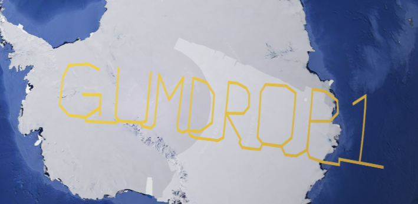
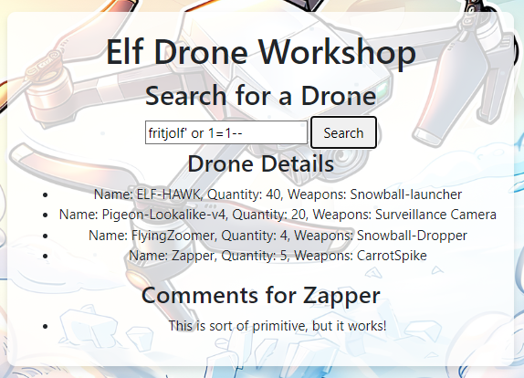

# Drone Path | Gold Medal

## Introducción

Este ejercicio consiste en explorar una página web relacionada con drones. El objetivo es descubrir información sensible y obtener una clave de despegue de uno de los drones. Para obtener la medalla **Gold**, no es necesario haber obtenido previamente la medalla **Silver**; aunque los primeros pasos son los mismos que los que se realizan en dicha parte.

## Paso 1: Intento de acceso con credenciales por defecto

En la página de **Login**, intentamos acceder con las credenciales por defecto:

```
Usuario: admin
Contraseña: admin
```

Sin embargo, esto no funciona. Como lo que tenemos son _inputs_ de usuario y contraseña para hacer el login, intentamos hacer una **inyección SQL** en el campo de usuario:

```
Usuario: admin' or 1=1 --
```


### Resultado

Accedemos exitosamente como administrador. Somos redirigidos a una página de búsqueda con un nuevo campo de _input_, una barra de búsqueda.

---

## Paso 2: Exploración de la página FileShare

En la sección **FileShare**, descargamos un archivo llamado `fritjolf-Path.kml`. Investigamos su formato y descubrimos que es un archivo de **Keyhole Markup Language (KML)**, utilizado para compartir datos en Google Earth ([documentación oficial](https://support.google.com/earth/answer/7365595?hl=es-419&co=GENIE.Platform%3DDesktop)).

Al cargar este archivo en Google Earth, vemos que se cargan unas coordenadas que forman una palabra al conectarlas.



---

## Paso 3: Inyección SQL en el buscador

En la página de búsqueda, ingresamos valores simples como `gumdrop1` y `fritjolf`, que eran valores ya conocidos (nombre del archivo KML y la palabra formada en el mapa), pero no obtenemos resultados. Al ser un campo de entrada, probamos otra **inyección SQL**:

```
test' or 1=1 --
```


### Resultado

La inyección devuelve una lista de drones disponibles. Cada dron incluye comentarios adicionales.

---

## Paso 4: Análisis de los comentarios

Como se tienen todos los nombres de los drones, insertamos cada uno en la barra de búsqueda y leemos los comentarios en busca de detalles que puedan guiarnos a obtener los códigos de despegue.

La medalla **Gold** está relacionada con la pista proporcionada en los comentarios del dron ** Pigeon-Lookalike-v4**, que aparecerán al ingresar el nombre en la barra de búsqueda:

> "Comments for Pigeon-Lookalike-v4
> This is a great drone for surveillance, but we need to keep it out of the rain.
> I can't believe we are using pigeons for surveillance. If anyone finds out, there will most likely be a conspiracy theory about it.
> I heard a rumor that there is something fishing with some of the files. There was some talk about only TRUE carvers would find secrets and that FALSE ones would never find it."

En este comentario llaman la atención las menciones a los "archivos" y las palabras **TRUE** y **FALSE** destacadas en mayúscula. Como el ejercicio incluye dos archivos, un `.kml` y un `.csv`, se analizó en cuál de ellos aparecen estas palabras.

## Paso 5: Inspección del Archivo `.csv`

En el archivo `.csv`, se puede ver que hay muchos campos que tienen los valores **TRUE** y **FALSE** de forma muy recurrente. Considerando varias posibilidades, se plantea que estos valores "true" y "false" podrían representarse como **1** y **0**, lo que permitiría formar cadenas binarias que podrían esconder algún patrón o palabra clave.

Se decidió transformar los valores **TRUE** y **FALSE** a **1** y **0** y después procesarlos para buscar información oculta.


## Paso 6: Transformación de Datos

Para hacer la transformación, se creó un script en Python que convierte los valores **TRUE** a **1** y **FALSE** a **0**, eliminando el resto del texto en cada línea, y escribe el resultado en un archivo `.txt`. El script utilizado es el siguiente:

```python
import csv

input_file = "ELF-HAWK-dump.csv"
output_file = "filtered_output.txt"

infile = open(input_file, mode="r", newline='', encoding="utf-8")
outfile = open(output_file, mode="w", encoding="utf-8")

try:
    reader = csv.reader(infile)
    binary_string = ""
    for row in reader:
        # Verificar si la fila contiene al menos un "TRUE"
        if "TRUE" in [cell.upper() for cell in row]:
            # Convertir TRUE a 1 y FALSE a 0 en cada fila y concatenar a la cadena binaria
            for cell in row:
                if cell.upper() == "TRUE":
                    binary_string += "1"
                elif cell.upper() == "FALSE":
                    binary_string += "0"
    # Escribir la cadena binaria en el archivo de salida
    outfile.write(binary_string)

finally:
    infile.close()
    outfile.close()

print("Cadena binaria:", binary_string)
```

### Funcionalidad del Script
1. Lee todas las líneas del archivo `.csv`.
2. Convierte los valores **TRUE** a **1** y **FALSE** a **0**.
3. Genera un archivo `filtered_output.txt` que contiene únicamente la cadena binaria resultante.


## Paso 7: Traducción del Binario

El archivo generado contiene una cadena binaria larga. Para verificar si esta cadena contiene información que se pueda usar, se utilizó un traductor de binario a texto. La herramienta que se usó fue: [PrepostSEO Binary Translator](https://www.prepostseo.com/tool/binary-translator).

### Resultados

Al traducir el binario, el archivo resultante contenía varios símbolos al inicio y, más abajo, aparecieron palabras clave:

```
CODEWORD - EXPERTTURKEYCARVERMEDAL
```


### Conclusión

La palabra clave oculta era **ExpertTurkeyCarverMedal**, que corresponde a la solución del ejercicio y permitió completar el desafío con éxito.
