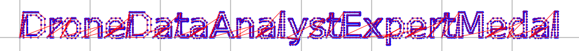

# Drone Path | Silver Medal

## Introducción

El ejercicio consiste en explorar una página web relacionada con drones. El objetivo es descubrir información sensible y obtener una clave de despegue de uno de los drones.

---

## Paso 1: Intento de acceso con credenciales por defecto

En la página de **Login**, intentamos acceder con las credenciales por defecto:

```
Usuario: admin
Contraseña: admin
```

Sin embargo, esto no funciona. Como lo que tenemos son _inputs_ de usuario y contraseña para hacer el login, intentamos hacer una **inyección SQL** en el campo de usuario:

```
Usuario: admin' or 1=1 --
```


### Resultado

Accedemos exitosamente como administrador. Somos redirigidos a una página de búsqueda con un nuevo campo de _input_, una barra de búsqueda.

---

## Paso 2: Exploración de la página FileShare

En la sección **FileShare**, descargamos un archivo llamado `fritjolf-Path.kml`. Investigamos su formato y descubrimos que es un archivo de **Keyhole Markup Language (KML)**, utilizado para compartir datos en Google Earth ([documentación oficial](https://support.google.com/earth/answer/7365595?hl=es-419&co=GENIE.Platform%3DDesktop)).

Al cargar este archivo en Google Earth, vemos que se cargan unas coordenadas que forman una palabra al conectarlas.


---

## Paso 3: Inyección SQL en el buscador

En la página de búsqueda, ingresamos valores simples como `gumdrop1` y `fritjolf`, que eran valores ya conocidos (nombre del archivo KML y la palabra formada en el mapa), pero no obtenemos resultados. Al ser un campo de entrada, probamos otra **inyección SQL**:

```
test' or 1=1 --
```


### Resultado

La inyección devuelve una lista de drones disponibles. Cada dron incluye comentarios adicionales.

---

## Paso 4: Análisis de los comentarios

Como se tienen todos los nombres de los drones, insertamos cada uno en la barra de búsqueda y leemos los comentarios en busca de detalles que puedan guiarnos a obtener los códigos de despegue.

### Comentario del dron **Pigeon-Lookalike-v4**

```
Comments for Pigeon-Lookalike-v4:
This is a great drone for surveillance, but we need to keep it out of the rain.
I can’t believe we are using pigeons for surveillance. If anyone finds out, there will most likely be a conspiracy theory about it.
I heard a rumor that there is something fishing with some of the files. There was some talk about only TRUE carvers would find secrets and that FALSE ones would never find it.
```

Los comentarios sugieren la posibilidad de encontrar archivos ocultos si inspeccionamos los datos correctamente. Vemos que se destacan las palabras _FALSE_ y _TRUE_ en mayúscula.

### Comentario del dron **ELF-HAWK**

```
Comments for ELF-HAWK:
These drones will work great to find Alabasters snowball warehouses. I have hid the activation code in the dataset ELF-HAWK-dump.csv. We need to keep it safe, for now it's under /files/secret.
We need to make sure we have enough of these drones ready for the upcoming operation. Well done on hiding the activation code in the dataset. If anyone finds it, it will take them a LONG time or forever to carve the data out, preferably the LATTER.
```

El archivo `ELF-HAWK-dump.csv`, ubicado en `/files/secret`, contiene la clave de activación. Descargamos este dataset para analizarlo.

Vemos además que se destaca la palabra LATTER en mayúscula.

---

## Paso 5: Análisis del archivo CSV

El archivo `.csv` tiene varias columnas, incluidas coordenadas de latitud y longitud. Intentamos relacionar estas coordenadas con el archivo KML previamente analizado. El .kml tiene coordenadas, que relacionamos con latitud y longitud, igual que en el `.csv`. Observamos que las unidades de medida no coinciden, lo que requiere conversión.

Probamos buscar una coordenada específica del archivo KML en el CSV utilizando el siguiente script:

### Script para buscar valores específicos en el CSV

```python
import csv

def buscar_valor_csv(ruta_csv, columna, valor_buscar):
    try:
        with open(ruta_csv, mode='r', encoding='utf-8') as archivo:
            lector_csv = csv.DictReader(archivo)
            resultados = []
            
            for linea, fila in enumerate(lector_csv, start=1):
                if fila[columna] == valor_buscar:
                    resultados.append((linea, fila))
            
            if resultados:
                print(f"Se encontró el valor '{valor_buscar}' en las siguientes filas:")
                for resultado in resultados:
                    print(f"Fila: {resultado[0]}, Datos: {resultado[1]}")
            else:
                print(f"No se encontró el valor '{valor_buscar}' en la columna '{columna}'.")
    except Exception as e:
        print(f"Ocurrió un error: {e}")

ruta_csv = "ELF-HAWK-dump.csv"
columna = "OSD.longitude"
valor_buscar = "77.263184"
buscar_valor_csv(ruta_csv, columna, valor_buscar)
```

El script no devolvió resultados útiles por las diferencias de unidades. Decidimos convertir todas las coordenadas del CSV al formato KML porque se asimila al contenido del archivo previamente analizado de KML, para ver si hay algun código escondido al igual que 'gumdrop1'.

---

## Paso 6: Conversión a formato KML

Usamos un script para convertir las coordenadas del CSV en un archivo KML:

```python
import csv
from xml.etree.ElementTree import Element, SubElement, tostring, ElementTree

def generar_kml(csv_file, kml_file, lat_col, lon_col):
    kml = Element('kml', xmlns="http://www.opengis.net/kml/2.2")
    document = SubElement(kml, 'Document')
    name = SubElement(document, 'name')
    name.text = 'Ruta Generada desde CSV'

    placemark = SubElement(document, 'Placemark')
    placemark_name = SubElement(placemark, 'name')
    placemark_name.text = 'Ruta'

    line_string = SubElement(placemark, 'LineString')
    coordinates = SubElement(line_string, 'coordinates')

    coords = []
    with open(csv_file, 'r') as file:
        reader = csv.DictReader(file)
        for row in reader:
            try:
                lat = float(row[lat_col])
                lon = float(row[lon_col])
                coords.append(f"{lon},{lat},0")
            except ValueError:
                continue

    coordinates.text = " ".join(coords)

    tree = ElementTree(kml)
    with open(kml_file, 'wb') as kml_output:
        tree.write(kml_output, encoding='utf-8', xml_declaration=True)

csv_path = "ELF-HAWK-dump.csv"
kml_path = "prueba.kml"
latitude_column = "OSD.latitude"
longitude_column = "OSD.longitude"
generar_kml(csv_path, kml_path, latitude_column, longitude_column)
print(f"KML generado correctamente en {kml_path}")
```

### Resultado

Las coordenadas no se pueden ver bien en Google Earth ya que muestran algo que no se entiende. Pero podemos ver patrones en la forma, por lo que las coordenadas tienen que ser visualizadas de otra manera. 

En lugar de en forma de esfera, se plantea visualizarlas en forma de plano, por lo que se pasan las coordenadas a un plano (x, y).

---

## Paso 7: Visualización 2D con Matplotlib

Para graficar las coordenadas en un plano 2D, generamos el siguiente código:

```python
import csv
import matplotlib.pyplot as plt

def graph(csv_file, lat_col, lon_col):
    x_coords = []
    y_coords = []
    with open(csv_file, 'r') as file:
        reader = csv.DictReader(file)
        for row in reader:
            try:
                x_coords.append(float(row[lon_col]))
                y_coords.append(float(row[lat_col]))
            except ValueError:
                continue

    plt.figure(figsize=(10, 10))
    plt.scatter(x_coords, y_coords, s=1, color="blue", label="Puntos")
    plt.plot(x_coords, y_coords, color="red", linewidth=0.5, label="Ruta")
    plt.xlabel("Coordenada X (e.g., OSD.longitude)")
    plt.ylabel("Coordenada Y (e.g., OSD.latitude)")
    plt.title("Ruta visualizada en 2D")
    plt.legend()
    plt.grid(True)
    plt.axis("equal")
    plt.show()

csv_path = "ELF-HAWK-dump.csv"
latitude_column = "OSD.latitude"
longitude_column = "OSD.longitude"
graph(csv_path, latitude_column, longitude_column)
```

Lo que genera el gráfico:




### Resultado

El gráfico generado contiene un texto oculto: **DroneDataAnalystExpertMedal**.

---

## Conclusión

El texto encontrado, **DroneDataAnalystExpertMedal**, es la clave de activación del dron. Este resultado permite completar la medalla SILVER del ejercicio.
