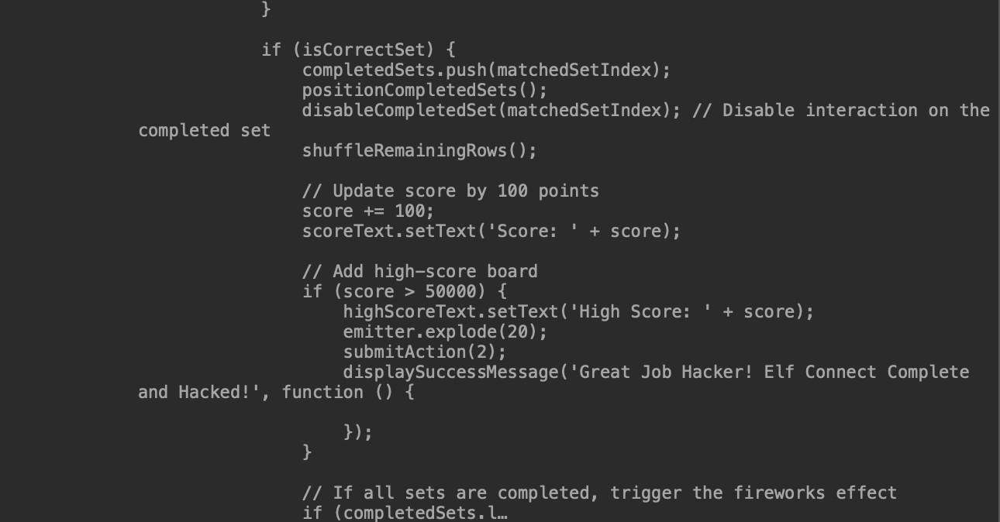

# Elf connect | Gold

El objetivo del juego es hacer coincidir grupos de cuatro palabras con categorías para ganar cuatro rondas.

### Enfoque inicial

Comenzamos resolviendo este desafío jugando, lo cual resultó ser bastante complicado porque debíamos acumular muchos puntos para progresar. Luego de varias partidas fallidas, decidimos inspeccionar el código JavaScript del juego utilizando las herramientas de desarrollo del navegador.

### Modificación de puntajes

Al analizar el código, identificamos el fragmento responsable de asignar los puntos obtenidos en cada partida. Esto nos permitió modificar directamente el puntaje para aumentar drásticamente el resultado por cada partida. 

La variable "score" es la encargada de asignar el puntaje del jugador y chequea que el score no sea mayor a 50000. Por ende, nuestro primer paso fue colocar un valor mayor al limite.

De esta forma, conseguimos ganar el juego completo jugando una sola vez.
