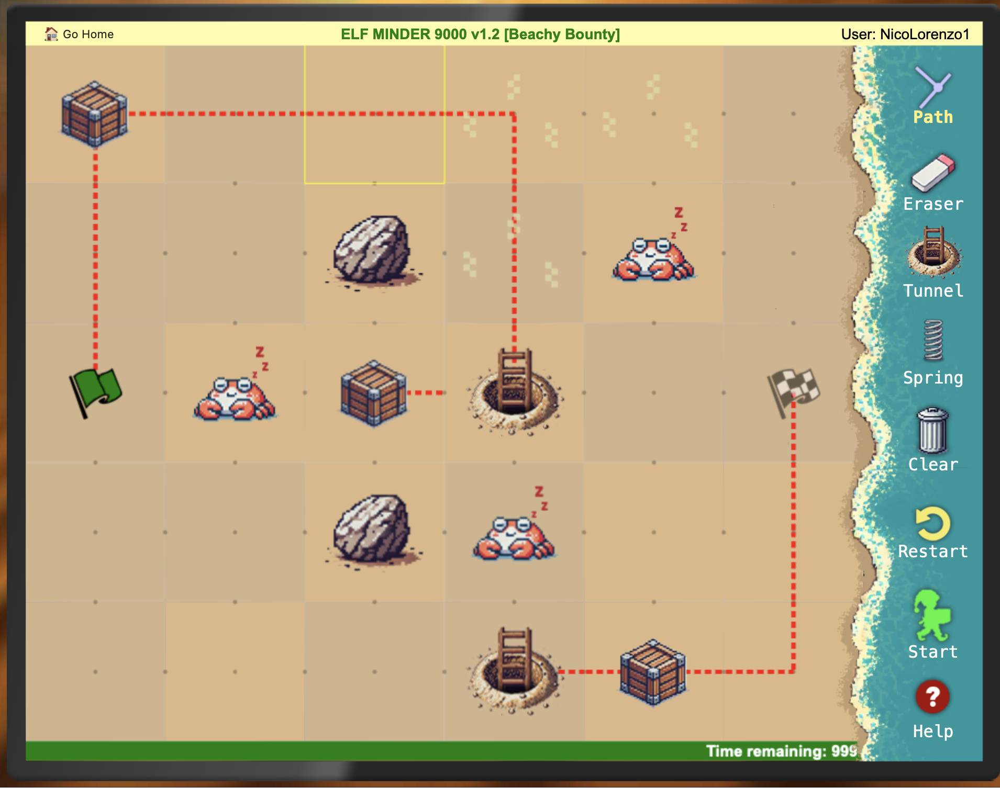

### Introducción al Desafío
Este desafío planteó un juego de múltiples niveles con un aumento progresivo en su dificultad. La meta principal era guiar al elfo desde el punto de inicio (bandera verde) hasta la meta (bandera a cuadros) mientras superábamos obstáculos y optimizábamos rutas en un entorno dinámico y cronometrado. La estrategia jugó un papel esencial para obtener la medalla "silver" sin modificar el código del juego.

### Exploración Inicial
Desde el comienzo, se hicieron varias partidas de prueba para familiarizarnos con las dinámicas del juego y los elementos interactivos disponibles. Durante esta etapa descubrimos los siguientes recursos clave del mapa que resultaron fundamentales para superar niveles:

Resortes: Permiten al elfo saltar sobre obstáculos como cajas o rocas, habilitando rutas que no serían accesibles de otra forma.

Túneles: Funcionan como portales que transportan al elfo de un punto del mapa a otro, reduciendo considerablemente el tiempo y la distancia necesaria para llegar a la meta.

Caminos dinámicos: El jugador puede ajustar los caminos en tiempo real durante la ejecución del juego, lo que habilita estrategias basadas en la improvisación.

Los desafíos mas complejos que encontramos en este juego fueron:

Tiempo limitado: Cada nivel estaba cronometrado, lo que nos obligaba a diseñar rutas óptimas para garantizar que el elfo llegara a la meta antes de que se agotara el tiempo.

Complejidad del mapa: Los niveles avanzados introducían más obstáculos (cajas, rocas, cangrejos) y requerían un uso estratégico de los objetos como túneles y resortes.

Estrategias dinámicas: Dado que el camino podía modificarse mientras el juego estaba en ejecución, debíamos prever movimientos rápidos y precisos para redirigir al elfo hacia rutas más eficientes.

### Resolución del Desafío
Optamos por resolver todos los niveles manualmente, diseñando rutas estratégicas y utilizando los elementos del mapa de manera eficiente. Esto nos permitió obtener la medalla "silver", priorizando la experiencia de resolver cada nivel sin modificar el código del juego.

#### Planificación 
Antes de iniciar el nivel, analizábamos los obstáculos y planificábamos una ruta tentativa que maximizara el uso de túneles y resortes.
Ejecución Dinámica: Durante el juego, ajustábamos el camino en tiempo real para redirigir al elfo según las necesidades del nivel. Esto fue especialmente útil en niveles avanzados donde el tiempo era un factor crítico.
Los túneles nos permitieron esquivar grandes áreas llenas de obstáculos, mientras que los resortes ayudaron a saltar sobre elementos como rocas y cajas.

En la imagen se puede observar uno de los últimos niveles del juego, el cual de no ser por los tuneles y los movimientos dinamicos de los caminos mientras el juego esta en ejecucion no seria posible pasar el nivel con éxito.

### Conclusión
Este desafío no solo puso a prueba nuestras habilidades de resolución de problemas y pensamiento estratégico, sino que también resaltó la importancia de adaptarnos a un entorno dinámico. El uso de los elementos interactivos del mapa, combinado con decisiones en tiempo real, fue crucial para superar cada nivel.

La experiencia fue enriquecedora y demostró que, con planificación y ejecución precisa, es posible superar incluso los niveles más complicados sin recurrir a modificaciones externas del juego.

