# Santa Vision Part B | Silver Medal

## Introducción

En esta segunda parte debemos hallar los datos necesarios para volver a autenticarnos, sin hacer uso de las cuentas de Wombley y Alabaster, para ver las feeds del Northpole en los monitores.

---

## Paso 1: Obtener usuario y contraseña

Al ingresar a la página vemos 2 botones en la parte inferior de la misma, que nos dan 2 listados, uno de clientes y otro de roles. Clickeamos primero el de clientes:

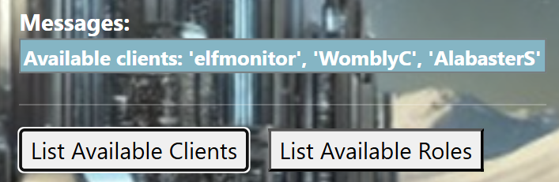

Observamos que el único cliente que no es Alabaster ni Wombley es el elfmonitor, así que nos guardamos este nombre para usar como username.

Ahora abrimos el listado de roles:

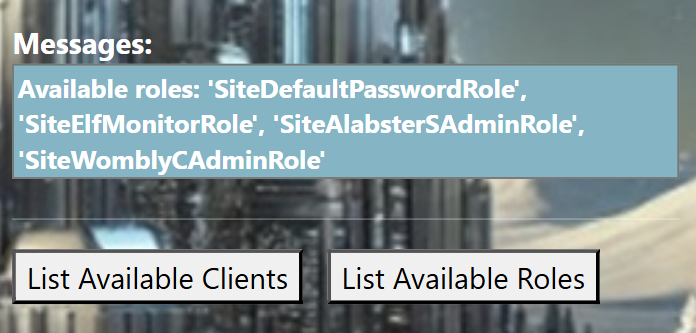

Nos aparecen múltiples roles, varios de ellos con los nombres de los clientes en el mismo.

Inicialmente no se veía ningún input de role en el sitio web, por lo cual se pensó que esta información sería necesaria en un futuro, pero luego de probar múltiples otras formas, entre la inspección de la página por contraseñas hardcodeadas, o comentarios que dieran con la contraseña, y la exportación de los datos Exif de tanto la imagen del Santa Vision Portal en el logging, como la imagen de Santa en la página previo al GateXOR, se decidió probar a añadir el rol como la contraseña.

### Resultado

Como el usuario a usar es elfmonitor, se tomó como contraseña el SiteElfMonitorRole:

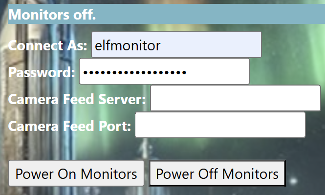

---

## Paso 2: Obtener el servidor y puerto de la cámara feed

Al inspeccionar la página en la búsqueda de contraseñas hardcodeadas se llegó al siguiente script en la tab de sources, que contiene la mayoría de la lógica legible de la página, para el logueo y conexión:

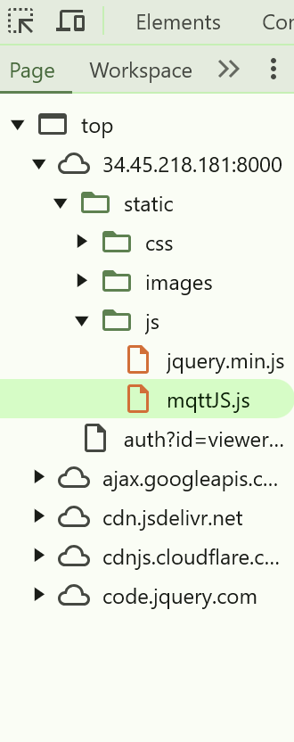

En la línea 126 se encontró la función MQTTconnect, que posee la lógica de conexión, y es el que toma los inputs que ingresamos de usuario, contraseña, camara feed (host) y camara port:

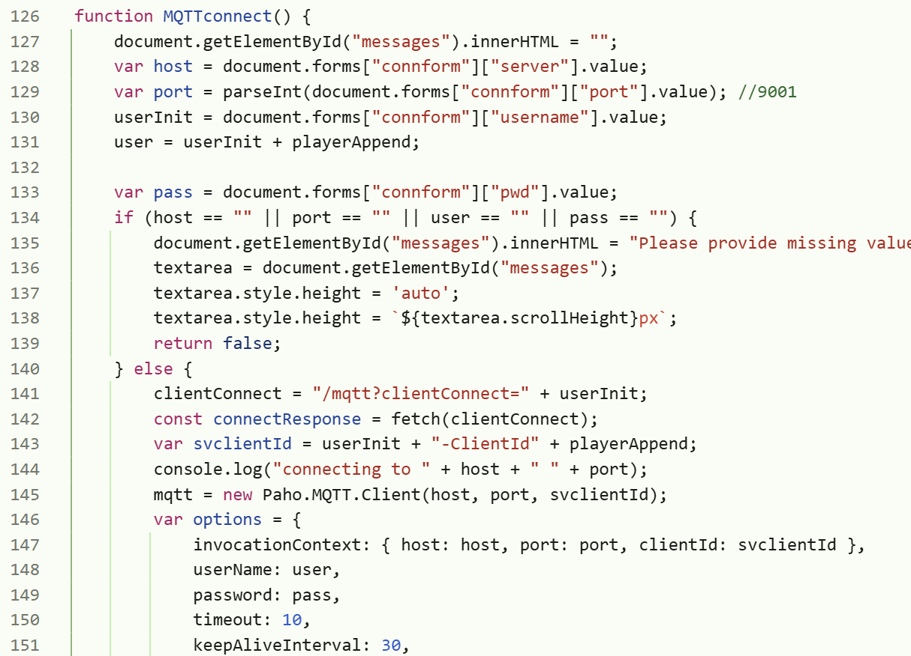

Al ver la función de este método se encontró un comentario al costado de la variable port, que se usa para realizar la conexión con el servidor. Consideramos que es muy probable que sea el puerto que se debe indicar en los inputs:

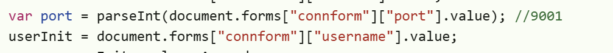

Con esto solo nos faltaría indicar el servidor, para ello volvemos al nmap y revisamos los services, encontrando que el puerto 9001 está escuchando en el host. Esto nos hace pensar que puede ser la misma IP:

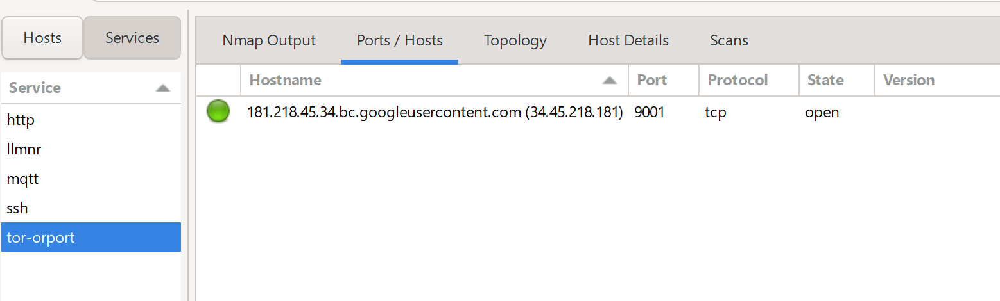

Ingresamos los inputs faltantes:

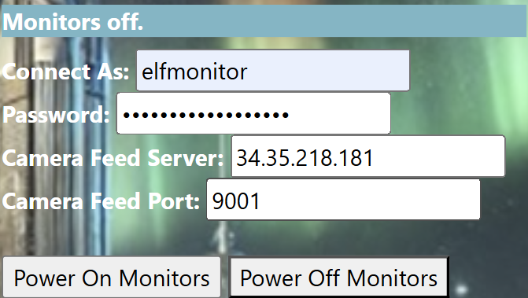

Clickeamos en el botón de Power On.

### Resultado

Prendimos los monitores.

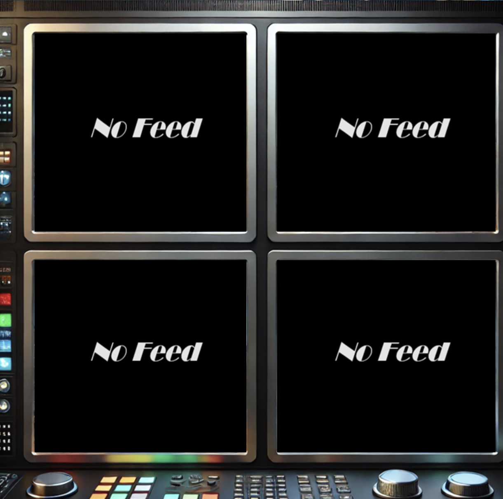

---

## Paso 3: Ver la feed de NorthpoleFeeds

Por último, ingresamos en el input de Broadcast feed el northpolefeeds para observarla en los monitores:

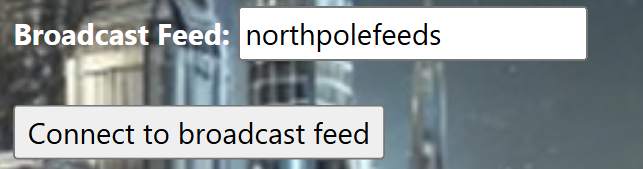

Clickeamos en Connect to broadcast feed.

### Resultado

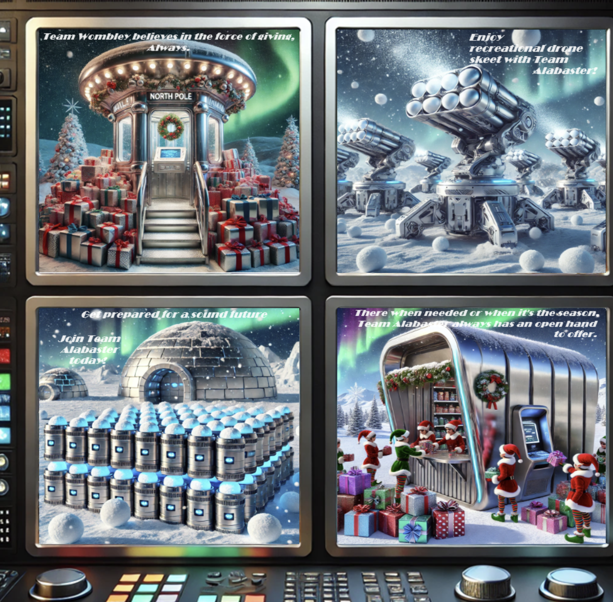

Se obtienen imágenes que van cambiando en los monitores.

---

## Conclusión

Se pudo ver la propaganda que está siendo esparcida por Wombley y Alabaster en el NorthpoleFeeds, usando el usuario elfmonitor.

Hacemos submit del usuario en los objectives:

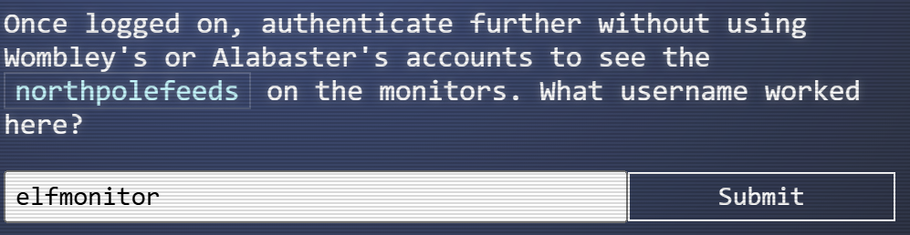

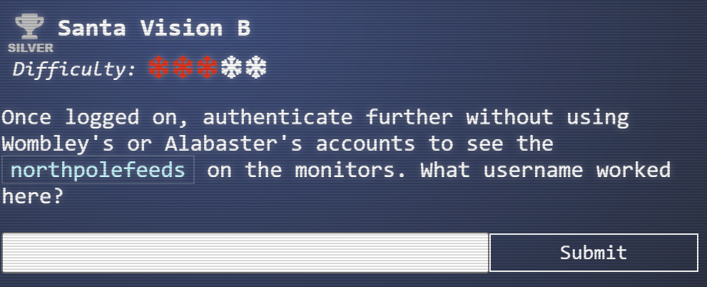
