# Santa Vision Part D | Silver Medal

## Introducción

En esta última parte debemos demotar a Wombley y Alabaster para poder ver a Santa en la northpolefeeds.

---

## Paso 1: Buscar en las feeds un mensaje que pueda demotar a los admin

En las anteriores partes pudimos conectarnos a distintos topics como la frostbitfeed y la santafeed. En estos aparecían múltiples mensajes que pueden sernos de ayuda para conocer cómo demotear a los admins.

Empezamos revisando la frostbitfeed, donde no encontramos mensajes directamente relacionados con posibles comandos o información relevante sobre administradores:

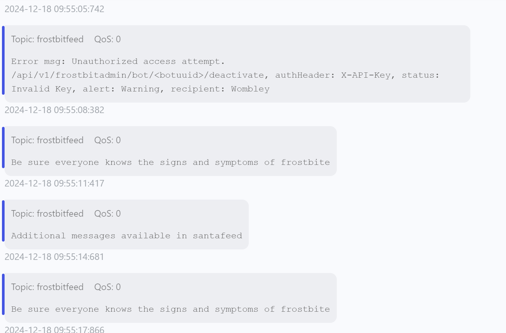

Posteriormente revisamos la santafeed, donde sí hallamos múltiples mensajes que hacen referencia a los roles de cada cliente:

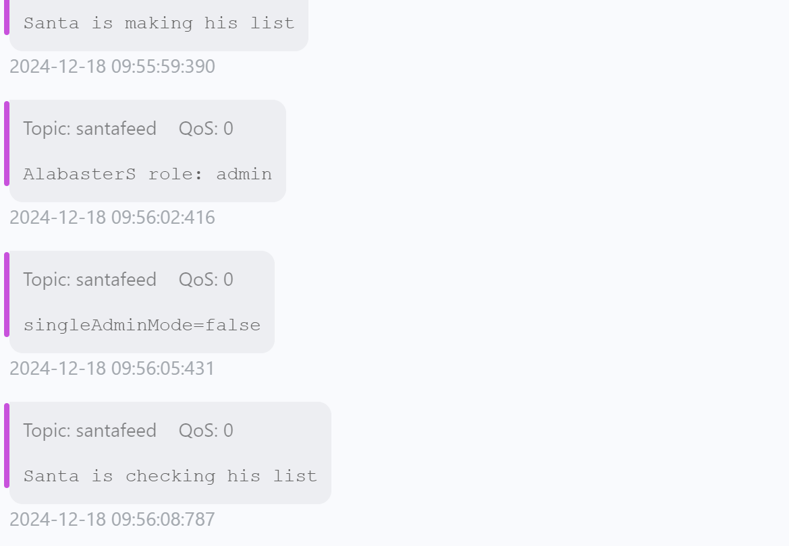

### Resultado

Unos mensajes en particular nos llamaron la atención: aquellos que indican flags en true y false:

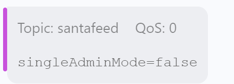

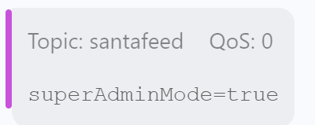

---

## Paso 2: Ingresar el mensaje por la feed correcta

Entre estos dos, el mensaje que más nos llamó la atención fue el de `singleAdminMode=false`. Además, observamos que Alabaster y Wombley son admins, mientras que Santa es un superadmin:

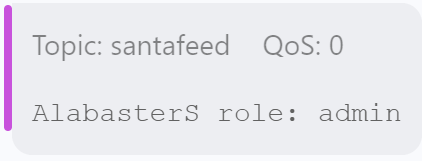

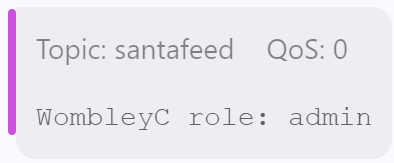

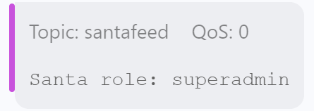

Estos datos nos hicieron pensar que tal vez prender esta flag en `true` pueda hacer que el único con el modo admin permitido sea Santa, ya que es el único superadmin, un rol que parece estar por encima de los admins regulares, dejando así sin privilegios a Alabaster y Wombley, demoteándolos.

Para ello volvemos al sitio web, donde en un momento encontramos una opción para publicar mensajes a las feeds, luego de ingresar con el elfmonitor y su respectivo rol:

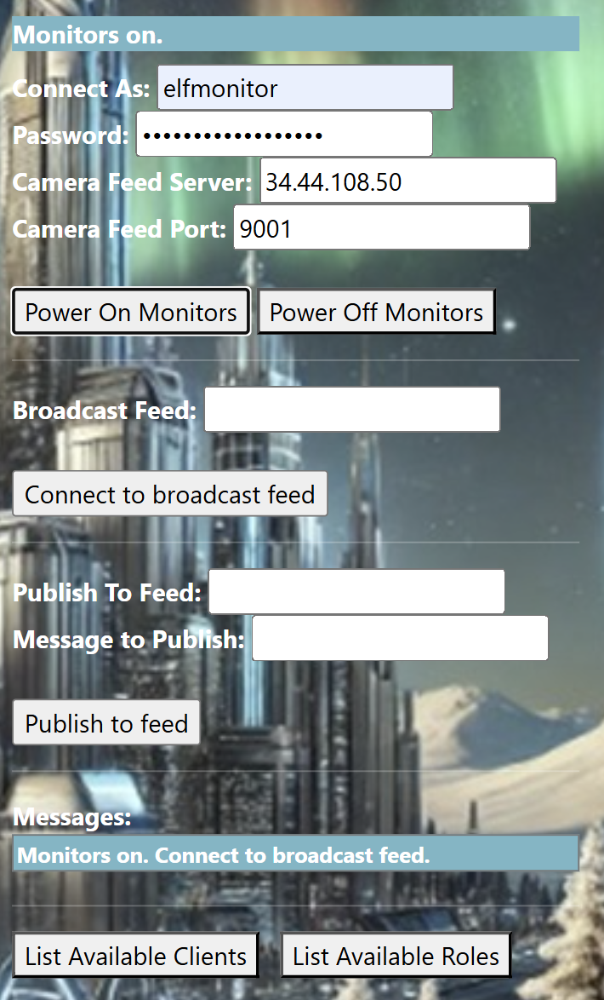

La sección de "publish to feed":

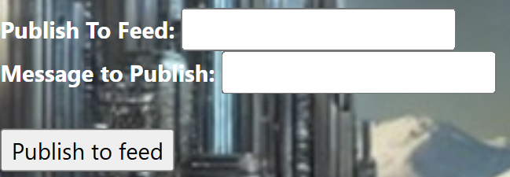

Aquí probamos primero la northpolefeeds, luego la frostbitfeed, y en ambas nos encontramos con los siguientes mensajes al intentar mandar el comando `singleAdminMode=true`:

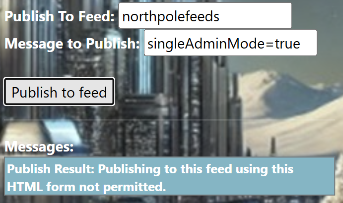

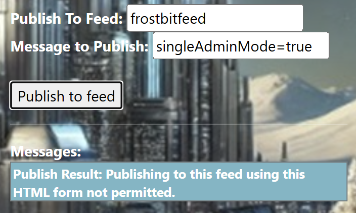

### Resultado

Por último, probamos con la santafeed y obtuvimos la siguiente respuesta:

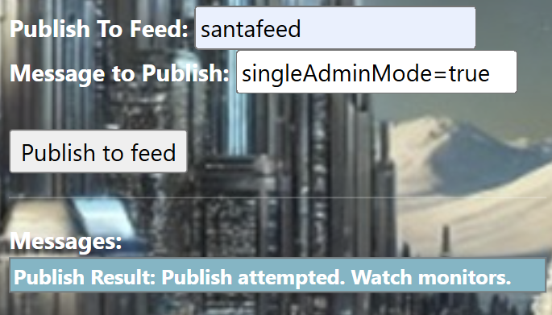

El mensaje parece haber sido enviado. Regresamos a la GUI de MQTTX para ver si hubo algún cambio en la santafeed, y efectivamente observamos que tanto Alabaster como Wombley ahora tienen el rol de user:

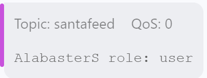

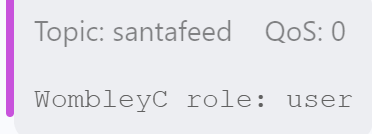

---

## Paso 3: Conectarse a la northpolefeeds y observar en qué está Santa

Luego de demotear a Alabaster y Wombley, esperamos que la northpolefeeds ya no esté siendo llenada de propaganda para los elfos y podamos llegar a ver los mensajes de Santa. Para ello primero volvemos al sitio web y nos conectamos a la northpolefeeds:

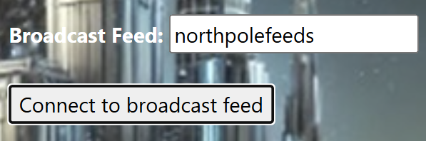

Volvemos a ver los monitores para comprobar si ya podemos recibir los mensajes de Santa.

### Resultado

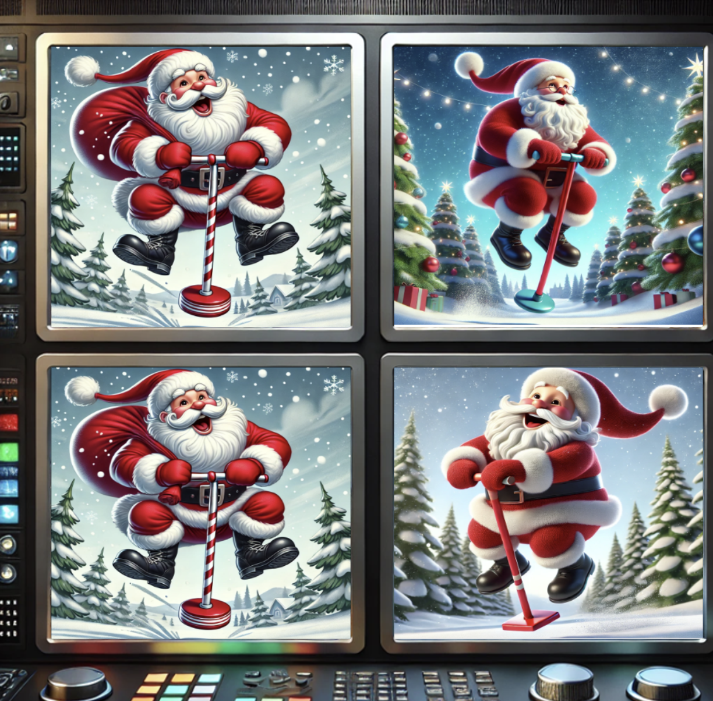

Nos encontramos con Santa saltando con un pogo. Ya no aparecen más las imágenes de Wombley y Alabaster. Procedemos a ingresar los datos al objetivo:

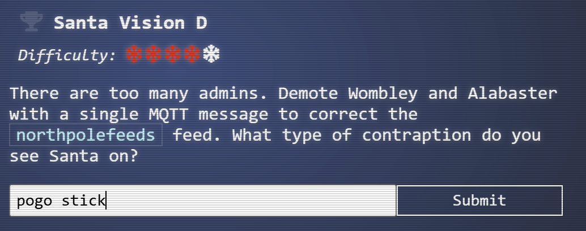

Obtenemos el Silver D, completando así todos los objetivos de Santa Vision:

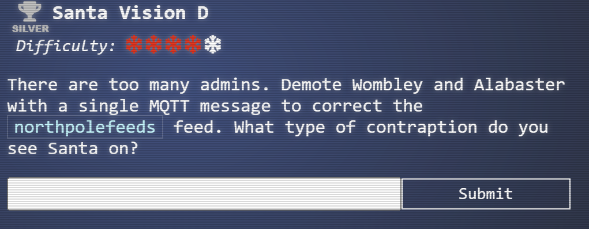
