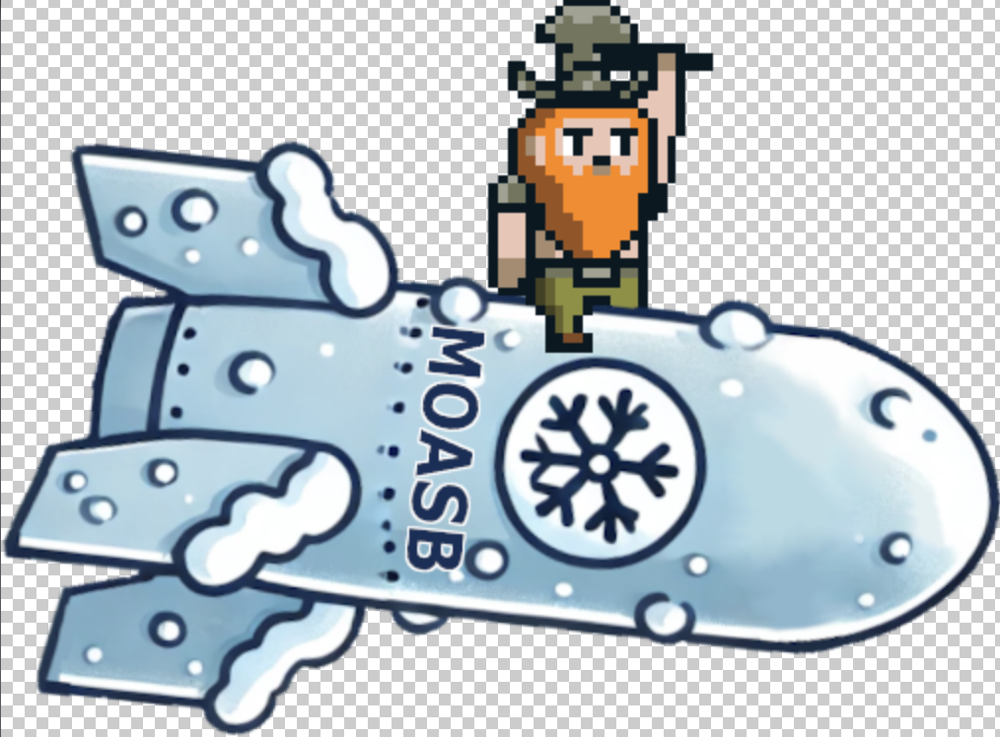
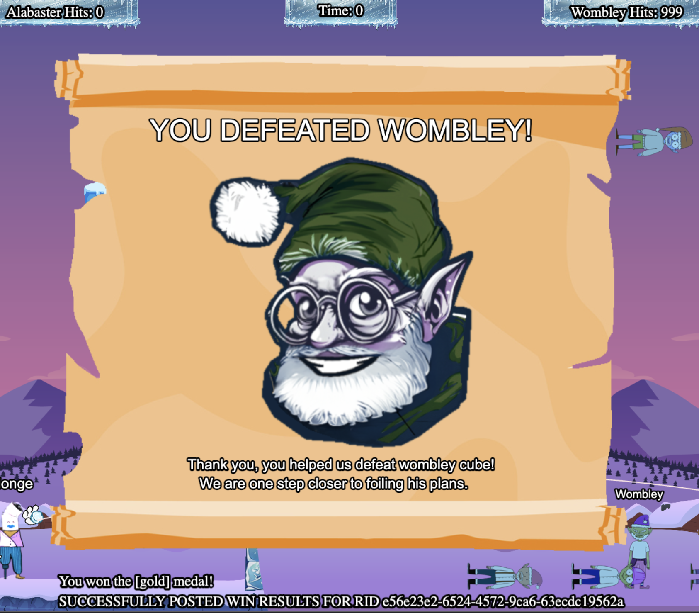

# Writeup - Snowball Showdown (Gold)

## Introducción
En el reto **"Snowball Showdown - Gold"**, Dusty Giftwrap introduce el desafío con un diálogo que sugiere los posibles enfoques para resolverlo:

*"Take down Wombley the usual way with a friend, or try a different strategy by tweaking client-side values for an extra edge.*

*Alternatively, we've got a secret weapon - a giant snow bomb - but we can't remember where we put it or how to launch it."*

De esto pude entender las siguientes estrategias:

1. **Derrotar a Wombley** mediante una estrategia habitual en cooperación con un amigo.
2. **Ajustar valores desde el lado del cliente** para obtener una ventaja adicional.
3. Existe una **"bomba de nieve gigante"** secreta que se debe localizar y utilizar.


---

## Observación inicial y análisis del juego

Al iniciar el juego, observé su funcionamiento y me dispuse a analizar su código fuente en busca de pistas o vulnerabilidades:

- Inicialmente, intenté **modificar las propiedades de las bolas de nieve**, pero sin obtener resultados satisfactorios.
- Al no encontrar una solución evidente, **cambié el enfoque hacia la búsqueda de la "giant snow bomb"**.

Durante la exploración del juego, navegué a través de los archivos del proyecto, incluidas las **imágenes y recursos adjuntos**, por si alguna pista visual resultara útil.

---

## Descubrimiento de MOASB

Entre las imágenes encontré una referencia interesante, la imagen de la bomba: 



Con la palabra **"MOASB"**. Este nombre ya lo había visto previamente en el código fuente, lo cual me llevó a buscar su contexto específico.

En el archivo `reconnecting-websocket.min.js`, identifiqué el siguiente fragmento de código:

```javascript
mainScene.ws.sendMessage({
    type: "moasb",
    launch_code: "<codigo>"
});
```

Este snippet hace referencia a un **mensaje tipo "moasb"** que parece estar relacionado con el lanzamiento de la bomba.

---

## Cómo ejecutar
Ya sabiendo la ubicación del código y la posibilidad que estuviera ahí la solución, me faltaba saber cómo interactuar con esa función.

Para esto utilicé ChatGPT, al cual le pasé el archivo en cuestión, y le dije que quería saber cómo ejecutar esa función.

**Prompt:**

> How can I launch the MOASB?
> 

**Output:**

> The code in the uploaded file contains a specific function for triggering the **MOASB launch sequence** in the game. Here's what I found:
> 
> 
> ---
> 
> ### **How to Launch the MOASB**
> 
> 1. **Triggering MOASB via WebSocket:**
> The MOASB launch sequence is initiated by sending a WebSocket message with the type `"moasb"`. The WebSocket message structure includes a `launch_code`, as shown in the following snippet:
>     
>     ```jsx
>     mainScene.ws.sendMessage({
>         type: "moasb",
>         launch_code: "<code>"
>     });
>     
>     ```
>     
> 2. **Conditions to Launch MOASB:**
>     - The MOASB animation and related effects are only triggered if `mainScene.moasb_started` is `false`.
>     - Once started, the code sets `mainScene.moasb_started` to `true` to ensure the MOASB is not triggered multiple times.
> 3. **MOASB Debug Trigger:**
> The following debug function is also present:
>     
>     ```jsx
>     window.bgDebug = e => {
>         if (e.type && e.type === "moasb_start" && mainScene && !mainScene.moasb_started) {
>             // MOASB sequence logic here...
>         }
>     };
>     
>     ```
>     
>     You can test-launch the MOASB by calling this `bgDebug` function in your browser's developer console:
>     
>     ```jsx
>     bgDebug({ type: "moasb_start" });
>     
>     ```
>     
> 4. **Sequence Overview:**
>     - The MOASB involves an animated bomber with spinning propellers (`propeller` animation) and a dwarf dropping a bomb (`dwarf-min` image).
>     - Once the bomb is dropped, it explodes, creating particle effects and removing healing terrain.
>     - This is handled with a series of tweens and particle effects managed by the `mainScene`.
> 
> ---
> 
> ### **Steps to Launch the MOASB in Code:**
> 
> 1. Ensure you have access to the `mainScene` object in the game.
> 2. Send the WebSocket message:
>     
>     ```jsx
>     mainScene.ws.sendMessage({
>         type: "moasb",
>         launch_code: "<code>"
>     });
>     
>     ```
>     
> 
> ---
> 
> ### **Alternative (Force MOASB Debugging):**
> 
> Use the debug function to trigger the MOASB directly:
> 
> ```jsx
> bgDebug({ type: "moasb_start" });
> 
> ```
> 
> This should bypass the `launch_code` requirement and manually initialize the MOASB sequence.
>
---

## Ejecución

Utilizando la respuesta de ChatGPT, abrí las herramientas de desarrollo del navegador, y ejecuté en consola el snippet de código que me brindó. Esto resulta en una animación, donde se acerca un avión y suelta la bomba, que utiliza la imagen antes encontrada. Al explotar se contabilizan 999 puntos para el jugador, a la vez que se muestra esta imagen en pantalla.



Con la cual podemos ver que completamos el desafío, consiguiendo el oro.

## Conclusión

El reto **Snowball Showdown** fue resuelto manipulando valores del lado del cliente y aprovechando una vulnerabilidad en la comunicación websocket. El string **"MOASB"** de la imagen encontrada, actuó como pista clave para identificar el mecanismo necesario para activar la bomba.
