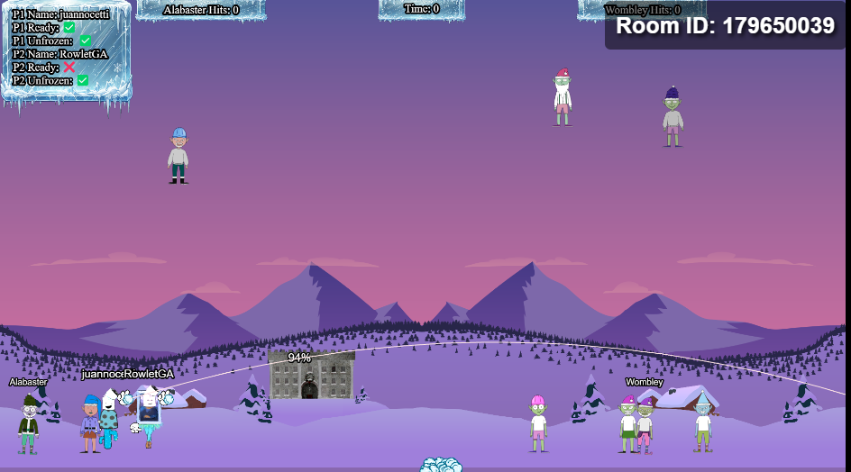
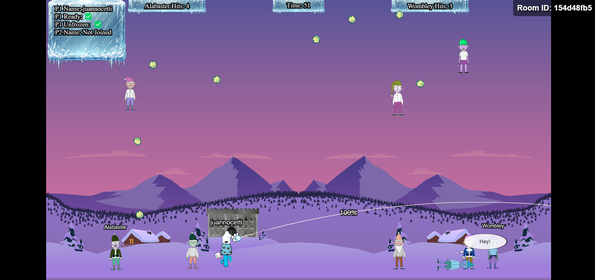
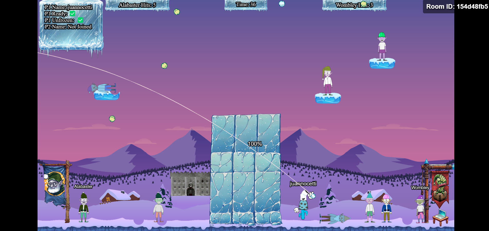

#  **Snowball Showdown Write-Up** 

## Introducción  
El desafío **Snowball Showdown** consiste en derrotar a los enemigos lanzando bolas de nieve, el ganador se define siendo el que más golpes le genere al rival.

---

## Problema Principal  
1. **Posiciones estratégicas**: Los enemigos se ubican de forma no estática, complicando los disparos.  
2. **Tiempo limitado**: El jugador debe actuar rápidamente, lo que complica la precisión del disparo.  
3. **Imprecisión manual**: Ajustar ángulos y fuerzas de disparo manualmente es ineficiente para impactar a múltiples objetivos.  
4. **Performance del enemigo**: El rival tiene más facilidad, precisión y velocidad, por lo qué, generalmente sale victorioso.

---

## Solución Final: Automatización del Disparo  
Implementamos un script que lanza **50 bolas de nieve** automáticamente desde una posición fija, con trayectorias y velocidades aleatorias. Esto aumentó la probabilidad de impacto sin ser detectado por el servidor. La ubicación de los disparos es en el centro de la pantalla donde se encuentra el divisor entre nuestra posición y la del rival. Al modificar el radio del daño generado, somos capaces de destruir la pared de nieve y pasar hacia el otro lado, logrando derrotar al enemigo teniendo una ubicación más cercana y evitando sus disparos.

### Código Implementado  
```javascript
const gameInstance = game.scene.keys['game'];

for (let i = 0; i < 50; i++) {
    const startX = 1000; 
    const startY = 1000; 
    const velocityX = (Math.random() - 0.5) * 100; 
    const velocityY = (Math.random() - 0.5) * 100; 
    const blastRadius = 5000; 
    const owner = "player"; 
    const id = i; 
    const isWomb = false; 

    gameInstance.fireOffCharacterSnowball(startX, startY, velocityX, velocityY, blastRadius, owner, id, isWomb);
}
```

**Explicación del Código**:  
- **startX / startY**: Posición fija desde donde se lanzan las bolas de nieve.  
- **velocityX / velocityY**: Velocidades aleatorias que dispersan los disparos para cubrir un área más amplia.  
- **blastRadius**: Daño en área, se utiliza el valor de **5000** permitiendo derrumbar el divisor del juego.   
---

## Resultados  
La solución automatizada logró lo siguiente:  
- **Mayor cobertura**: Gracias a las velocidades aleatorias, las bolas alcanzaron objetivos dispersos, centrandose en el medio de la pantalla.
- **Cumplimiento de restricciones**: El tamaño de las bolas de nieve no fue modificado, evitando bloqueos del servidor.  
- **Eficiencia**: El lanzamiento de las bolas de nieve en el centro nos permitió obtener una posición mucho más adecuada para conseguir la victoria.

---

## Evidencia Gráfica  

**1. Lanzamiento de bolas de nieve**  


**2. Cruce hacia posición del enemigo**  


**3. Posición enemiga obtenida**  


---

## Conclusión  
El desafío **Snowball Showdown** demostró ser un reto que requería un enfoque técnico para superarlo y obtener su medalla de plata. La captura de tráfico con Burp Suite y la manipulación del tamaño de las bolas fueron intentos interesantes pero fallidos, ya que los mismos fueron detectados por la aplicación. Finalmente, la solución automatizada logró:  
- Disparos que destruyeron el obstáculo que nos separaba del enemigo.  
- Cumplimiento de las reglas del juego.  
- Mayor efectividad frente a los enemigos, brindándonos más efectividad de disparos dado la cercana posición.

---
